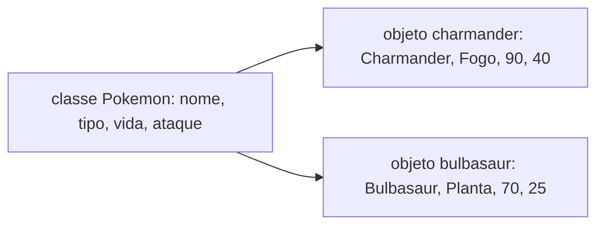
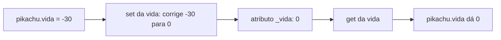
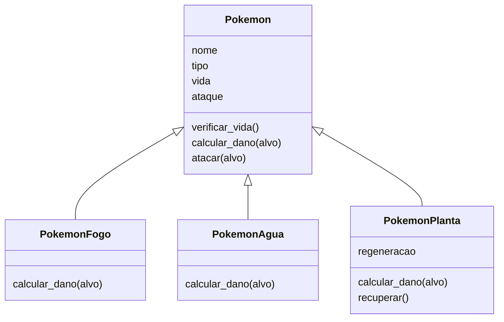
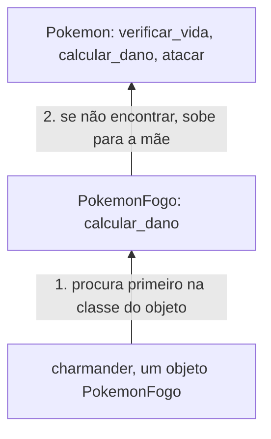
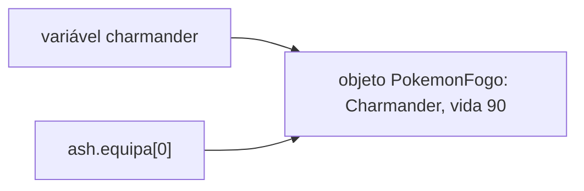
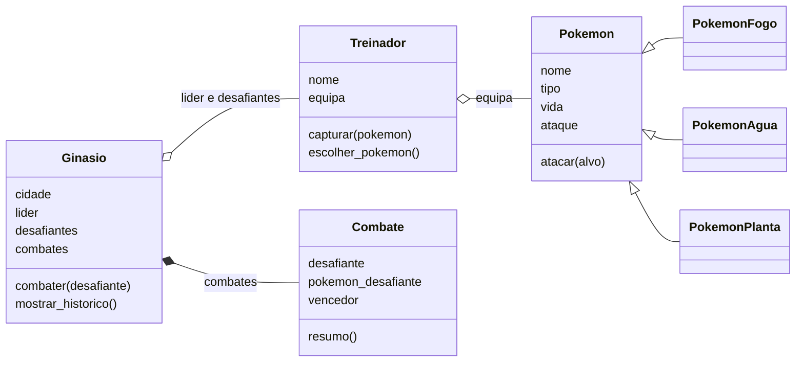
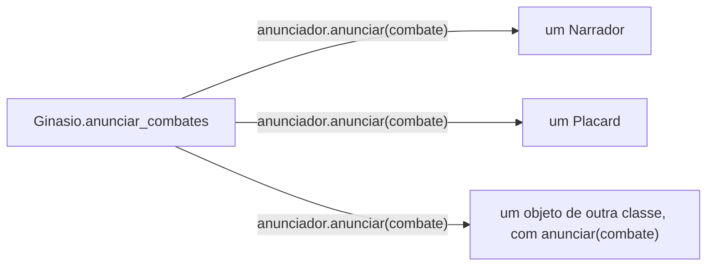
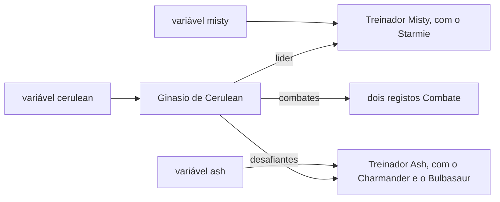

# Objetos, composição e comportamento

Neste guia, crias as tuas próprias classes, e cada Pokémon passa a ser um objeto que guarda os seus dados e cumpre as suas regras. Depois, ligas os objetos uns aos outros, com a herança, a agregação e a composição, até teres um ginásio onde os treinadores combatem. Pelo caminho, vês os métodos de classe, o duck typing, as dataclasses e o que faz a arroba dos decoradores.

Usa o Python do 10.º ano, sobretudo as listas e os dicionários, as funções com `return` e o valor `None`, e os módulos com `import`. Para praticar: [laboratório](laboratorios/03-objetos-e-composicao-laboratorio.md) e [ficha de exercícios](exercicios/03-objetos-e-composicao-exercicios.md).

## Neste guia

1. [Parte 1: Classes e objetos](#parte-1-classes-e-objetos)
2. [Parte 2: Proteger o estado do objeto](#parte-2-proteger-o-estado-do-objeto)
3. [Parte 3: Herança](#parte-3-herança)
4. [Parte 4: Composição e agregação](#parte-4-composição-e-agregação)
5. [Parte 5: Métodos de classe](#parte-5-métodos-de-classe)
6. [Parte 6: Duck typing](#parte-6-duck-typing)
7. [Parte 7: Dataclasses](#parte-7-dataclasses)
8. [Parte 8: Decoradores](#parte-8-decoradores)
9. [Exemplo guiado: o ginásio Pokémon](#exemplo-guiado-o-ginásio-pokémon)

## Parte 1: Classes e objetos

### Num dicionário, os dados e as regras ficam separados

Com o Python do 10.º ano, um Pokémon cabe num dicionário, e o ataque pode ser uma função que recebe dois dicionários. Neste exemplo, a vida de um Pokémon tem de ficar sempre entre 0 e 150.

```python
# dicionario.py: dois Pokémon guardados em dicionários, sem nenhuma regra.
charmander = {"nome": "Charmander", "tipo": "Fogo", "vida": 90, "ataque": 40}
bulbasaur = {"nome": "Bulbasaur", "tipo": "Planta", "vida": 110, "ataque": 25}


def atacar(atacante, alvo):
    """Tira ao alvo tanta vida quanto o ataque do atacante."""
    alvo["vida"] = alvo["vida"] - atacante["ataque"]
    print(f"{atacante['nome']} ataca {alvo['nome']}.")


atacar(charmander, bulbasaur)
print(bulbasaur["vida"])
bulbasaur["vida"] = -500    # ninguém impede uma vida negativa
print(bulbasaur["vida"])
```

```text
Charmander ataca Bulbasaur.
70
-500
```

O ataque está certo: 110 menos 40 dá 70. Mas o dicionário também guardou -500 sem protestar, porque nada nele sabe que a vida tem uma regra. Para a regra se cumprir, teria de estar escrita em todas as funções que mudam a vida: a que ataca, a que cura, a que envenena. Basta uma esquecer-se dela para o Pokémon ficar num estado impossível. Os dados estão num sítio, e as regras estão espalhadas por outros.

A programação orientada a objetos junta os dados e as regras no mesmo sítio, dentro de cada Pokémon.

<details>
<summary>Para ires mais longe: paradigmas de programação</summary>

Um paradigma de programação é uma maneira de organizar um programa. No 10.º ano programaste de forma estruturada, também chamada procedimental: os dados ficam em variáveis, listas e dicionários, e as funções recebem-nos por parâmetro. Na programação orientada a objetos, cada objeto junta os dados que descrevem uma coisa e as ações que essa coisa sabe fazer. O Python permite as duas formas, e há outras, como a programação funcional. Nenhuma é melhor em todas as situações: a orientada a objetos ajuda quando o programa cresce e há regras que se têm de cumprir sempre.

</details>

### Uma classe é um molde para criar objetos

Já usaste objetos sem lhes dares esse nome. Uma lista é um objeto: em `numeros.append(5)`, pedes à lista `numeros` que acrescente um valor. A novidade deste tema é criares os teus próprios tipos de objetos.

Uma **classe** é a descrição de um tipo de coisa: diz que dados tem e o que sabe fazer. Um **objeto** é uma coisa concreta criada a partir de uma classe, com os seus próprios valores, e também se diz que é uma instância da classe. A classe é como a forma de um bolo: com a mesma forma fazes muitos bolos, e cada um tem o seu recheio.

Escreve-se `class`, o nome da classe e dois pontos, e tudo o que fica indentado por baixo pertence à classe. O nome leva maiúscula inicial e não leva acentos, como `Pokemon` ou `Ginasio`, para se distinguir das variáveis e das funções. Lá dentro, o `def __init__` corre sozinho sempre que se cria um objeto e guarda nele os valores iniciais. Para criar um objeto, escreve-se o nome da classe com esses valores entre parênteses, como numa chamada de função. Para ler ou mudar um dado do objeto, escreve-se a variável, um ponto e o nome do dado.

```python
# classe.py: a primeira classe Pokemon, só com os dados.
class Pokemon:
    """Primeira versão da classe: só os dados de um Pokémon."""

    def __init__(self, nome, tipo, vida, ataque):
        """Cria um Pokémon com nome, tipo, vida e ataque."""
        self.nome = nome
        self.tipo = tipo
        self.vida = vida
        self.ataque = ataque


charmander = Pokemon("Charmander", "Fogo", 90, 40)
bulbasaur = Pokemon("Bulbasaur", "Planta", 110, 25)
bulbasaur.vida = bulbasaur.vida - charmander.ataque
print(bulbasaur.nome, bulbasaur.vida)
print(charmander.nome, charmander.vida)
```

No `__init__`, o primeiro parâmetro, `self`, é o objeto que está a ser criado. A linha `self.nome = nome` guarda o nome dentro dele, e as três seguintes fazem o mesmo com o tipo, a vida e o ataque. Depois do ataque, que vida tem o Charmander?

```text
Bulbasaur 70
Charmander 90
```

A vida do Bulbasaur desceu para 70, e a do Charmander ficou em 90. Cada objeto tem os seus valores, e mudar um não muda os outros objetos da mesma classe.



A classe diz que dados tem cada Pokémon, e cada objeto criado a partir dela guarda os seus próprios valores.

### Os atributos guardam o estado de cada objeto

Aos dados de um objeto, como o `nome`, o `tipo`, a `vida` e o `ataque`, chama-se **atributos**. Um atributo é uma variável que pertence a um objeto: cada objeto tem o seu, com o seu valor. O conjunto dos valores dos atributos de um objeto, num dado momento, é o **estado** do objeto. Logo depois de ser criado, o Bulbasaur tinha 110 de vida, e depois do ataque ficou com 70. O objeto é o mesmo, mas o estado mudou.

### O construtor dá a cada objeto o estado inicial

A função `__init__`, escrita dentro da classe, com dois sublinhados de cada lado, é o **construtor** da classe. Não o chamas pelo nome: é o Python que o chama sempre que crias um objeto. Quando o Python executa `Pokemon("Charmander", "Fogo", 90, 40)`, acontece isto, por esta ordem:

1. Cria um objeto novo da classe `Pokemon`, ainda sem atributos.
2. Chama o `__init__`, com o objeto novo no parâmetro `self` e os quatro valores nos parâmetros `nome`, `tipo`, `vida` e `ataque`.
3. A linha `self.nome = nome` cria no objeto o atributo `nome`, com o valor `"Charmander"`, e as três seguintes fazem o mesmo com o tipo, a vida e o ataque.
4. O construtor acaba, e `Pokemon(...)` dá o objeto já preenchido, que fica guardado na variável `charmander`.

O construtor não tem `return`, porque quem devolve o objeto é o Python, no passo 4.

A linha `self.nome = nome` tem o mesmo nome dos dois lados, e isso confunde. O `nome` da direita é o parâmetro, que só existe enquanto o construtor corre, como em qualquer função. O `self.nome` da esquerda é o atributo, que fica no objeto depois de o construtor acabar. A linha passa o valor do parâmetro, que vai desaparecer, para o atributo, que fica.

### Um método é uma função que pertence à classe

Para saber a vida de um Pokémon, dava jeito perguntar ao próprio Pokémon, com `charmander.verificar_vida()`, como pedes a uma lista que cresça com `numeros.append(5)`. Um **método** é uma função escrita dentro de uma classe, com `def`. O primeiro parâmetro de um método chama-se **`self`** e recebe o objeto que está antes do ponto na chamada. A classe escreve-se uma vez para todos os Pokémon, e o `self` é a forma de dizer, lá dentro, "o Pokémon que está a ser usado agora". Os atributos dizem o que o objeto tem, e os métodos dizem o que ele sabe fazer.

```python
# metodo.py: um Pokémon que sabe mostrar a sua vida.
class Pokemon:
    """Um Pokémon que já sabe mostrar a sua vida."""

    def __init__(self, nome, tipo, vida, ataque):
        """Cria um Pokémon com nome, tipo, vida e ataque."""
        self.nome = nome
        self.tipo = tipo
        self.vida = vida
        self.ataque = ataque

    def verificar_vida(self):
        """Mostra a vida do Pokémon."""
        print(f"{self.nome} tem {self.vida} de vida.")


charmander = Pokemon("Charmander", "Fogo", 90, 40)
bulbasaur = Pokemon("Bulbasaur", "Planta", 110, 25)
charmander.verificar_vida()
Pokemon.verificar_vida(charmander)
bulbasaur.verificar_vida()
```

A segunda chamada está escrita de outra maneira. O que achas que escreve?

```text
Charmander tem 90 de vida.
Charmander tem 90 de vida.
Bulbasaur tem 110 de vida.
```

A chamada `charmander.verificar_vida()` não tem nada entre parênteses, e mesmo assim o método recebe um argumento: o Python põe no `self` o objeto que está antes do ponto. Por baixo, é o mesmo que `Pokemon.verificar_vida(charmander)`, e por isso as duas primeiras linhas são iguais. Na terceira chamada, o `self` é o Bulbasaur, e o mesmo código escreve outro nome e outra vida. O nome `self` é uma convenção, que todos os programadores de Python seguem.

### Um método que recebe outro objeto

Atacar envolve dois Pokémon: o que ataca e o que é atacado. O método `atacar` recebe o atacante no `self`, como sempre, e o atacado num segundo parâmetro, o `alvo`. Um método pode também chamar outros métodos, do próprio objeto ou dos objetos que recebeu, como o `atacar` faz com `alvo.verificar_vida()`.

```python
# atacar.py: um Pokémon que sabe atacar outro Pokémon.
class Pokemon:
    """Um Pokémon que sabe mostrar a sua vida e atacar outro Pokémon."""

    def __init__(self, nome, tipo, vida, ataque):
        """Cria um Pokémon com nome, tipo, vida e ataque."""
        self.nome = nome
        self.tipo = tipo
        self.vida = vida
        self.ataque = ataque

    def verificar_vida(self):
        """Mostra a vida do Pokémon."""
        print(f"{self.nome} tem {self.vida} de vida.")

    def atacar(self, alvo):
        """Ataca outro Pokémon e tira-lhe tanta vida quanto o ataque."""
        print(f"{self.nome} ataca {alvo.nome} e tira {self.ataque} de vida.")
        alvo.vida = alvo.vida - self.ataque
        alvo.verificar_vida()


charmander = Pokemon("Charmander", "Fogo", 90, 40)
bulbasaur = Pokemon("Bulbasaur", "Planta", 110, 25)
charmander.atacar(bulbasaur)
bulbasaur.atacar(charmander)
charmander.atacar(bulbasaur)
charmander.atacar(bulbasaur)
```

Segue as vidas de cabeça: com quanto fica o Bulbasaur no fim?

```text
Charmander ataca Bulbasaur e tira 40 de vida.
Bulbasaur tem 70 de vida.
Bulbasaur ataca Charmander e tira 25 de vida.
Charmander tem 65 de vida.
Charmander ataca Bulbasaur e tira 40 de vida.
Bulbasaur tem 30 de vida.
Charmander ataca Bulbasaur e tira 40 de vida.
Bulbasaur tem -10 de vida.
```

Em `charmander.atacar(bulbasaur)`, o `self` é o Charmander e o `alvo` é o Bulbasaur. Na segunda chamada, os papéis trocam. O método é o mesmo, e quem decide quem é quem é a posição de cada objeto na chamada: antes do ponto ou entre parênteses. No fim, o Bulbasaur fica com -10 de vida, o mesmo problema do dicionário. Ter uma classe não chega: falta a classe proteger a regra da vida.

### Métodos estáticos: funções que vivem na classe

Há contas que pertencem às regras dos Pokémon, mas não precisam de nenhum Pokémon. Prender um valor entre um mínimo e um máximo é uma delas: com 200, dá 150; com -30, dá 0; com 75, dá 75. Tudo o que a conta precisa chega pelos parâmetros.

Um método assim é um **método estático**. Escreve-se dentro da classe, com a linha `@staticmethod` por cima do `def`, e não recebe `self`. O `staticmethod` é um **decorador**: um nome que se escreve com uma arroba por cima de um método e que muda a forma como ele funciona. Este diz ao Python que não passe o objeto ao método. Um método estático chama-se pelo nome da classe, como em `Pokemon.limitar(200, 0, 150)`.

```python
# estatico.py: a vida inicial fica entre 0 e 150, com um método estático.
VIDA_MINIMA = 0
VIDA_MAXIMA = 150


class Pokemon:
    """Um Pokémon cuja vida inicial fica sempre entre 0 e 150."""

    def __init__(self, nome, tipo, vida, ataque):
        """Cria um Pokémon com a vida inicial presa entre os limites."""
        self.nome = nome
        self.tipo = tipo
        self.vida = Pokemon.limitar(vida, VIDA_MINIMA, VIDA_MAXIMA)
        self.ataque = ataque

    @staticmethod
    def limitar(valor, minimo, maximo):
        """Devolve o valor, preso entre o mínimo e o máximo."""
        if valor < minimo:
            return minimo
        if valor > maximo:
            return maximo
        return valor


print(Pokemon.limitar(200, 0, 150))
print(Pokemon.limitar(-30, 0, 150))
mew = Pokemon("Mew", "Psíquico", 999, 30)
print(mew.vida)
mew.vida = -500
print(mew.vida)
```

O construtor já aplica a regra. O que achas que mostra o último `print`?

```text
150
0
150
-500
```

As duas primeiras linhas mostram o método a trabalhar sem nenhum Pokémon criado. O Mew foi pedido com 999 e ficou com 150, porque o construtor passou a vida pelo `limitar`. A última linha mostra -500: a linha `mew.vida = -500` mudou o atributo diretamente, sem passar por regra nenhuma. Uma regra que só se aplica onde alguém se lembrou de a chamar não protege o objeto.

Para decidires se um método é estático, pergunta: este método precisa de saber qual é o objeto? O `verificar_vida` precisa, porque usa `self.nome` e `self.vida`, e por isso é um método do objeto, como se chama a um método que recebe o `self`. O `limitar` não precisa, porque tudo lhe chega pelos parâmetros. Uma função fora da classe também fazia a conta, mas dentro da classe diz a quem lê que a conta faz parte das regras dos Pokémon.

## Parte 2: Proteger o estado do objeto

### Propriedades: o get e o set com cara de atributo

A parte 1 acabou com dois Pokémon em estados impossíveis: um Bulbasaur com -10 de vida e um Mew com -500. A regra dos 0 a 150 só se aplicava onde alguém se lembrava dela. Para valer sempre, todas as mudanças da vida têm de passar por ela, venham de onde vierem.

Uma **propriedade** é um atributo que, quando é lido, chama um método, e quando é alterado, chama outro. Ao método que lê chama-se get (obter, em inglês) e ao que altera chama-se set (definir): são o **get e o set** da propriedade. Quem usa a classe escreve `pikachu.vida` e `pikachu.vida = 50`, como num atributo normal, e por baixo o Python chama o get e o set. É no set que a regra vive.

O get leva por cima o decorador `@property`, e o set leva `@vida.setter`, que se lê "o set da propriedade vida". Os dois métodos têm o nome da propriedade, `vida`, e é esse nome que os junta. O valor não pode ficar guardado em `vida`, porque esse nome já é o da propriedade, e por isso fica noutro atributo, o `_vida`. O sublinhado à frente avisa que esse atributo é só para uso dentro da classe.



Quem escreve na propriedade passa pelo set, que aplica a regra e guarda o valor no `_vida`. Quem a lê passa pelo get, que vai buscar o valor ao `_vida`.

```python
# propriedade.py: a vida é uma propriedade, sempre entre 0 e 150.
VIDA_MINIMA = 0
VIDA_MAXIMA = 150


class Pokemon:
    """Um Pokémon cuja vida é uma propriedade, sempre entre 0 e 150."""

    def __init__(self, nome, vida):
        """Cria um Pokémon com nome e vida."""
        self.nome = nome
        self.vida = vida

    @property
    def vida(self):
        """Get da vida: devolve a vida atual."""
        return self._vida

    @vida.setter
    def vida(self, valor):
        """Set da vida: guarda o valor, sempre entre 0 e 150."""
        if valor < VIDA_MINIMA:
            valor = VIDA_MINIMA
        elif valor > VIDA_MAXIMA:
            valor = VIDA_MAXIMA
        self._vida = valor


pikachu = Pokemon("Pikachu", 100)
pikachu.vida = pikachu.vida - 130
print(pikachu.vida)
pikachu.vida = 500
print(pikachu.vida)
```

O Pikachu tinha 100 de vida e levou 130. Com quanto fica?

```text
0
150
```

A linha `pikachu.vida = pikachu.vida - 130` faz três coisas, por esta ordem:

1. Lê `pikachu.vida`, o que chama o get, que dá 100.
2. Calcula 100 - 130, que dá -30.
3. Guarda -30 em `pikachu.vida`, o que chama o set, que corrige para 0 e guarda 0 no `_vida`.

O set não dá erro com um valor fora dos limites: corrige-o para o limite mais próximo, e por isso o 500 ficou 150. Este set, como os do `pokemon.py` das aulas, escreve a comparação lá dentro, em vez de chamar o `limitar` da parte 1. Podia chamá-lo, mas não precisa: o set já é o único sítio por onde a vida muda, e assim a regra lê-se toda num só método.

<details>
<summary>Para ires mais longe: o get e o set como dois métodos</summary>

Sem propriedade, o get e o set escrevem-se como dois métodos do objeto, com nomes diferentes, e quem usa a classe tem de os chamar:

```python
# get_e_set.py: a vida lida e mudada através de dois métodos.
VIDA_MINIMA = 0
VIDA_MAXIMA = 150


class Pokemon:
    """Um Pokémon que só deixa ler e mudar a vida através de métodos."""

    def __init__(self, nome, vida):
        """Cria um Pokémon com nome e vida."""
        self.nome = nome
        self.set_vida(vida)

    def get_vida(self):
        """Get: devolve a vida atual."""
        return self._vida

    def set_vida(self, valor):
        """Set: guarda a vida, sempre entre 0 e 150."""
        if valor < VIDA_MINIMA:
            valor = VIDA_MINIMA
        elif valor > VIDA_MAXIMA:
            valor = VIDA_MAXIMA
        self._vida = valor


pikachu = Pokemon("Pikachu", 100)
pikachu.set_vida(pikachu.get_vida() - 130)
print(pikachu.get_vida())
```

Mostra `0`, como a propriedade. A regra é a mesma, mas `pikachu.set_vida(pikachu.get_vida() - 130)` lê-se pior do que `pikachu.vida = pikachu.vida - 130`. A propriedade dá ao get e ao set a escrita de um atributo normal.

</details>

### Público e privado em Python

Ainda nada impede alguém de escrever `pikachu._vida = -500` e saltar o set. Há linguagens com palavras próprias para marcar o que se pode usar fora da classe, a que se chama **modificadores de acesso**. Em Python não há essas palavras: é a forma como o nome começa que faz esse papel.

- Um nome sem sublinhado à frente, como `nome`, é público: qualquer código o pode usar.
- Um nome com um sublinhado à frente, como `_ataque`, é **privado** por convenção: é um aviso de que é para uso interno da classe. O Python não impede nada, porque é um acordo entre quem escreve a classe e quem a usa.
- Um nome com dois sublinhados à frente, como `__vida`, também é privado, e o Python muda-lhe o nome.

```python
# privado.py: um atributo público e dois privados.
class Pokemon:
    """Um Pokémon com um atributo público e dois privados."""

    def __init__(self, nome, vida, ataque):
        """Cria um Pokémon com nome, vida e ataque."""
        self.nome = nome          # público: sem sublinhado
        self._ataque = ataque     # privado por convenção: um sublinhado
        self.__vida = vida        # privado, e o Python muda-lhe o nome


pikachu = Pokemon("Pikachu", 100, 30)
print(pikachu.nome)
print(pikachu._ataque)
print(pikachu.__vida)
```

As duas primeiras linhas funcionam, e a terceira dá erro. Aqui mostra-se só a última linha do erro, a que diz o que aconteceu:

```text
Pikachu
30
AttributeError: 'Pokemon' object has no attribute '__vida'
```

O Python deixou ler o `_ataque`, mas o código de fora da classe não o devia fazer. Se o autor da classe mudar a forma de guardar o ataque, esse código deixa de funcionar. Dentro da classe, o Python guardou o `self.__vida` com outro nome: juntou-lhe um sublinhado e o nome da classe, e o atributo passou a chamar-se `_Pokemon__vida`. Por isso, `pikachu.__vida` não existe.

Os nomes que começam e acabam em dois sublinhados, como o `__init__`, são outra coisa: são nomes especiais do Python e não mudam de nome.

Em Python, a regra da vida protege-se com a propriedade, e o `_vida` fica só com o aviso do sublinhado.

<details>
<summary>Para ires mais longe: o nome novo dos dois sublinhados</summary>

Quem souber o nome que o Python deu ao atributo chega ao valor:

```python
# nome_novo.py: um atributo de dois sublinhados, lido pelo nome que o Python lhe deu.
class Pokemon:
    """Um Pokémon que guarda a vida num atributo com dois sublinhados."""

    def __init__(self, nome, vida):
        """Cria um Pokémon com nome e vida."""
        self.nome = nome
        self.__vida = vida


pikachu = Pokemon("Pikachu", 100)
print(pikachu._Pokemon__vida)
```

```text
100
```

Os dois sublinhados são só um aviso mais forte do que um, e não uma proteção a sério.

</details>

### Onde se escreve `vida` e onde se escreve `_vida`

Uma propriedade usa dois nomes. A propriedade `vida`, pública, é a porta por onde tudo entra, com o set a conferir o que passa. O atributo `_vida`, privado, é o armazém onde o valor fica guardado.

| Onde estás a escrever | O que escreves | Porquê |
| --- | --- | --- |
| Fora da classe | `pikachu.vida` | Passa pelo get e pelo set, e a regra aplica-se |
| Dentro da classe, no construtor e nos outros métodos | `self.vida` | Também passa pelo set |
| Só dentro do get e do set | `self._vida` | É onde o valor fica guardado |

O erro típico está no construtor. É tentador escrever lá `self._vida = vida`, diretamente no armazém, porque parece mais simples. Este Pokémon faz isso:

```python
# construtor_errado.py: um construtor que salta o set da vida.
VIDA_MINIMA = 0
VIDA_MAXIMA = 150


class Pokemon:
    """Versão com um erro: o construtor salta o set da vida."""

    def __init__(self, nome, vida):
        """Cria um Pokémon com nome e vida."""
        self.nome = nome
        self._vida = vida          # escreve diretamente no privado e salta o set

    @property
    def vida(self):
        """Get da vida: devolve a vida atual."""
        return self._vida

    @vida.setter
    def vida(self, valor):
        """Set da vida: guarda o valor, sempre entre 0 e 150."""
        if valor < VIDA_MINIMA:
            valor = VIDA_MINIMA
        elif valor > VIDA_MAXIMA:
            valor = VIDA_MAXIMA
        self._vida = valor


mew = Pokemon("Mew", 999)
print(mew.vida)
mew.vida = mew.vida + 1
print(mew.vida)
```

Que vida tem o Mew antes e depois de lhe somares 1?

```text
999
150
```

O Mew nasceu com 999, um estado impossível, porque o construtor escreveu diretamente no `_vida`. Ao somar 1, o set correu pela primeira vez e corrigiu para 150, e a vida desceu ao somar 1. Dentro da classe, fora do get e do set, escreve-se sempre `self.vida`, também no construtor.

No set, o erro é o contrário: o set não pode escrever `self.vida = valor`. Essa linha chamava o set outra vez, que chegava à mesma linha e chamava o set outra vez, sem fim, até o Python desistir:

```text
RecursionError: maximum recursion depth exceeded
```

Quando vires um `RecursionError` numa classe com propriedades, procura um set que escreve no nome da propriedade em vez de escrever no atributo privado.

## Parte 3: Herança

### A classe Pokemon completa

Esta é a classe `Pokemon` das aulas, a primeira parte do ficheiro [pokemon.py](../exemplos/python-avancado/pokemon/03-objetos-e-composicao/pokemon.py). Junta à vida uma segunda propriedade, o ataque, e tem os métodos para verificar a vida, calcular o dano e atacar.

```python
VIDA_MINIMA = 0
VIDA_MAXIMA = 150
ATAQUE_MINIMO = 1
ATAQUE_MAXIMO = 50


class Pokemon:
    """Classe-mãe: o que todos os Pokémon têm e sabem fazer."""

    def __init__(self, nome, tipo, vida, ataque):
        """Cria um Pokémon com nome, tipo, vida e ataque."""
        self.nome = nome
        self.tipo = tipo
        # Passamos pelas propriedades para a validação dos sets
        # também se aplicar quando o objeto é criado.
        self.vida = vida
        self.ataque = ataque

    @property
    def vida(self):
        """Get da vida: devolve a vida atual."""
        return self._vida

    @vida.setter
    def vida(self, valor):
        """Set da vida: guarda o valor, sempre entre 0 e 150."""
        if valor < VIDA_MINIMA:
            valor = VIDA_MINIMA
        elif valor > VIDA_MAXIMA:
            valor = VIDA_MAXIMA
        self._vida = valor

    @property
    def ataque(self):
        """Get do ataque: devolve o valor de ataque."""
        return self._ataque

    @ataque.setter
    def ataque(self, valor):
        """Set do ataque: guarda o valor, sempre entre 1 e 50."""
        if valor < ATAQUE_MINIMO:
            valor = ATAQUE_MINIMO
        elif valor > ATAQUE_MAXIMO:
            valor = ATAQUE_MAXIMO
        self._ataque = valor

    def verificar_vida(self):
        """Mostra a vida do Pokémon e devolve True se ele ainda pode lutar."""
        if self.vida == 0:
            print(f"{self.nome} está KO (0/{VIDA_MAXIMA}).")
            return False
        print(f"{self.nome} tem {self.vida}/{VIDA_MAXIMA} de vida.")
        return True

    def calcular_dano(self, alvo):
        """Devolve quanta vida este Pokémon tira ao alvo num ataque.

        Na classe-mãe o dano é simplesmente o valor de ataque. As classes-filhas
        vão reescrever este método para aplicar as suas vantagens.
        """
        return self.ataque

    def atacar(self, alvo):
        """Ataca outro Pokémon e tira-lhe a vida calculada por calcular_dano."""
        if self.vida == 0:
            print(f"{self.nome} está KO e não pode atacar.")
            return
        if alvo.vida == 0:
            print(f"{alvo.nome} já está KO.")
            return
        # O Python chama a versão do método que pertence ao objeto: se self for
        # um PokemonFogo, é a versão do PokemonFogo que corre.
        dano = self.calcular_dano(alvo)
        print(f"{self.nome} ataca {alvo.nome} e tira {dano} de vida.")
        alvo.vida = alvo.vida - dano
        alvo.verificar_vida()
```

Lê-a de cima para baixo. A propriedade do ataque segue o molde da vida, com outros limites: o ataque fica entre 1 e 50, e por isso um ataque tira sempre alguma vida. O `verificar_vida` mostra a vida e devolve `True` se o Pokémon ainda pode lutar, ou `False` se está KO, fora de combate, com 0 de vida. O `atacar` começa pelos dois casos em que não há ataque e sai deles com um `return` sozinho. Depois pede o dano ao `calcular_dano`, tira-o ao alvo e mostra a vida dele. O dano fica num método à parte para se poder mudar sem mexer no `atacar`. A linha `alvo.vida = alvo.vida - dano` passa pelo set do alvo, e a vida nunca fica negativa.

Os programas que começam por `from pokemon import ...` vão buscar as classes a este ficheiro: `from pokemon import Pokemon` lê-se "do ficheiro `pokemon`, traz a classe `Pokemon`". Para os correres:

1. Copia para uma pasta tua os três ficheiros do exemplo: o [pokemon.py](../exemplos/python-avancado/pokemon/03-objetos-e-composicao/pokemon.py), o [ginasio.py](../exemplos/python-avancado/pokemon/03-objetos-e-composicao/ginasio.py) e o [anunciadores.py](../exemplos/python-avancado/pokemon/03-objetos-e-composicao/anunciadores.py).
2. Guarda os teus programas nessa pasta, com nomes teus. Um ficheiro teu chamado `pokemon.py`, `ginasio.py` ou `anunciadores.py` toma o lugar do ficheiro do exemplo, e a importação falha.
3. Corre-os nessa pasta. Sem o `pokemon.py` ao lado, o Python para com `ModuleNotFoundError: No module named 'pokemon'`.

```python
# geodude.py: um Pokémon criado com valores fora dos limites.
from pokemon import Pokemon

pikachu = Pokemon("Pikachu", "Elétrico", 100, 30)
geodude = Pokemon("Geodude", "Pedra", 300, 0)
print(geodude.vida, geodude.ataque)
pikachu.atacar(geodude)
geodude.vida = geodude.vida - 500
geodude.verificar_vida()
geodude.atacar(pikachu)
pikachu.atacar(geodude)
```

```text
150 1
Pikachu ataca Geodude e tira 30 de vida.
Geodude tem 120/150 de vida.
Geodude está KO (0/150).
Geodude está KO e não pode atacar.
Geodude já está KO.
```

O Geodude foi pedido com 300 de vida e 0 de ataque, e ficou com 150 e 1. Depois de levar 500, ficou com 0, e não com -380. Os dois `return` do `atacar` impediram o Geodude KO de atacar e o Pikachu de atacar um Pokémon que já estava KO.

### Uma classe-filha herda tudo da classe-mãe

Nos jogos, os tipos dão vantagens: o fogo tira o dobro às plantas, a água tira o dobro ao fogo e as plantas tiram o dobro à água. Podias encher o `calcular_dano` da classe `Pokemon` de condições, uma por cada par de tipos. Mas cada tipo novo acrescentava condições ao mesmo método, com as regras de todos os tipos misturadas.

A alternativa é uma classe para cada tipo, que aproveita tudo o que a `Pokemon` já tem e só muda o que é diferente. A esta relação chama-se **herança**: a **classe-filha** é construída a partir da classe-mãe e recebe tudo o que a mãe tem. A filha pode acrescentar atributos e métodos e pode reescrever métodos da mãe. Também se diz subclasse e superclasse.

A herança descreve uma relação "é um". Para saberes se serve, experimenta a frase em português: "um Pokémon de fogo é um Pokémon" é verdade, e por isso a herança serve. Escreve-se o nome da mãe entre parênteses, a seguir ao nome da filha. Esta é a classe `PokemonFogo`, do ficheiro `pokemon.py`:

```python
class PokemonFogo(Pokemon):
    """Um PokemonFogo É UM Pokemon: herda tudo e só muda o dano."""

    def __init__(self, nome, vida, ataque):
        """Cria um Pokémon de fogo com nome, vida e ataque."""
        # Um PokemonFogo é sempre do tipo "Fogo", por isso o tipo não se pede.
        super().__init__(nome, "Fogo", vida, ataque)

    def calcular_dano(self, alvo):
        """Contra Planta, o fogo tira o dobro."""
        dano = super().calcular_dano(alvo)
        if alvo.tipo == "Planta":
            print("É super eficaz!")
            dano = dano * 2
        return dano
```

As duas linhas com `super()` usam o que a mãe já tem. No construtor, corre-se o construtor da `Pokemon`, com o tipo `"Fogo"`; no `calcular_dano`, começa-se pelo dano que a `Pokemon` calcula, e a filha só o dobra contra as plantas.

```python
# fogo.py: um Pokémon de fogo usa o que herdou da classe Pokemon.
from pokemon import PokemonFogo

charmander = PokemonFogo("Charmander", 90, 40)
print(charmander.nome, charmander.tipo, charmander.vida)
charmander.verificar_vida()
charmander.vida = 999
print(charmander.vida)
```

```text
Charmander Fogo 90
Charmander tem 90/150 de vida.
150
```

A classe `PokemonFogo` não tem uma linha sobre o nome, o `verificar_vida` ou a regra da vida, e o Charmander tem tudo isso, porque o herdou da `Pokemon`. A última linha mostra que até o set foi herdado: corrigiu 999 para 150.



O diagrama mostra a mãe e as três filhas do ficheiro `pokemon.py`, ligadas por linhas com um triângulo vazio do lado da mãe. A mãe tem o que todos os Pokémon partilham. Cada filha mostra só o que acrescenta ou reescreve: as três reescrevem o `calcular_dano`, e só a `PokemonPlanta` tem a `regeneracao` e o `recuperar`.

### O construtor da filha chama o da mãe

O construtor da `PokemonFogo` pede três valores, o nome, a vida e o ataque, porque um Pokémon de fogo é sempre do tipo `"Fogo"`. Os atributos só passam a existir num objeto quando o construtor da mãe corre sobre ele, e por isso a filha chama-o com `super().__init__(nome, "Fogo", vida, ataque)`. A função **`super()`** dá acesso à classe-mãe, e `super().__init__(...)` quer dizer "corre o construtor da mãe sobre este objeto".

Copiar as linhas do construtor da mãe para a filha também funcionava. Mas a regra da vida e do ataque ficava escrita em dois sítios, e quem a mudasse num esquecia-se do outro. Com o `super().__init__`, o construtor da mãe continua a ser o único sítio que cria os atributos.

A `PokemonPlanta` é uma filha que acrescenta um atributo, a regeneração, e um método, o `recuperar`. O construtor chama o da mãe e, a seguir, cria o atributo novo:

```python
class PokemonPlanta(Pokemon):
    """Um PokemonPlanta É UM Pokemon, com um atributo e um método a mais."""

    def __init__(self, nome, vida, ataque, regeneracao):
        """Cria um Pokémon de planta com nome, vida, ataque e regeneração."""
        super().__init__(nome, "Planta", vida, ataque)
        self.regeneracao = regeneracao

    def calcular_dano(self, alvo):
        """Contra Água, a planta tira o dobro."""
        dano = super().calcular_dano(alvo)
        if alvo.tipo == "Água":
            print("É super eficaz!")
            dano = dano * 2
        return dano

    def recuperar(self):
        """Método novo, que só as plantas têm: recupera vida."""
        if self.vida == 0:
            print(f"{self.nome} está KO e não pode recuperar.")
            return
        # self.vida (a propriedade), e não self._vida: o set herdado continua
        # a impedir que a vida passe de 150.
        self.vida = self.vida + self.regeneracao
        print(f"{self.nome} recupera vida.")
        self.verificar_vida()
```

A terceira filha, a `PokemonAgua`, é igual à `PokemonFogo`, com o tipo `"Água"` e a vantagem contra o fogo, e está no mesmo ficheiro.

<details>
<summary>Para ires mais longe: uma filha não chega aos dois sublinhados da mãe</summary>

Se a mãe guardasse a vida em `__vida`, com dois sublinhados, uma filha que lhe tentasse mexer diretamente não lá chegava:

```python
# dois_sublinhados.py: uma filha que tenta usar o atributo de dois sublinhados da mãe.
VIDA_MAXIMA = 150


class Pokemon:
    """Um Pokémon que guarda a vida num atributo com dois sublinhados."""

    def __init__(self, nome, vida):
        """Cria um Pokémon com nome e vida."""
        self.nome = nome
        self.vida = vida

    @property
    def vida(self):
        """Get da vida: devolve a vida atual."""
        return self.__vida

    @vida.setter
    def vida(self, valor):
        """Set da vida: guarda o valor, sempre entre 0 e 150."""
        if valor < 0:
            valor = 0
        elif valor > VIDA_MAXIMA:
            valor = VIDA_MAXIMA
        self.__vida = valor


class PokemonPlanta(Pokemon):
    """Uma planta que tenta mexer diretamente na vida guardada pela mãe."""

    def __init__(self, nome, vida, regeneracao):
        """Cria um Pokémon de planta com nome, vida e regeneração."""
        super().__init__(nome, vida)
        self.regeneracao = regeneracao

    def recuperar(self):
        """Tenta somar a regeneração à vida, usando o atributo da mãe."""
        self.__vida = self.__vida + self.regeneracao


bulbasaur = PokemonPlanta("Bulbasaur", 100, 20)
print(bulbasaur.vida)
bulbasaur.recuperar()
```

```text
100
AttributeError: 'PokemonPlanta' object has no attribute '_PokemonPlanta__vida'. Did you mean: '_Pokemon__vida'?
```

Dentro da `Pokemon`, o Python guardou a vida como `_Pokemon__vida`. Dentro da `PokemonPlanta`, transformou `self.__vida` em `_PokemonPlanta__vida`, com o nome da filha, e esse atributo não existe. A correção é a filha usar a propriedade pública, com `self.vida = self.vida + self.regeneracao`. É por isso que a classe das aulas guarda a vida em `_vida`, com um só sublinhado, e usa a propriedade `vida` em todo o lado, também nas filhas.

</details>

### Reescrever um método

Quando uma filha define um método com o mesmo nome de um método da mãe, os objetos da filha passam a usar a versão da filha. A isto chama-se **reescrever** o método. As três filhas reescrevem o `calcular_dano`, e os objetos criados diretamente da `Pokemon` continuam a usar a versão da mãe.

```python
# reescrever.py: o mesmo ataque contra um Pokémon normal e contra uma planta.
from pokemon import Pokemon, PokemonFogo, PokemonPlanta

charmander = PokemonFogo("Charmander", 90, 40)
bulbasaur = PokemonPlanta("Bulbasaur", 110, 25, 20)
rattata = Pokemon("Rattata", "Normal", 60, 15)
charmander.atacar(rattata)
charmander.atacar(bulbasaur)
bulbasaur.recuperar()
```

Quanta vida tira o Charmander em cada ataque?

```text
Charmander ataca Rattata e tira 40 de vida.
Rattata tem 20/150 de vida.
É super eficaz!
Charmander ataca Bulbasaur e tira 80 de vida.
Bulbasaur tem 30/150 de vida.
Bulbasaur recupera vida.
Bulbasaur tem 50/150 de vida.
```

Contra o Rattata, criado diretamente da classe `Pokemon`, o Charmander tirou o seu ataque, 40. Contra o Bulbasaur, que é de planta, tirou o dobro, 80, e o programa escreveu "É super eficaz!" antes do ataque.

O `calcular_dano` da filha começa por `dano = super().calcular_dano(alvo)`, que corre a versão da mãe, e só depois aplica a vantagem do tipo. Escrever `dano = self.ataque` dava hoje o mesmo resultado. Mas, no dia em que a regra do dano base mudasse na mãe, cada filha teria de ser corrigida à mão. Com o `super()`, a regra do dano base fica num só sítio, a mãe, e cada filha só acrescenta a sua vantagem.

### O Python escolhe a versão do objeto

O `atacar` está escrito só na mãe, com a linha `dano = self.calcular_dano(alvo)`. Como é que o Charmander tirou o dobro ao Bulbasaur? Quando escreves `self.calcular_dano(alvo)`, o Python procura o método a começar pela classe do objeto que está no `self`, e só sobe para a mãe se não o encontrar lá. Segue a chamada `charmander.atacar(bulbasaur)`:

1. O Python procura `atacar` na `PokemonFogo`, não o encontra, sobe para a `Pokemon` e corre-o, com o Charmander no `self` e o Bulbasaur no `alvo`.
2. Dentro do `atacar`, chega a `self.calcular_dano(alvo)`. O `self` é um `PokemonFogo`, e o Python encontra o `calcular_dano` na própria `PokemonFogo`.
3. A versão da filha chama a da mãe, que devolve 40. O alvo é de planta, e a filha escreve "É super eficaz!" e devolve 80.
4. De volta ao `atacar`, o dano é 80, e o resto do método é igual para todos os tipos.



A procura começa na classe do objeto e sobe para a mãe. O `calcular_dano` do Charmander encontra-se logo na `PokemonFogo`, e o `atacar` só na `Pokemon`.

O `atacar` foi escrito uma vez e funciona para todos os tipos de Pokémon, mesmo os que ainda não existem, desde que cada um tenha o seu `calcular_dano`.

A procura só sobe da filha para a mãe: nunca desce, nem vai de lado para uma filha irmã. Por isso, um Charmander não sabe recuperar:

```python
# sem_recuperar.py: um Pokémon de fogo tenta usar um método das plantas.
from pokemon import PokemonFogo

charmander = PokemonFogo("Charmander", 90, 40)
charmander.recuperar()
```

```text
AttributeError: 'PokemonFogo' object has no attribute 'recuperar'
```

O Python procurou o `recuperar` na `PokemonFogo` e depois na `Pokemon`, e não o encontrou em nenhuma. Que exista na `PokemonPlanta` não interessa, porque o Python nunca procura numa classe irmã.

## Parte 4: Composição e agregação

### Um objeto que guarda outros objetos

Até aqui, os atributos guardavam números e textos. Um atributo também pode guardar outro objeto, ou uma lista de objetos: um treinador tem uma equipa de Pokémon. Ao objeto que guarda chama-se o **todo**, e a cada objeto guardado chama-se uma **parte**. É uma relação "tem", diferente da herança, que é "é um": um treinador não é um Pokémon, tem Pokémon. Quando o todo recebe partes que já existiam antes dele, como os Pokémon que um treinador captura, a relação chama-se agregação. É isso que diz o comentário `# AGREGAÇÃO` da classe.

Esta é a classe `Treinador`, do ficheiro [ginasio.py](../exemplos/python-avancado/pokemon/03-objetos-e-composicao/ginasio.py), sem o método `com_equipa`:

```python
class Treinador:
    """Um treinador tem uma equipa de Pokémon (agregação)."""

    def __init__(self, nome):
        """Cria um treinador com um nome e a equipa vazia."""
        self.nome = nome
        # AGREGAÇÃO: a equipa começa vazia e recebe Pokémon que já existiam.
        self.equipa = []

    def capturar(self, pokemon):
        """Junta à equipa um Pokémon que foi criado fora do treinador."""
        self.equipa.append(pokemon)

    def escolher_pokemon(self):
        """Devolve o primeiro Pokémon da equipa que ainda pode lutar, ou None."""
        for pokemon in self.equipa:
            if pokemon.vida > 0:
                return pokemon
        return None
```

O `capturar` não cria nenhum Pokémon: recebe um que alguém criou antes. O `escolher_pokemon` percorre a equipa pela ordem da captura e devolve o primeiro Pokémon que ainda tem vida. Se chegar ao fim da lista sem encontrar nenhum, devolve `None`, que quer dizer "não há nenhum".

```python
# equipa.py: um treinador com dois Pokémon na equipa.
from pokemon import PokemonFogo, PokemonPlanta
from ginasio import Treinador

ash = Treinador("Ash")
ash.capturar(PokemonFogo("Charmander", 90, 40))
ash.capturar(PokemonPlanta("Bulbasaur", 110, 25, 20))
print(len(ash.equipa))
for pokemon in ash.equipa:
    print(pokemon.nome)
print(ash.escolher_pokemon().nome)
ash.equipa[0].vida = 0
print(ash.escolher_pokemon().nome)
```

```text
2
Charmander
Bulbasaur
Charmander
Bulbasaur
```

O primeiro a lutar é o Charmander, o primeiro da lista. Depois de a vida dele passar a 0, o primeiro com vida passa a ser o Bulbasaur. A linha `ash.equipa[0].vida = 0` lê-se da esquerda para a direita, um ponto de cada vez: a equipa do Ash, o primeiro Pokémon dela e a vida desse Pokémon.

### Uma variável guarda uma referência, não uma cópia

Em Python, uma variável não contém o objeto: aponta para ele, que está guardado noutro sítio da memória. Ao que a variável guarda chama-se uma **referência**. Quando escreves `ash.capturar(charmander)`, o que entra na lista é outra referência para o mesmo objeto, e não uma cópia. Passam a existir duas referências para um só Charmander.



A variável `charmander` e o primeiro lugar da equipa do Ash apontam para o mesmo objeto.

Para perguntar se duas referências levam ao mesmo objeto, usa-se o operador `is`, que já usaste com o `None`: `a is b` dá `True` se `a` e `b` forem o mesmo objeto.

```python
# referencia.py: a equipa guarda o mesmo Charmander que a variável.
from pokemon import PokemonFogo
from ginasio import Treinador

charmander = PokemonFogo("Charmander", 90, 40)
ash = Treinador("Ash")
ash.capturar(charmander)
print(ash.equipa[0] is charmander)
charmander.vida = 10
print(ash.equipa[0].vida)
ash.equipa[0].vida = 75
print(charmander.vida)
```

Depois de `charmander.vida = 10`, que vida tem o Pokémon da equipa?

```text
True
10
75
```

Só há um Charmander. Mudou-se a vida pela variável, e a equipa viu 10; mudou-se pela equipa, e a variável viu 75.

Dois objetos criados com os mesmos valores são outra coisa:

```python
# dois_objetos.py: dois Charmander diferentes, com os mesmos valores.
from pokemon import PokemonFogo

charmander = PokemonFogo("Charmander", 90, 40)
outro = PokemonFogo("Charmander", 90, 40)
print(charmander is outro)
print(charmander.nome == outro.nome)
outro.vida = 10
print(charmander.vida)
```

```text
False
True
90
```

São dois Charmander diferentes, com o mesmo nome. O `is` diz que não são o mesmo objeto, o `==` diz que os nomes são iguais, e mudar a vida de um não muda a do outro.

### Agregação: o todo reúne partes que existem por si

Numa **agregação**, as partes existem por si. São criadas fora do todo e entregues a ele, podem estar em mais do que um todo ao mesmo tempo e continuam a existir quando o todo desaparece. A relação entre o treinador e a equipa é uma agregação. O Charmander é criado fora do treinador, em `charmander = PokemonFogo(...)`, e só depois é entregue com `ash.capturar(charmander)`. A variável `charmander` continua a ser outra referência para ele.

Falta ver o que acontece ao Charmander quando o treinador desaparece. A instrução **`del`** apaga uma variável, e não o objeto: `del ash` apaga a variável `ash`, que era uma referência para o treinador. O Python só liberta um objeto quando já nenhuma referência leva a ele: nenhuma variável, nenhuma lista, nenhum atributo de outro objeto.

```python
# agregacao.py: o treinador desaparece, e o Charmander continua.
from pokemon import PokemonFogo
from ginasio import Treinador

charmander = PokemonFogo("Charmander", 90, 40)
ash = Treinador("Ash")
ash.capturar(charmander)
del ash
charmander.verificar_vida()
```

```text
Charmander tem 90/150 de vida.
```

O `del ash` apagou a única referência para o treinador, e o Python libertou-o, com a sua lista. O Charmander não foi com ele, porque a variável `charmander` ainda aponta para ele: existia antes do treinador e continua a existir depois.

Fora da programação, uma playlist e as músicas são uma agregação: a mesma música pode estar em várias playlists, e apagar uma playlist não apaga as músicas. Num ginásio, o líder e os desafiantes também são agregação. São treinadores que já existem antes do ginásio, que ele recebe de fora e que continuam a existir se ele fechar.

### Um registo guarda nomes, e não objetos

O ginásio vai guardar o histórico dos seus combates, com um registo por combate: quem desafiou, com que Pokémon e quem venceu. Para isso, o registo só precisa dos nomes, e fica igual mesmo que os objetos mudem ou desapareçam. Se guardasse os próprios objetos `Treinador` e `Pokemon`, guardava referências para objetos que continuam a mudar depois do combate.

```python
# registo.py: o registo de um combate guarda três nomes.
class Combate:
    """Registo de um combate: quem desafiou, com que Pokémon e quem venceu."""

    def __init__(self, desafiante, pokemon_desafiante, vencedor):
        """Guarda os nomes do desafiante, do seu Pokémon e do vencedor."""
        self.desafiante = desafiante
        self.pokemon_desafiante = pokemon_desafiante
        self.vencedor = vencedor

    def resumo(self):
        """Devolve uma linha de texto que descreve o combate."""
        return f"{self.desafiante} com {self.pokemon_desafiante}: venceu {self.vencedor}"


registo = Combate("Ash", "Charmander", "Misty")
print(registo.resumo())
```

```text
Ash com Charmander: venceu Misty
```

O `resumo` junta os três nomes numa linha, pronta a escrever no histórico. Aqui, o registo foi criado à mão, só para o experimentar. No ginásio, quem os cria é o próprio ginásio.

### Composição: o todo cria e guarda as suas partes

Numa **composição**, as partes pertencem ao todo: são criadas pelo próprio todo, não são partilhadas com outros todos e desaparecem quando o todo desaparece. No ginásio, os registos dos combates são uma composição. Esta é a classe `Ginasio`, do ficheiro [ginasio.py](../exemplos/python-avancado/pokemon/03-objetos-e-composicao/ginasio.py), com o construtor e o histórico:

```python
class Ginasio:
    """Um ginásio tem um líder e recebe desafiantes (agregação)
    e guarda o registo dos seus combates (composição)."""

    def __init__(self, cidade, lider):
        """Cria um ginásio com a cidade e o líder, e as duas listas vazias."""
        self.cidade = cidade
        self.lider = lider              # AGREGAÇÃO: Treinador criado fora
        self.desafiantes = []           # AGREGAÇÃO: existem sem o ginásio
        self.combates = []              # COMPOSIÇÃO: só o ginásio os cria

    def mostrar_historico(self):
        """Mostra o resumo de todos os combates deste ginásio."""
        print(f"\nHistórico do ginásio de {self.cidade}:")
        for combate in self.combates:
            print(" -", combate.resumo())
```

O construtor recebe a cidade e o líder, que é um `Treinador` criado fora. Os três atributos escrevem-se da mesma maneira, com uma referência ou uma lista de referências, e só os comentários dizem qual é agregação e qual é composição. O `mostrar_historico` escreve o resumo de cada registo, com o `\n` a deixar uma linha em branco antes do título, e não entrega os registos a ninguém.

O ginásio tem também o método `combater`, que recebe o treinador que vem desafiar o líder. Põe a lutar o primeiro Pokémon com vida de cada um, à vez, a começar pelo do desafiante, até um deles ficar KO, e escreve o combate no ecrã. O método acaba com esta linha, que cria o registo do combate:

```python
# O registo nasce aqui dentro: é o ginásio que o cria e o guarda.
self.combates.append(Combate(desafiante.nome, atacante.nome, vencedor.nome))
```

O `desafiante` é o treinador que desafia, o `atacante` é o Pokémon dele e o `vencedor` é o treinador que ganha. As três características da composição estão lá. O `Combate(...)` está escrito dentro de um método do ginásio, e ninguém de fora cria registos para lhe entregar. O registo fica só na lista `combates`, e o ginásio não o entrega a mais ninguém. Quando o ginásio desaparece, a lista vai com ele, e os registos, que só ela apontava, vão também. O método inteiro está no [exemplo guiado](#o-ginásio-organiza-um-combate).

Fora da programação, uma casa e as suas divisões são uma composição. A cozinha foi construída com a casa, não é partilhada com a casa do lado e não fica a existir sozinha se a casa for demolida.

### As perguntas que decidem

Para decidir se uma relação entre um todo e uma parte é agregação ou composição, fazem-se duas perguntas: a parte faz sentido sem o todo, e quem cria a parte? Um Pokémon faz sentido sem treinador, e é criado fora dele. Um registo de um combate de Cerulean não faz sentido sem o ginásio, e é o ginásio que o cria. As duas últimas linhas da tabela são o que daí resulta: se a parte pode estar em vários todos e o que lhe acontece quando o todo desaparece.

| Pergunta | Agregação | Composição |
| --- | --- | --- |
| A parte faz sentido sem o todo? | Sim | Não |
| Quem cria a parte? | Alguém fora do todo | O próprio todo |
| A parte pode estar em mais do que um todo? | Pode | Não |
| Quando o todo desaparece, a parte... | continua a existir | desaparece com ele |

No ginásio, as respostas dão isto:

| Todo | Parte | Faz sentido sem o todo? | Quem a cria? | Relação |
| --- | --- | --- | --- | --- |
| `Treinador` | Os Pokémon da `equipa` | Sim | Quem escreve `PokemonFogo(...)` fora do treinador | Agregação |
| `Ginasio` | O `lider` | Sim | Fora do ginásio, que o recebe no construtor | Agregação |
| `Ginasio` | Os `desafiantes` | Sim | Fora do ginásio, que os recebe no `combater` | Agregação |
| `Ginasio` | Os registos em `combates` | Não | O próprio ginásio, no `combater` | Composição |

O Python não tem uma palavra para a agregação nem outra para a composição, e não faz cumprir a diferença. Quem decide é quem desenha as classes, e os comentários `# AGREGAÇÃO` e `# COMPOSIÇÃO` dizem a quem lê qual foi a decisão. Para a pergunta de quem cria, conta o sítio onde está escrita a expressão que cria o objeto, como `Treinador("Misty")` ou `Combate(...)`. O ficheiro onde a classe está definida não conta.

### O diagrama de classes: losango vazio e losango cheio

A **UML** é uma forma de desenhar programas orientados a objetos que se usa em todo o mundo. Num **diagrama de classes**, cada classe é um retângulo com o nome, os atributos e os métodos, e as relações são linhas com um símbolo numa das pontas. A agregação leva um losango vazio do lado do todo, e a composição leva um losango cheio, também do lado do todo. A herança leva um triângulo vazio do lado da mãe.



O diagrama mostra o ginásio. Entre o `Ginasio` e o `Treinador` há um losango vazio junto ao `Ginasio`: o líder e os desafiantes são agregação. Entre o `Ginasio` e o `Combate` há um losango cheio junto ao `Ginasio`: os registos são composição. Entre o `Treinador` e o `Pokemon` há outro losango vazio, porque a equipa é agregação. E das três filhas sai um triângulo vazio que aponta para a `Pokemon`: é a herança.

Para te lembrares de qual é qual, pensa em quem é dono da parte. No losango cheio, o todo é dono da parte do princípio ao fim, porque a cria e a leva consigo. No losango vazio, o todo tem a parte, mas ela veio de fora e pode ir para outro lado.

### É um ou tem um: herança, agregação ou composição

Quando se aprende herança, é fácil usá-la para tudo. Um treinador tem Pokémon, e alguém escreve `class Treinador(Pokemon):` para o treinador ficar com os métodos dos Pokémon. O resultado é um treinador com vida e ataque, que pode ser atacado por um Charmander e ficar KO.

A frase em português evita o erro. "Um treinador é um Pokémon" é falso, e "um treinador tem Pokémon" é verdade. Uma frase com "tem" pede um atributo que guarda outro objeto, numa agregação ou numa composição, e não herança.

| Frase | Verdadeira? | O que pede |
| --- | --- | --- |
| Um Pokémon de fogo é um Pokémon | Sim | Herança: `class PokemonFogo(Pokemon)` |
| Um treinador é um Pokémon | Não | Não pede herança |
| Um treinador tem Pokémon | Sim | Agregação: o atributo `equipa` |
| Um ginásio tem um líder, que é um treinador | Sim | Agregação: o atributo `lider` |
| Um ginásio tem um histórico de combates | Sim | Composição: o atributo `combates` |

A herança só serve quando "é um" é sempre verdade e um objeto da filha pode ser usado em qualquer sítio onde se usa um da mãe. Na dúvida, começa por "tem um", que é mais fácil de mudar mais tarde.

## Parte 5: Métodos de classe

### Um treinador já com a equipa

Criar um treinador com uma equipa leva uma linha para o treinador e uma linha por cada Pokémon:

```python
ash = Treinador("Ash")
ash.capturar(PokemonFogo("Charmander", 90, 40))
ash.capturar(PokemonPlanta("Bulbasaur", 110, 25, 20))
```

Dava jeito criar o treinador numa só linha, já com a equipa: dar o nome e a lista dos Pokémon e receber o treinador pronto. Para isso, pode haver, ao lado do construtor, uma segunda maneira de criar treinadores, com um nome que diz o que faz: `Treinador.com_equipa(...)` lê-se "um treinador com equipa". Chama-se **construtor alternativo**: um método da classe que cria um objeto, lhe faz o trabalho que for preciso e o devolve.

### Primeira tentativa: um método estático

O construtor alternativo não precisa de nenhum treinador, porque é ele que o cria, e por isso parece um método estático. Este programa experimenta-o, com uma versão curta do `Treinador` e uma classe-filha, `Lider`, para um líder de ginásio. Um líder é um treinador, e por isso a herança serve; por agora, a filha só tem a docstring. Os Pokémon são só nomes, para o programa ficar curto. No fim de cada `print`, `type(ash).__name__` escreve o nome da classe do objeto: o `type` dá a classe, e o `.__name__` dá o nome dela.

```python
# estatico_errado.py: um construtor alternativo escrito como método estático.
class Treinador:
    """Versão curta do Treinador, só para ver o problema do método estático."""

    def __init__(self, nome):
        """Cria um treinador com um nome e a equipa vazia."""
        self.nome = nome
        self.equipa = []

    def capturar(self, pokemon):
        """Junta um Pokémon à equipa."""
        self.equipa.append(pokemon)

    @staticmethod
    def com_equipa(nome, pokemons):
        """Cria um treinador já com os Pokémon da lista na equipa."""
        treinador = Treinador(nome)
        for pokemon in pokemons:
            treinador.capturar(pokemon)
        return treinador


class Lider(Treinador):
    """Um Lider É UM Treinador. Por agora, não acrescenta nada."""


ash = Treinador.com_equipa("Ash", ["Charmander", "Bulbasaur"])
misty = Lider.com_equipa("Misty", ["Starmie"])
print(ash.nome, len(ash.equipa), type(ash).__name__)
print(misty.nome, len(misty.equipa), type(misty).__name__)
```

A Misty foi criada com `Lider.com_equipa`. De que classe achas que é?

```text
Ash 2 Treinador
Misty 1 Treinador
```

O Ash é um `Treinador`, como devia, mas a Misty também, e devia ser um `Lider`. O método estático tem escrito `Treinador(nome)` e cria sempre um `Treinador`, porque não recebe nada que lhe diga por que classe foi chamado. O programa corre sem nenhuma mensagem, e o objeto fica da classe errada.

### O método de classe recebe a classe

Um **método de classe** é um método marcado com o decorador `@classmethod`, que recebe como primeiro parâmetro a classe por onde foi chamado. Esse parâmetro chama-se **`cls`**, por convenção, como o do objeto se chama `self`. Em `Treinador.com_equipa(...)`, o `cls` é `Treinador`, e em `Lider.com_equipa(...)`, o `cls` é `Lider`.

Nas aulas, talvez ouças chamar "métodos de classe" aos métodos que levam `self`, como `charmander.atacar(bulbasaur)`. Aqui, esses são os métodos do objeto, e método de classe é só o que leva `@classmethod`.

É assim que o `com_equipa` fica no ficheiro [ginasio.py](../exemplos/python-avancado/pokemon/03-objetos-e-composicao/ginasio.py):

```python
class Treinador:
    """Um treinador tem uma equipa de Pokémon (agregação)."""

    def __init__(self, nome):
        """Cria um treinador com um nome e a equipa vazia."""
        self.nome = nome
        # AGREGAÇÃO: a equipa começa vazia e recebe Pokémon que já existiam.
        self.equipa = []

    @classmethod
    def com_equipa(cls, nome, pokemons):
        """Cria um treinador da classe cls, já com os Pokémon da lista na equipa.

        É um construtor alternativo. Em Treinador.com_equipa(...), cls é
        Treinador; em Lider.com_equipa(...), cls é Lider, e o objeto criado
        é um Lider.
        """
        treinador = cls(nome)
        for pokemon in pokemons:
            treinador.capturar(pokemon)
        return treinador

    # O capturar e o escolher_pokemon ficam por baixo, iguais aos da parte 4.
```

Em relação à versão estática, mudam três coisas. Há a linha `@classmethod`, o primeiro parâmetro passa a ser o `cls`, que o Python preenche sozinho, e o treinador cria-se com `cls(nome)` em vez de `Treinador(nome)`. Chamar `cls(nome)` é chamar o construtor da classe que está no `cls`: se for `Lider`, cria um `Lider`. O resto é o que fazias à mão. O método usa o `capturar` do próprio treinador, e não `treinador.equipa.append`. Se um dia a captura tiver uma regra, como um limite de seis Pokémon, o construtor alternativo cumpre-a sem ninguém lhe mexer.

### Um só método cria treinadores e líderes

Para o `cls` fazer diferença, o `Lider` tem de ter alguma coisa sua. No `ginasio.py`, o líder reescreve o `escolher_pokemon`: um treinador escolhe o primeiro Pokémon com vida, e um líder escolhe sempre o que tem mais vida.

```python
class Lider(Treinador):
    """Um Lider É UM Treinador que escolhe sempre o Pokémon com mais vida."""

    def escolher_pokemon(self):
        """Devolve o Pokémon da equipa com mais vida, ou None se estão todos KO."""
        escolhido = None
        for pokemon in self.equipa:
            if pokemon.vida > 0:
                if escolhido is None or pokemon.vida > escolhido.vida:
                    escolhido = pokemon
        return escolhido
```

O método vai guardando em `escolhido` o melhor Pokémon encontrado até ali, a começar em `None`, porque ainda não viu nenhum. O `Lider` não tem construtor próprio: herda o do `Treinador`, que só pede o nome, e por isso `cls(nome)` funciona nas duas classes.

```python
# lider.py: o mesmo construtor alternativo cria um líder e um treinador.
from pokemon import PokemonAgua, PokemonFogo
from ginasio import Lider, Treinador

equipa_da_misty = [PokemonAgua("Staryu", 60, 20), PokemonAgua("Starmie", 90, 35)]
misty = Lider.com_equipa("Misty", equipa_da_misty)
ash = Treinador.com_equipa("Ash", [PokemonFogo("Charmander", 90, 40)])
print(misty.nome, len(misty.equipa), type(misty).__name__)
print(ash.nome, len(ash.equipa), type(ash).__name__)
print(misty.escolher_pokemon().nome)
outra_misty = Treinador.com_equipa("Misty", equipa_da_misty)
print(outra_misty.escolher_pokemon().nome)
```

Com a mesma equipa, que Pokémon escolhe cada Misty?

```text
Misty 2 Lider
Ash 1 Treinador
Starmie
Staryu
```

A Misty criada com `Lider.com_equipa` é um `Lider`, e o Ash, criado pela mesma linha de código chamada em `Treinador`, é um `Treinador`. A Misty líder escolhe o Starmie, que tem 90 de vida, mais do que os 60 do Staryu. A outra Misty, criada como treinadora, escolhe o Staryu, o primeiro da lista. Com o método estático, as duas teriam escolhido o Staryu.

O Python também deixa chamar um método de classe a partir de um objeto, como em `ash.com_equipa(...)`. Mas quem lê fica a pensar que o método faz alguma coisa ao Ash, e não faz. Chama-o sempre pela classe.

### Escolher o tipo de método

Ficas com três tipos de método, e cada um recebe uma coisa diferente:

| Tipo | Como se marca | Primeiro parâmetro | Exemplo | Para quê |
| --- | --- | --- | --- | --- |
| Método do objeto | sem decorador | `self`, o objeto | `ash.capturar(pikachu)` | Trabalhar com os atributos de um objeto |
| Método estático | `@staticmethod` | nenhum especial | `Pokemon.limitar(200, 0, 150)`, da parte 1 | Uma conta das regras da classe, que não precisa de objeto nem de classe |
| Método de classe | `@classmethod` | `cls`, a classe | `Lider.com_equipa("Misty", [...])` | Trabalhar com a classe, sobretudo para criar objetos dela |

Para decidires, faz as perguntas por esta ordem. O método precisa de saber qual é o objeto, porque lê ou muda os seus atributos? É um método do objeto. Não precisa de objeto, mas precisa de saber que classe o chamou, quase sempre para criar um objeto dessa classe? É um método de classe. Não precisa de nenhuma das duas coisas, porque tudo chega pelos parâmetros? É um método estático.

<details>
<summary>Para ires mais longe: um construtor alternativo que não serve às filhas</summary>

O `com_equipa` funciona porque o `Treinador` e o `Lider` se criam da mesma maneira, só com o nome. Nos Pokémon não é assim: a `Pokemon` pede o nome, o tipo, a vida e o ataque, e as filhas pedem menos, porque o tipo já está escrito nelas. Este programa experimenta um construtor alternativo para Pokémon selvagens, numa versão curta das classes:

```python
# selvagem.py: um construtor alternativo na mãe que as filhas não podem usar.
class Pokemon:
    """Versão curta: só o construtor e um método de classe."""

    def __init__(self, nome, tipo, vida, ataque):
        """Cria um Pokémon com nome, tipo, vida e ataque."""
        self.nome = nome
        self.tipo = tipo
        self.vida = vida
        self.ataque = ataque

    @classmethod
    def selvagem(cls, nome):
        """Cria um Pokémon selvagem, fraco, da classe cls."""
        return cls(nome, "Normal", 40, 10)


class PokemonFogo(Pokemon):
    """Versão curta: o construtor não pede o tipo."""

    def __init__(self, nome, vida, ataque):
        """Cria um Pokémon de fogo com nome, vida e ataque."""
        super().__init__(nome, "Fogo", vida, ataque)


rattata = Pokemon.selvagem("Rattata")
print(rattata.nome, rattata.tipo, rattata.vida)
vulpix = PokemonFogo.selvagem("Vulpix")
print(vulpix.nome)
```

```text
Rattata Normal 40
TypeError: PokemonFogo.__init__() takes 4 positional arguments but 5 were given
```

Em `PokemonFogo.selvagem`, o `cls` é `PokemonFogo`, e o construtor dela só aceita o nome, a vida e o ataque. Os números contam o `self`: 3 parâmetros mais o `self` são 4, e os 4 valores do `selvagem` mais o `self` são 5. Um construtor alternativo com `cls(...)` só serve às classes que se criam com os mesmos valores.

</details>

## Parte 6: Duck typing

### Duck typing: o que conta é o comportamento

O `atacar` da classe `Pokemon` nunca pergunta se o alvo é um Pokémon. Do alvo, usa quatro coisas: o `nome`, o `tipo`, que o `calcular_dano` das filhas lê, a `vida`, que lê e muda, e o método `verificar_vida`. No ginásio há um boneco de palha para os Pokémon treinarem os ataques. Não é um Pokémon, e a classe dele não herda da `Pokemon`, mas tem as quatro coisas:

```python
# boneco.py: um alvo de treino que não é um Pokémon.
from pokemon import PokemonFogo


class BonecoDePalha:
    """Um alvo para treinar ataques. NÃO é um Pokémon: não herda de Pokemon."""

    def __init__(self):
        """Cria o boneco, de palha, com muita vida."""
        self.nome = "Boneco de palha"
        self.tipo = "Planta"
        self.vida = 500

    def verificar_vida(self):
        """Mostra quanto o boneco ainda aguenta."""
        print(f"{self.nome} ainda aguenta {self.vida}.")
        return True


charmander = PokemonFogo("Charmander", 90, 40)
boneco = BonecoDePalha()
charmander.atacar(boneco)
charmander.atacar(boneco)
```

O boneco é de palha, e por isso do tipo `"Planta"`. Quanto lhe tira cada ataque do Charmander?

```text
É super eficaz!
Charmander ataca Boneco de palha e tira 80 de vida.
Boneco de palha ainda aguenta 420.
É super eficaz!
Charmander ataca Boneco de palha e tira 80 de vida.
Boneco de palha ainda aguenta 340.
```

O Charmander atacou o boneco como se fosse um Pokémon: o `calcular_dano` do fogo viu `"Planta"` e dobrou o dano, e o `atacar` chamou o `verificar_vida` do próprio boneco. O boneco tem 500 de vida, porque a regra da vida máxima é das propriedades da `Pokemon`, e ele não as tem.

A isto chama-se **duck typing**: usar um objeto pelo que ele sabe fazer, e não pela classe a que pertence. O método não pergunta de que classe é o objeto que recebe: usa-o, e se o objeto tiver os atributos e os métodos de que o método precisa, funciona. O nome vem de uma frase em inglês: "se anda como um pato e grasna como um pato, é um pato" (duck quer dizer pato). O Python só confirma se o objeto tem o que é preciso no momento em que corre a linha que o usa.

### O contrato de um método fica na docstring

O ginásio quer anunciar os seus combates de mais do que uma maneira. Para o público, um narrador conta cada combate com entusiasmo. Para a parede, um placard mostra cada combate numa linha curta e numerada. Mais tarde, pode querer uma terceira maneira, sem ter de mexer no código do ginásio. Basta o ginásio pedir uma só coisa a quem anuncia: um método `anunciar` que recebe um combate. Este é o método novo do `Ginasio`, no `ginasio.py`:

```python
class Ginasio:
    # O construtor, o combater e o mostrar_historico ficam por cima deste método.

    def anunciar_combates(self, anunciador):
        """Entrega cada combate ao anunciador, para ele o anunciar.

        O anunciador pode ser um objeto de qualquer classe, desde que tenha o
        método anunciar(combate). O ginásio não quer saber de que classe é.
        """
        for combate in self.combates:
            anunciador.anunciar(combate)
```

O método não diz de que classe tem de ser o anunciador, nem confirma nada: só a docstring diz o que um anunciador tem de ter. A isto chama-se o **contrato** do método, o que a docstring diz que o objeto recebido tem de ter e de fazer.

Os anunciadores estão noutro ficheiro, o [anunciadores.py](../exemplos/python-avancado/pokemon/03-objetos-e-composicao/anunciadores.py):

```python
"""Anunciadores de combates: duck typing, o código das aulas de Python avançado.

O Ginasio, no ficheiro ginasio.py, anuncia os combates com
anunciador.anunciar(combate). Estas duas classes não têm nenhuma classe-mãe em
comum, nem com o ginásio: só têm um método com o mesmo nome e os mesmos
parâmetros. Para o ginásio, é quanto basta.
"""


class Narrador:
    """Anuncia cada combate como um locutor, com entusiasmo."""

    def anunciar(self, combate):
        """Escreve o anúncio do combate, numa frase longa."""
        print(f"E atenção! {combate.desafiante} entrou com {combate.pokemon_desafiante}...")
        print(f"... e o vencedor é {combate.vencedor}! Que combate!")


class Placard:
    """Mostra cada combate numa linha curta, como um placard do ginásio."""

    def __init__(self):
        """Cria o placard com o contador de combates a zero."""
        self.numero = 0

    def anunciar(self, combate):
        """Escreve uma linha numerada com o desafiante e o vencedor."""
        self.numero = self.numero + 1
        print(f"[{self.numero}] {combate.desafiante} | vencedor: {combate.vencedor}")
```

O `Narrador` escreve duas linhas por combate e não guarda nada, e por isso não tem construtor: `Narrador()` cria um objeto sem atributos. O `Placard` escreve uma linha, com um número que vai contando, e por isso tem um atributo `numero` e um construtor que o põe a zero.



O ginásio faz a mesma chamada, `anunciador.anunciar(combate)`, a qualquer anunciador que receba. Serve o `Narrador`, serve o `Placard` e serve uma classe nova que tenha esse método, sem nenhuma ligação entre elas.

```python
# anunciar.py: os mesmos combates anunciados de duas maneiras.
from pokemon import PokemonAgua, PokemonFogo, PokemonPlanta
from ginasio import Ginasio, Lider, Treinador
from anunciadores import Narrador, Placard

misty = Lider.com_equipa("Misty", [PokemonAgua("Staryu", 60, 20), PokemonAgua("Starmie", 90, 35)])
ash = Treinador.com_equipa("Ash", [PokemonPlanta("Bulbasaur", 110, 50, 20)])
gary = Treinador.com_equipa("Gary", [PokemonFogo("Vulpix", 30, 20)])

cerulean = Ginasio("Cerulean", misty)
cerulean.combater(ash)
cerulean.combater(gary)

print("\n--- Narrador ---")
cerulean.anunciar_combates(Narrador())
print("\n--- Placard ---")
cerulean.anunciar_combates(Placard())
```

```text

=== Ash desafia Misty no ginásio de Cerulean ===
É super eficaz!
Bulbasaur ataca Starmie e tira 100 de vida.
Starmie está KO (0/150).

=== Gary desafia Misty no ginásio de Cerulean ===
Vulpix ataca Staryu e tira 20 de vida.
Staryu tem 40/150 de vida.
É super eficaz!
Staryu ataca Vulpix e tira 40 de vida.
Vulpix está KO (0/150).

--- Narrador ---
E atenção! Ash entrou com Bulbasaur...
... e o vencedor é Ash! Que combate!
E atenção! Gary entrou com Vulpix...
... e o vencedor é Misty! Que combate!

--- Placard ---
[1] Ash | vencedor: Ash
[2] Gary | vencedor: Misty
```

No primeiro combate, a Misty escolheu o Starmie, que tinha mais vida, e o Bulbasaur, de planta, tirou-lhe o dobro do ataque, 100. No segundo, o Starmie já estava KO, e a Misty escolheu o Staryu, que venceu o Vulpix, porque a água tira o dobro ao fogo. Depois, o mesmo `anunciar_combates` deu dois resultados diferentes, conforme o objeto que recebeu, e o ginásio não mudou uma linha.

### Quando o objeto não tem o que é preciso

Se o objeto não tiver o método, o Python só descobre quando corre a linha que o chama. Este fotógrafo fotografa os combates, mas não sabe anunciar:

```python
# fotografo.py: um objeto sem o método anunciar, entregue duas vezes ao ginásio.
from pokemon import PokemonAgua, PokemonPlanta
from ginasio import Ginasio, Lider, Treinador


class Fotografo:
    """Fotografa os combates, mas não sabe anunciar."""

    def fotografar(self, combate):
        """Diz que fotografou o vencedor do combate."""
        print(f"Fotografia de {combate.vencedor}.")


misty = Lider.com_equipa("Misty", [PokemonAgua("Starmie", 90, 35)])
ash = Treinador.com_equipa("Ash", [PokemonPlanta("Bulbasaur", 110, 50, 20)])
cerulean = Ginasio("Cerulean", misty)
cerulean.anunciar_combates(Fotografo())
print("Sem combates, ainda não houve erro.")
cerulean.combater(ash)
cerulean.anunciar_combates(Fotografo())
```

A primeira chamada ao `anunciar_combates` dá erro?

```text
Sem combates, ainda não houve erro.

=== Ash desafia Misty no ginásio de Cerulean ===
É super eficaz!
Bulbasaur ataca Starmie e tira 100 de vida.
Starmie está KO (0/150).
AttributeError: 'Fotografo' object has no attribute 'anunciar'
```

Não deu. Na primeira vez, o ginásio ainda não tinha combates: o ciclo do `anunciar_combates` não deu nenhuma volta, e a linha `anunciador.anunciar(combate)` não correu. O fotógrafo só falhou quando havia um combate para anunciar. Um objeto errado pode passar despercebido durante muito tempo, e por isso uma classe feita para duck typing experimenta-se numa situação em que o método seja mesmo chamado.

### Duck typing ou herança

A herança e o duck typing permitem a mesma coisa: chamar o mesmo método em objetos diferentes e ter comportamentos diferentes. A diferença está no que liga esses objetos.

| | Herança | Duck typing |
| --- | --- | --- |
| O que liga as classes | Uma relação "é um" | Nada, a não ser terem os mesmos métodos |
| O que se partilha | O código da mãe: atributos, métodos e regras | Só os nomes e os parâmetros dos métodos |
| Exemplo deste guia | `PokemonFogo` é um `Pokemon`; `Lider` é um `Treinador` | O boneco de palha e os Pokémon; o `Narrador` e o `Placard` |
| Quando se usa | Quando "um X é um Y" é verdade e as classes partilham código | Quando objetos sem parentesco têm de responder à mesma chamada |

Não faz sentido dizer que um narrador é um placard, nem inventar uma classe-mãe só para os juntar. Já a `PokemonFogo` partilha com a `Pokemon` as propriedades, as regras e o `atacar`, e aí a herança evita repetir código. As duas convivem. O `Lider` herda do `Treinador`, mas o ginásio nunca pergunta de que classe é o seu líder. Usa-o, e aceitaria um objeto de outra classe que tivesse o que o `combater` lhe pede.

## Parte 7: Dataclasses

### O que o print e o == fazem com um objeto

O registo de um combate, a classe `Combate`, só guarda três nomes e não tem regras. Mesmo assim, o construtor obriga a escrever cada nome três vezes: no parâmetro, no atributo e no valor que o atributo recebe. E um objeto destes faz duas coisas mal, que este programa mostra com uma versão só com o construtor:

```python
# combate_normal.py: dois registos com os mesmos nomes, numa classe normal.
class Combate:
    """Registo de um combate, como na parte 4: só o construtor."""

    def __init__(self, desafiante, pokemon_desafiante, vencedor):
        """Guarda os nomes do desafiante, do seu Pokémon e do vencedor."""
        self.desafiante = desafiante
        self.pokemon_desafiante = pokemon_desafiante
        self.vencedor = vencedor


primeiro = Combate("Ash", "Bulbasaur", "Ash")
repetido = Combate("Ash", "Bulbasaur", "Ash")
print(primeiro.vencedor)
print(primeiro)
print(primeiro == repetido)
```

Os dois registos guardam os mesmos três nomes. O que dá o `==`?

```text
Ash
<__main__.Combate object at 0x107d2dfd0>
False
```

O `print` de um objeto de uma classe tua diz de que classe é e em que sítio da memória está, e não o que guarda. O número depois de `at` é outro no teu computador e muda de cada vez que executas o programa. O `==` diz que os dois registos não são iguais. Para os objetos das tuas classes, o `==` faz a mesma pergunta que o `is`: se são o mesmo objeto. E não são, porque são dois objetos que por acaso têm os mesmos valores.

### Uma dataclass escreve o construtor por ti

Uma **dataclass** é uma classe que serve sobretudo para guardar dados, escrita de forma que o Python faça o trabalho repetitivo. Em vez do construtor, escreves um **campo** por cada dado, com o nome, dois pontos e o tipo, e o Python escreve o resto. O `dataclass` vem do módulo `dataclasses`, que já vem com o Python, e importa-se com `from dataclasses import dataclass`. A linha `@dataclass` por cima da classe é um decorador, como o `@property` e o `@classmethod`, mas muda a classe inteira.

```python
# combate_dataclass.py: o mesmo registo, escrito como dataclass.
from dataclasses import dataclass


@dataclass
class Combate:
    """Registo de um combate, agora escrito como dataclass."""

    desafiante: str
    pokemon_desafiante: str
    vencedor: str


primeiro = Combate("Ash", "Bulbasaur", "Ash")
repetido = Combate("Ash", "Bulbasaur", "Ash")
print(primeiro.vencedor)
print(primeiro)
print(primeiro == repetido)
print(primeiro is repetido)
```

```text
Ash
Combate(desafiante='Ash', pokemon_desafiante='Bulbasaur', vencedor='Ash')
True
False
```

A partir dos três campos, o `@dataclass` escreveu três coisas. Escreveu o construtor, que recebe um valor por campo, pela ordem dos campos, e o guarda num atributo com o nome do campo. Escreveu a forma de se mostrar, com o nome da classe e cada campo com o seu valor, e os textos entre plicas. E escreveu a comparação pelos dados: o `==` compara os campos um a um, e por isso dá `True`. O `is` não mudou, porque continuam a ser dois objetos.

### Uma dataclass continua a ser uma classe

No ficheiro [ginasio.py](../exemplos/python-avancado/pokemon/03-objetos-e-composicao/ginasio.py), o `Combate` é uma dataclass, com o `resumo` escrito como sempre, com `self`:

```python
@dataclass
class Combate:
    """Registo de um combate. Só o ginásio cria registos (composição).

    É uma dataclass: guarda os nomes do desafiante, do seu Pokémon e do
    vencedor, e o @dataclass escreve sozinho o construtor, a forma de o
    mostrar com print e a comparação com ==.
    """

    desafiante: str
    pokemon_desafiante: str
    vencedor: str

    def resumo(self):
        """Devolve uma linha de texto que descreve o combate."""
        return f"{self.desafiante} com {self.pokemon_desafiante}: venceu {self.vencedor}"
```

O resto do ginásio não dá pela mudança. A linha do `combater` que cria cada registo dá os três valores pela ordem dos campos, e o construtor da dataclass recebe-os como o antigo. Os anunciadores leem os mesmos três atributos, e os registos continuam a ser criados só pelo ginásio.

```python
# registo_do_ginasio.py: um combate e o registo que o ginásio guardou.
from pokemon import PokemonAgua, PokemonPlanta
from ginasio import Ginasio, Lider, Treinador

misty = Lider.com_equipa("Misty", [PokemonAgua("Starmie", 90, 35)])
ash = Treinador.com_equipa("Ash", [PokemonPlanta("Bulbasaur", 110, 50, 20)])
cerulean = Ginasio("Cerulean", misty)
cerulean.combater(ash)
print(cerulean.combates[0])
cerulean.mostrar_historico()
```

```text

=== Ash desafia Misty no ginásio de Cerulean ===
É super eficaz!
Bulbasaur ataca Starmie e tira 100 de vida.
Starmie está KO (0/150).
Combate(desafiante='Ash', pokemon_desafiante='Bulbasaur', vencedor='Ash')

Histórico do ginásio de Cerulean:
 - Ash com Bulbasaur: venceu Ash
```

A linha do `print` mostra de uma vez tudo o que o ginásio guardou sobre o combate, e o `resumo` continua a funcionar no histórico.

### As anotações de tipo dizem que linhas são campos

A parte `: str` de cada campo chama-se **anotação de tipo**: diz que tipo de valor se espera ali. Numa dataclass não é opcional, porque é por ela que o `@dataclass` descobre os campos. Cada linha com um nome, dois pontos e um tipo passa a ser um campo, e mais nenhuma. Mas a anotação não confirma nada:

```python
# anotacao.py: um número no lugar de um texto.
from ginasio import Combate

estranho = Combate("Ash", "Bulbasaur", 42)
print(estranho)
print(estranho.resumo())
```

O vencedor devia ser um texto. O Python aceita o 42?

```text
Combate(desafiante='Ash', pokemon_desafiante='Bulbasaur', vencedor=42)
Ash com Bulbasaur: venceu 42
```

Aceita, e o 42 aparece sem plicas, porque é um número. A anotação serve para quem lê saber o que se espera e para a dataclass saber que o campo existe, mas não é uma regra que o Python aplique. Uma regra a sério, como a da vida entre 0 e 150, continua a precisar de uma propriedade.

### Quando uma dataclass não serve

O construtor de uma dataclass guarda o que recebe, tal como recebe. Para o registo de um combate, é o que se quer. Para uma classe com regras, não é:

```python
# pokemon_de_dados.py: um Pokémon como dataclass, ao lado da classe com propriedades.
from dataclasses import dataclass

from pokemon import PokemonPlanta


@dataclass
class PokemonDeDados:
    """Um Pokémon só com dados, para ver o que se perde."""

    nome: str
    tipo: str
    vida: int
    ataque: int


geodude = PokemonDeDados("Geodude", "Pedra", 500, -10)
print(geodude)
geodude.vida = geodude.vida - 800
print(geodude.vida)
oddish = PokemonPlanta("Oddish", 500, -10, 5)
print(oddish.vida, oddish.ataque)
```

```text
PokemonDeDados(nome='Geodude', tipo='Pedra', vida=500, ataque=-10)
-300
150 1
```

O `PokemonDeDados` aceitou 500 de vida e -10 de ataque, e depois deixou a vida descer a -300, porque a vida é um atributo normal, sem set. O Oddish, criado pela classe com propriedades, ficou com 150 de vida e 1 de ataque, porque o construtor dele passa pelos sets. Uma classe que só junta dados, sem regras, como o registo de um combate, é uma boa dataclass. Uma classe com regras que protegem o estado, como a `Pokemon`, fica uma classe normal, com as propriedades.

<details>
<summary>Para ires mais longe: campos com valor por omissão</summary>

Um campo pode ter um valor por omissão, que recebe quando quem cria o objeto não dá nenhum. Escreve-se a seguir ao tipo, como uma atribuição. A poção mais simples cura 20:

```python
# pocao.py: uma dataclass com um campo que tem valor por omissão.
from dataclasses import dataclass


@dataclass
class Pocao:
    """Uma poção que cura um Pokémon. Se ninguém disser quanto, cura 20."""

    nome: str
    cura: int = 20


normal = Pocao("Poção")
super_pocao = Pocao("Super Poção", 50)
print(normal)
print(super_pocao)
```

```text
Pocao(nome='Poção', cura=20)
Pocao(nome='Super Poção', cura=50)
```

Os campos com valor por omissão têm de ficar depois dos outros. Com a `cura` antes do `nome`, o Python recusa a classe logo que a lê, com `TypeError: non-default argument 'nome' follows default argument 'cura'`.

Uma lista também não pode ser valor por omissão. Uma dataclass `Treinador` com `equipa: list = []` é recusada com `ValueError: mutable default <class 'list'> for field equipa is not allowed: use default_factory`. A lista seria criada uma só vez, quando a classe é lida, e todos os treinadores ficavam com a mesma: uma captura do Ash aparecia também na equipa da Misty. Por isso, o `Treinador`, com a equipa que começa vazia e os métodos que a mudam, continua a ser uma classe normal.

</details>

## Parte 8: Decoradores

### Uma função é um valor

Ao longo deste guia, escreveste linhas com arroba: o `@staticmethod`, o `@property` e o `@vida.setter`, o `@classmethod` e o `@dataclass`. Para perceber o que a arroba faz, falta uma ideia: uma função é um valor, como um número ou uma lista. Quando o Python lê um `def`, cria uma função e guarda-a no nome que vem a seguir ao `def`. Com parênteses, esse nome chama a função; sem parênteses, é a própria função.

```python
# funcao_valor.py: a mesma função com dois nomes.
def saudar(nome):
    """Devolve uma saudação para o nome dado."""
    return f"Olá, {nome}!"


print(saudar("Ash"))
print(type(saudar).__name__)
falar = saudar
print(falar("Misty"))
print(falar is saudar)
```

```text
Olá, Ash!
function
Olá, Misty!
True
```

A primeira linha chama a função e escreve o que ela devolveu. A segunda não chama nada: `saudar`, sem parênteses, é a função, e o `type` diz que é da classe `function`. A linha `falar = saudar` guarda em `falar` uma referência para a mesma função, como duas variáveis podiam apontar para o mesmo Pokémon. Há uma só função com dois nomes, e por isso `falar("Misty")` funciona e `falar is saudar` dá `True`.

### Entregar uma função a outra função

Se uma função é um valor, pode ser dada como argumento a outra função, como se dá um número ou uma lista:

```python
# para_todos.py: uma função que recebe outra função.
def saudar(nome):
    """Devolve uma saudação para o nome dado."""
    return f"Olá, {nome}!"


def despedir(nome):
    """Devolve uma despedida para o nome dado."""
    return f"Adeus, {nome}."


def para_todos(funcao, nomes):
    """Chama a função com cada nome da lista e escreve o que ela devolve."""
    for nome in nomes:
        print(funcao(nome))


treinadores = ["Ash", "Misty"]
para_todos(saudar, treinadores)
para_todos(despedir, treinadores)
```

```text
Olá, Ash!
Olá, Misty!
Adeus, Ash.
Adeus, Misty.
```

O parâmetro `funcao` recebe a `saudar` na primeira chamada e a `despedir` na segunda. Em `para_todos(saudar, treinadores)` não há parênteses depois de `saudar`: a função é entregue, e quem a chama é o `para_todos`, lá dentro, com `funcao(nome)`.

<details>
<summary>Para ires mais longe: um método também é um valor</summary>

Escrito sem parênteses, `charmander.atacar` é o método `atacar` já preso ao Charmander: quando for chamado, o `self` vai ser o Charmander.

```python
# metodo_valor.py: o ataque do Charmander guardado numa variável.
from pokemon import PokemonFogo, PokemonPlanta

charmander = PokemonFogo("Charmander", 90, 40)
bulbasaur = PokemonPlanta("Bulbasaur", 110, 25, 20)
acao = charmander.atacar
print(type(acao).__name__)
acao(bulbasaur)
acao(bulbasaur)
```

```text
method
É super eficaz!
Charmander ataca Bulbasaur e tira 80 de vida.
Bulbasaur tem 30/150 de vida.
É super eficaz!
Charmander ataca Bulbasaur e tira 80 de vida.
Bulbasaur está KO (0/150).
```

A variável `acao` guarda o ataque do Charmander sem o fazer, e cada `acao(bulbasaur)` é um ataque. Com parênteses, `acao = charmander.atacar(bulbasaur)` fazia o ataque logo, nessa linha, e guardava em `acao` o que o `atacar` devolve, que é `None`, porque o método não tem um `return` com valor.

</details>

### O que faz a arroba

Escrever um decorador por cima de um `def`:

```python
@decorador
def funcao():
    ...
```

é o mesmo que escrever o `def` sem arroba e, logo a seguir, esta linha:

```python
def funcao():
    ...


funcao = decorador(funcao)
```

O nome depois da arroba, aqui `decorador`, é o decorador. O Python cria a função, entrega-a ao decorador e guarda no mesmo nome o que o decorador devolver. Um decorador é, afinal, uma coisa que se pode chamar, como uma função: recebe o que está por baixo da arroba e devolve o que fica com esse nome. A arroba é só uma forma mais curta de escrever a linha, posta em cima, onde se vê antes de se ler o método. Este é o método estático da parte 1, com a linha no lugar da arroba:

```python
# sem_arroba.py: um método estático escrito sem arroba.
class Pokemon:
    """Versão curta: só o método estático, escrito sem arroba."""

    def limitar(valor, minimo, maximo):
        """Devolve o valor, preso entre o mínimo e o máximo."""
        if valor < minimo:
            return minimo
        if valor > maximo:
            return maximo
        return valor

    limitar = staticmethod(limitar)


print(Pokemon.limitar(200, 0, 150))
print(Pokemon.limitar(75, 0, 150))
```

```text
150
75
```

O `limitar` funciona como o da parte 1. O `staticmethod` recebeu a função e devolveu um objeto que a guarda e que sabe que, quando o método for chamado, não lhe deve passar o objeto. A linha está dentro da classe, com a indentação do `def`, porque é lá que o nome `limitar` tem de ficar.

Os outros decoradores que já usaste escrevem-se da mesma maneira, sempre por baixo do que decoram:

| Com arroba | Sem arroba |
| --- | --- |
| `@staticmethod` por cima de `def limitar` | `limitar = staticmethod(limitar)` |
| `@classmethod` por cima de `def com_equipa` | `com_equipa = classmethod(com_equipa)` |
| `@property` por cima de `def vida` | `vida = property(vida)` |
| `@dataclass` por cima de `class Combate` | `Combate = dataclass(Combate)` |

Um decorador pode estar por cima de um `def` ou de uma `class`, e o mecanismo é o mesmo.

<details>
<summary>Para ires mais longe: uma propriedade com set, sem arroba</summary>

O `property` pode receber logo o get e o set, escritos como dois métodos com nomes diferentes:

```python
# propriedade_sem_arroba.py: o get e o set juntos numa propriedade, sem arroba.
VIDA_MINIMA = 0
VIDA_MAXIMA = 150


class Pokemon:
    """O Pokémon da parte 2, com o get e o set juntos numa propriedade sem arroba."""

    def __init__(self, nome, vida):
        """Cria um Pokémon com nome e vida."""
        self.nome = nome
        self.vida = vida

    def get_vida(self):
        """Get: devolve a vida atual."""
        return self._vida

    def set_vida(self, valor):
        """Set: guarda a vida, sempre entre 0 e 150."""
        if valor < VIDA_MINIMA:
            valor = VIDA_MINIMA
        elif valor > VIDA_MAXIMA:
            valor = VIDA_MAXIMA
        self._vida = valor

    vida = property(get_vida, set_vida)


geodude = Pokemon("Geodude", 500)
print(geodude.vida)
geodude.vida = geodude.vida - 200
print(geodude.vida)
```

```text
150
0
```

Com as arrobas, o mesmo faz-se em dois passos. O `@property` faz `vida = property(vida)`, uma propriedade só com o get. O `@vida.setter` pede a essa propriedade, com `vida.setter`, uma igual com o set acrescentado, e guarda-a no mesmo nome. É por isso que os dois métodos têm de se chamar `vida`, e que o segundo decorador começa por `vida.`.

</details>

### Um decorador corre uma vez, quando o def é lido

Para ver o momento em que um decorador trabalha, este programa usa um decorador escrito por nós. Recebe a função, escreve o nome dela e devolve-a tal como a recebeu. O nome de uma função obtém-se com `.__name__`, como o de uma classe.

```python
# quando_corre.py: um decorador que avisa quando uma função é definida.
def anunciar_definicao(funcao):
    """Decorador: escreve o nome da função quando ela é definida e devolve-a igual."""
    print(f"Definida a função {funcao.__name__}.")
    return funcao


@anunciar_definicao
def saudar(nome):
    """Devolve uma saudação para o nome dado."""
    return f"Olá, {nome}!"


print("O programa continua.")
print(saudar("Ash"))
print(saudar("Misty"))
```

Quantas vezes aparece a frase "Definida a função", e onde?

```text
Definida a função saudar.
O programa continua.
Olá, Ash!
Olá, Misty!
```

A frase aparece uma vez, antes de tudo o resto. O decorador correu quando o Python leu o `def`, a fazer `saudar = anunciar_definicao(saudar)`, e devolveu a função igual. As duas chamadas a `saudar` são chamadas à função original, e o decorador não volta a correr. Os decoradores que conheces fazem o mesmo: o `@staticmethod` trabalha uma vez, quando a classe é lida, e não de cada vez que o `limitar` é chamado.

## Exemplo guiado: o ginásio Pokémon

### O problema

> Numa cidade há um ginásio, com um líder. Os treinadores vêm ao ginásio desafiar o líder. Em cada desafio, luta o primeiro Pokémon com vida de cada treinador. Atacam à vez, a começar pelo do desafiante, até um deles ficar KO, e vence o treinador do Pokémon que ficou de pé. O ginásio guarda o registo de cada combate, com quem desafiou, com que Pokémon e quem venceu, e deve poder mostrar o seu histórico.

### As classes e as relações

Os substantivos do problema dão as classes candidatas: ginásio, cidade, líder, treinador, Pokémon e combate. A cidade é só um nome, e fica como atributo de texto do ginásio. O líder é um treinador. O Pokémon já tem as suas classes. Ficam três classes: o `Treinador`, o `Ginasio` e o `Combate`, que é o registo de um combate.

As relações saem das duas perguntas da parte 4. A equipa, o líder e os desafiantes são agregação, e os registos dos combates são composição, como mostra o [diagrama de classes](#o-diagrama-de-classes-losango-vazio-e-losango-cheio).

O ginásio fica no ficheiro `ginasio.py`, que começa pelas importações:

```python
from dataclasses import dataclass

from pokemon import PokemonAgua, PokemonFogo, PokemonPlanta
```

A seguir vêm o [Treinador](#um-objeto-que-guarda-outros-objetos), com o `capturar` e o `escolher_pokemon`, e o `Combate`, que no `ginasio.py` é a [dataclass com o `resumo`](#uma-dataclass-continua-a-ser-uma-classe). Depois vem o `Ginasio`. O construtor recebe a cidade e o líder e começa com as duas listas vazias, e o `mostrar_historico` escreve o resumo de cada registo:

```python
class Ginasio:
    """Um ginásio tem um líder e recebe desafiantes (agregação)
    e guarda o registo dos seus combates (composição)."""

    def __init__(self, cidade, lider):
        """Cria um ginásio com a cidade e o líder, e as duas listas vazias."""
        self.cidade = cidade
        self.lider = lider              # AGREGAÇÃO: Treinador criado fora
        self.desafiantes = []           # AGREGAÇÃO: existem sem o ginásio
        self.combates = []              # COMPOSIÇÃO: só o ginásio os cria

    def mostrar_historico(self):
        """Mostra o resumo de todos os combates deste ginásio."""
        print(f"\nHistórico do ginásio de {self.cidade}:")
        for combate in self.combates:
            print(" -", combate.resumo())
```

Falta o que o ginásio faz: o combate.

### O ginásio organiza um combate

O método `combater` entra na classe `Ginasio`, entre o construtor e o `mostrar_historico`, e recebe o treinador que vem desafiar. Começa por preparar o combate:

```python
class Ginasio:
    # O construtor fica por cima deste método, e o mostrar_historico por baixo.

    def combater(self, desafiante):
        """Um combate entre o primeiro Pokémon com vida de cada treinador."""
        if desafiante not in self.desafiantes:
            self.desafiantes.append(desafiante)
        atacante = desafiante.escolher_pokemon()
        defensor = self.lider.escolher_pokemon()
        if atacante is None or defensor is None:
            print("Não há combate: um dos treinadores não tem Pokémon com vida.")
            return
```

O desafiante entra na lista dos desafiantes, se ainda lá não estiver: o `not in` evita repetidos quando o mesmo treinador volta. Depois, o ginásio pede a cada treinador que escolha o seu Pokémon, com o `escolher_pokemon`, em vez de percorrer as equipas: cada classe faz o trabalho que lhe pertence. Ao Pokémon do desafiante chama-se `atacante`, porque ataca primeiro, e ao do líder, `defensor`. Se um dos dois for `None`, não há combate, e o `return` sai do método sem fazer registo.

Para experimentar esta parte, o fim do ficheiro leva um programa principal, debaixo da linha `if __name__ == "__main__":`. O que está debaixo dela só corre quando executas o próprio `ginasio.py`, e não quando outro programa o importa com `from ginasio import ...`. Por agora, quem desafia a Misty é o Brock, que ainda não tem Pokémon:

```python
if __name__ == "__main__":
    misty = Treinador("Misty")
    misty.capturar(PokemonAgua("Starmie", 120, 35))
    brock = Treinador("Brock")
    cerulean = Ginasio("Cerulean", misty)
    cerulean.combater(brock)
```

```text
Não há combate: um dos treinadores não tem Pokémon com vida.
```

O `escolher_pokemon` do Brock devolveu `None`, e o `combater` saiu pelo `return`, sem combate e sem registo.

Por baixo do último `if`, ainda dentro do método, entram o ciclo do combate e o registo:

```python
        print(f"\n=== {desafiante.nome} desafia {self.lider.nome} no ginásio de {self.cidade} ===")
        while True:
            atacante.atacar(defensor)
            if defensor.vida == 0:
                vencedor = desafiante
                break
            defensor.atacar(atacante)
            if atacante.vida == 0:
                vencedor = self.lider
                break
        # O registo nasce aqui dentro: é o ginásio que o cria e o guarda.
        self.combates.append(Combate(desafiante.nome, atacante.nome, vencedor.nome))
```

O `while True` é um ciclo que só acaba quando chega a um `break`. Em cada volta, o atacante ataca, e se o defensor ficou KO, vence o desafiante e o ciclo acaba. Senão, o defensor ataca, e o mesmo teste faz-se ao atacante. Um ciclo destes só é seguro quando há a certeza de que chega a um `break`. Aqui há, porque o ataque nunca é menor do que 1, e por isso cada ataque tira pelo menos 1 de vida. Como a vida nunca passa de 150, um dos dois chega a 0 ao fim de um número limitado de voltas. A última linha é a composição: depois do ciclo, o ginásio cria o registo e guarda-o na sua lista.

### Dois combates no ginásio de Cerulean

O programa principal de experiência dá lugar ao do `ginasio.py`, que cria a Misty, líder do ginásio de Cerulean, e o Ash, que a desafia duas vezes:

```python
if __name__ == "__main__":
    misty = Treinador("Misty")
    misty.capturar(PokemonAgua("Starmie", 120, 35))
    ash = Treinador("Ash")
    ash.capturar(PokemonFogo("Charmander", 90, 40))
    ash.capturar(PokemonPlanta("Bulbasaur", 110, 25, 20))
    cerulean = Ginasio("Cerulean", misty)
    cerulean.combater(ash)
    cerulean.combater(ash)
    cerulean.mostrar_historico()
    # Apagar o ginásio apaga os registos dos combates, que só ele guardava.
    # Os treinadores e os seus Pokémon continuam a existir.
    del cerulean
    print(f"\n{ash.nome} continua com {len(ash.equipa)} Pokémon; {misty.nome} continua com {len(misty.equipa)}.")
```

A Misty tem um Starmie, de água, com 120 de vida e 35 de ataque. O Ash luta primeiro com o Charmander, de fogo, com 90 de vida e 40 de ataque, e a água tira o dobro ao fogo. Segue o primeiro combate de cabeça: quem fica KO, e ao fim de quantos ataques?

```text

=== Ash desafia Misty no ginásio de Cerulean ===
Charmander ataca Starmie e tira 40 de vida.
Starmie tem 80/150 de vida.
É super eficaz!
Starmie ataca Charmander e tira 70 de vida.
Charmander tem 20/150 de vida.
Charmander ataca Starmie e tira 40 de vida.
Starmie tem 40/150 de vida.
É super eficaz!
Starmie ataca Charmander e tira 70 de vida.
Charmander está KO (0/150).

=== Ash desafia Misty no ginásio de Cerulean ===
É super eficaz!
Bulbasaur ataca Starmie e tira 50 de vida.
Starmie está KO (0/150).

Histórico do ginásio de Cerulean:
 - Ash com Charmander: venceu Misty
 - Ash com Bulbasaur: venceu Ash

Ash continua com 2 Pokémon; Misty continua com 1.
```

O primeiro combate, ataque a ataque, a partir de 90 de vida no Charmander e 120 no Starmie:

| Ataque | Quem ataca | Dano | Vida do Charmander | Vida do Starmie |
| ---: | --- | ---: | ---: | ---: |
| 1 | Charmander | 40 | 90 | 80 |
| 2 | Starmie, super eficaz | 70 | 20 | 80 |
| 3 | Charmander | 40 | 20 | 40 |
| 4 | Starmie, super eficaz | 70 | 0 | 40 |

No quarto ataque, o Charmander fica KO, e vence a Misty. O "É super eficaz!" aparece antes da linha do ataque, porque é escrito dentro do `calcular_dano`, que o `atacar` chama antes de escrever a sua linha.

No segundo combate, o `escolher_pokemon` do Ash salta o Charmander, que está KO, e escolhe o Bulbasaur. O Starmie continua com os 40 de vida com que ficou: ninguém o curou, porque o ginásio trabalha com os Pokémon verdadeiros dos treinadores, e não com cópias. O Bulbasaur, de planta, tem vantagem contra a água, tira o dobro do seu ataque, 50, e vence logo no primeiro ataque.

### O que sobrevive quando o ginásio desaparece

A última linha da saída foi escrita depois de `del cerulean`. Antes do `del`, as referências eram estas:



O ginásio só era apontado pela variável `cerulean`, e os dois registos só pela lista `combates` do ginásio. A Misty e o Ash eram apontados também pelas variáveis `misty` e `ash`.

O `del cerulean` apagou a única referência para o ginásio, e o Python libertou-o, com as suas listas. Os registos ficaram sem nenhuma referência e foram também: é a composição, em que as partes desaparecem com o todo. A Misty e o Ash continuaram a existir, com as suas equipas: é a agregação, em que as partes sobrevivem ao todo. A última linha da saída confirma-o, e o Charmander continua na equipa do Ash, mesmo KO.

<details>
<summary>Para ires mais longe: a medalha, um caso que engana</summary>

Nos jogos, quem vence o líder de um ginásio recebe a medalha desse ginásio. Se o ginásio der uma medalha ao desafiante que vence, a medalha é criada dentro do `combater`, como o registo, e parece composição. Para o experimentar, o `ginasio.py` precisa de três mudanças. A primeira é uma classe nova:

```python
class Medalha:
    """Medalha que um ginásio dá a quem vence o seu líder."""

    def __init__(self, cidade):
        """Cria a medalha do ginásio de uma cidade."""
        self.cidade = cidade
```

A segunda é, no `Treinador`, uma lista de medalhas no fim do construtor e um método novo no fim da classe:

```python
class Treinador:
    """Um treinador tem uma equipa de Pokémon (agregação)."""

    def __init__(self, nome):
        """Cria um treinador com um nome e a equipa vazia."""
        self.nome = nome
        # AGREGAÇÃO: a equipa começa vazia e recebe Pokémon que já existiam.
        self.equipa = []
        self.medalhas = []

    # O com_equipa, o capturar e o escolher_pokemon ficam como estão.

    def receber_medalha(self, medalha):
        """Junta às medalhas do treinador uma medalha que ele ganhou."""
        self.medalhas.append(medalha)
```

A terceira é a entrega da medalha, no fim do `combater`, depois da linha que guarda o registo:

```python
        # A medalha também nasce aqui dentro, mas quem a guarda é o treinador.
        if vencedor is desafiante:
            desafiante.receber_medalha(Medalha(self.cidade))
```

No programa principal, as duas linhas do fim, a partir do `del cerulean`, dão lugar a estas:

```python
    del cerulean
    for medalha in ash.medalhas:
        print(f"{ash.nome} tem a medalha do ginásio de {medalha.cidade}.")
```

Os combates e o histórico ficam iguais, e a última linha da saída passa a ser esta:

```text
Ash tem a medalha do ginásio de Cerulean.
```

Só há uma medalha, a do segundo combate, porque o primeiro foi ganho pela Misty. O ginásio fechou, e a medalha continua a existir, com o treinador que a ganhou. O ginásio criou-a, mas não a guardou: entregou-a ao treinador. Uma parte de uma composição é criada pelo todo, fica guardada no todo e desaparece com ele, e a medalha só cumpre a primeira destas três coisas. Por isso, a pergunta "quem cria a parte?" não chega sozinha: é preciso ver também quem a guarda e com quem ela desaparece.

</details>

## Erros frequentes

### Esquecer o `self` num método

Com `def verificar_vida():`, sem nada entre parênteses, a chamada `pikachu.verificar_vida()` dá `TypeError: Pokemon.verificar_vida() takes 0 positional arguments but 1 was given`. O argumento a mais é o objeto, que o Python passa sempre ao método. Corrige-se pondo o `self` como primeiro parâmetro.

### Esquecer o `self.` no construtor

Com `nome = nome` em vez de `self.nome = nome`, nada fica guardado no objeto, e o erro só aparece quando alguém lê o atributo: `AttributeError: 'Pokemon' object has no attribute 'nome'`. Se tens a certeza de ter escrito o atributo no construtor, procura lá uma linha sem `self.`.

### Criar um objeto com valores a menos

Se o construtor pede o nome e a vida, `Pokemon("Pikachu")` dá `TypeError: Pokemon.__init__() missing 1 required positional argument: 'vida'`. A mensagem diz que parâmetro ficou sem valor. O `self` não conta, porque é o Python que o dá.

### Uma propriedade sem set

Sem um método com `@vida.setter` e o mesmo nome, `vida`, a propriedade só se pode ler. A primeira linha que a muda, que costuma ser a do construtor, dá `AttributeError: property 'vida' of 'Pokemon' object has no setter`. Corrige-se escrevendo o set, com o nome da propriedade.

### Esquecer o `super().__init__` na filha

Se o construtor da filha não chamar o da mãe, os atributos que a mãe cria nunca chegam a existir. Com uma filha que só escreve `self.tipo = "Fogo"` no construtor, o `verificar_vida` dá `AttributeError: 'PokemonFogo' object has no attribute '_vida'. Did you mean: 'vida'?`. O get foi procurar o `_vida`, que só o set cria, e o set é chamado pelo construtor da mãe, que não correu.

### Esquecer o `return` num método reescrito

Sem o `return dano` no `calcular_dano` da `PokemonFogo`, o método devolve `None`. Um ataque ao Bulbasaur escreve `Charmander ataca Bulbasaur e tira None de vida.` e depois para com `TypeError: unsupported operand type(s) for -: 'int' and 'NoneType'`, porque não se subtrai `None` a um número. O `None` na frase é a pista.

### Usar o `escolher_pokemon` sem confirmar o `None`

Se o treinador não tem nenhum Pokémon com vida, `ash.escolher_pokemon().nome` dá `AttributeError: 'NoneType' object has no attribute 'nome'`. O `NoneType` é o tipo do `None`. É por isso que o `combater` confirma `atacante is None or defensor is None` antes de usar os dois Pokémon.

### Esquecer o `@classmethod`

Sem o decorador, o `com_equipa` passa a ser um método do objeto, e o Python já não lhe dá a classe. Em `Treinador.com_equipa("Ash", ["Charmander"])`, o `"Ash"` vai para o `cls`, a lista vai para o `nome` e o `pokemons` fica sem nada: `TypeError: Treinador.com_equipa() missing 1 required positional argument: 'pokemons'`. Quando um método de classe se queixa de que falta o último argumento, confirma se o decorador está lá.

### Um método com o nome certo e os parâmetros errados

Um anunciador com `def anunciar(self):`, sem o combate, tem o nome que o ginásio procura, mas não recebe o que o ginásio lhe dá. Numa classe `Sino` assim, o `anunciar_combates` para com `TypeError: Sino.anunciar() takes 1 positional argument but 2 were given`. Os dois argumentos são o `self` e o combate. No duck typing, o método tem de ter o mesmo nome e os mesmos parâmetros que quem o chama usa.

### Um campo da dataclass sem tipo

Numa dataclass, uma linha sem anotação não é um campo. Só com o nome, como `vencedor`, a classe nem chega a ser criada: `NameError: name 'vencedor' is not defined`. Com um valor sem tipo, como `vencedor = ""`, a classe é criada, mas o construtor só recebe os outros campos, e `Combate("Ash", "Bulbasaur", "Ash")` dá `TypeError: Combate.__init__() takes 3 positional arguments but 4 were given`.

### Esquecer o `@dataclass` ou a importação

Sem o decorador, ninguém escreve o construtor, e `Combate("Ash", "Bulbasaur", "Ash")` dá `TypeError: Combate() takes no arguments`. Sem a linha `from dataclasses import dataclass`, o erro aparece logo na linha do decorador: `NameError: name 'dataclass' is not defined`.

### Parênteses a mais ao entregar uma função

`para_todos(saudar(), treinadores)` chama a `saudar` ali mesmo, sem o nome, e dá `TypeError: saudar() missing 1 required positional argument: 'nome'`. Quando entregas uma função a outra, escreve só o nome dela.

### Um decorador sem `return`

Se o `anunciar_definicao` não tiver o `return funcao`, devolve `None`, e é `None` que fica guardado em `saudar`. O `def` é lido sem problema, e o erro só aparece quando alguém chama a `saudar`: `TypeError: 'NoneType' object is not callable`.

## Palavras novas deste guia

- Classe: a descrição de um tipo de coisa, que diz que dados tem e o que sabe fazer.
- Objeto: uma coisa concreta criada a partir de uma classe, com os seus próprios valores. Também se diz instância.
- Atributo: uma variável que pertence a um objeto.
- Estado: os valores dos atributos de um objeto, num dado momento.
- Construtor: a função `__init__`, escrita dentro da classe, que o Python chama ao criar um objeto, para lhe dar o estado inicial.
- Método: uma função escrita dentro de uma classe.
- `self`: o primeiro parâmetro de um método, que recebe o objeto que está antes do ponto na chamada.
- Método do objeto: um método que recebe o objeto no `self` e trabalha com os atributos dele.
- Método estático: um método marcado com `@staticmethod`, que não recebe `self`, porque não precisa de nenhum objeto.
- Decorador: um nome que se escreve com uma arroba por cima de um `def` ou de uma `class`, e que muda o que está por baixo. `@d` por cima de `def f` faz o mesmo que `f = d(f)` por baixo.
- Propriedade: um atributo cuja leitura chama um método, o get, e cuja alteração chama outro, o set.
- Get e set: o método que lê o valor de uma propriedade e o método que o altera, aplicando a regra.
- Modificador de acesso: o que marca um nome como público ou privado. Em Python, é a forma como o nome começa.
- Público: um nome sem sublinhado à frente, que qualquer código pode usar.
- Privado: um nome para uso interno da classe, com um ou dois sublinhados à frente. Em Python, é um acordo, que não impede o acesso.
- Herança: a relação "é um" entre duas classes, em que a classe-filha recebe tudo o que a classe-mãe tem.
- Classe-filha e classe-mãe: a filha é construída a partir da mãe. Também se diz subclasse e superclasse.
- `super()`: dá acesso à classe-mãe, para correr a versão dela de um método.
- Reescrever um método: escrever na filha um método com o mesmo nome de um método da mãe.
- Todo e parte: numa relação "tem", o objeto que guarda e cada objeto guardado.
- Referência: o que uma variável, uma lista ou um atributo guarda quando guarda um objeto. Aponta para o objeto, e não é uma cópia dele.
- `del`: a instrução que apaga uma variável, e não o objeto.
- Agregação: a relação em que as partes existem por si. São criadas fora do todo, podem estar em vários todos e sobrevivem a ele.
- Composição: a relação em que as partes pertencem ao todo. São criadas por ele, não são partilhadas e desaparecem com ele.
- UML: uma forma de desenhar programas orientados a objetos.
- Diagrama de classes: o desenho das classes e das relações entre elas, com o losango vazio na agregação, o cheio na composição e o triângulo na herança.
- Construtor alternativo: uma segunda forma de criar objetos, ao lado do construtor; é um método da classe que cria um objeto, lhe faz o trabalho preciso e o devolve.
- Método de classe: um método marcado com `@classmethod`, que recebe a classe por onde foi chamado.
- `cls`: o primeiro parâmetro de um método de classe, que recebe a classe, como o `self` recebe o objeto.
- Duck typing: usar um objeto pelo que ele sabe fazer, e não pela classe a que pertence.
- Contrato de um método: o que a docstring diz que o objeto recebido tem de ter e de fazer.
- Dataclass: uma classe que serve sobretudo para guardar dados, marcada com `@dataclass`. O Python escreve-lhe o construtor, a forma de se mostrar e a comparação com `==`.
- Campo: numa dataclass, cada dado que os objetos guardam, escrito com o nome, dois pontos e o tipo.
- Anotação de tipo: a indicação do tipo esperado, depois de dois pontos, como em `vencedor: str`. O Python não a confirma.

## O que vem a seguir

No tema seguinte, [Exceções, depuração e logging](04-excecoes-depuracao-e-logging.md), o ginásio passa a recusar pedidos com exceções.

## Para saber mais

- [Classes](https://docs.python.org/3/tutorial/classes.html): a parte do tutorial oficial do Python sobre classes, objetos e herança, em inglês.
- [dataclasses](https://docs.python.org/3/library/dataclasses.html): a documentação oficial das dataclasses, em inglês, com os campos e os valores por omissão.


