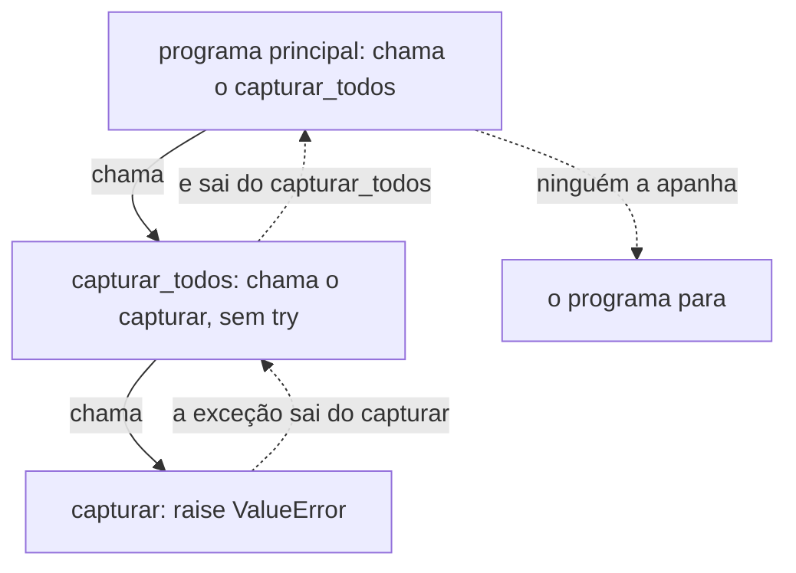
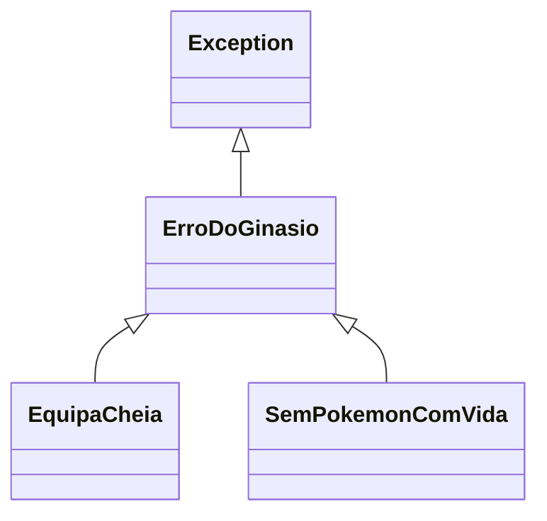
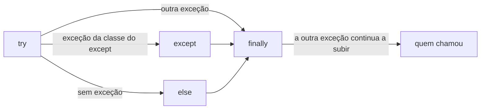
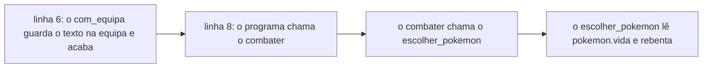
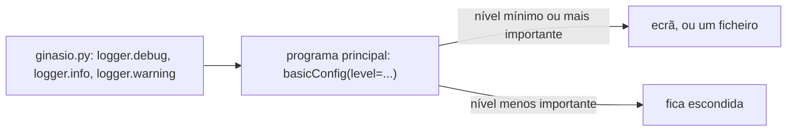

# Exceções, depuração e logging

Neste guia, o ginásio Pokémon passa a recusar com exceções os pedidos que não pode cumprir, e quem o chama já não pode ignorar a recusa. Depois, aprendes a encontrar a causa de um erro, com a mensagem de erro completa e com o depurador do VS Code. Por fim, o ginásio passa a deixar um registo do que faz, para quem o mantém.

Usa o `try` com `except` do 10.º ano e, do guia 03, a herança e o ginásio. Rever: [Uma classe-filha herda tudo da classe-mãe](03-objetos-e-composicao.md#uma-classe-filha-herda-tudo-da-classe-mãe), [O construtor da filha chama o da mãe](03-objetos-e-composicao.md#o-construtor-da-filha-chama-o-da-mãe), [Um só método cria treinadores e líderes](03-objetos-e-composicao.md#um-só-método-cria-treinadores-e-líderes) e [Exemplo guiado: o ginásio Pokémon](03-objetos-e-composicao.md#exemplo-guiado-o-ginásio-pokémon). Para praticar: [laboratório](laboratorios/04-excecoes-depuracao-e-logging-laboratorio.md) e [ficha de exercícios](exercicios/04-excecoes-depuracao-e-logging-exercicios.md).

## Neste guia

1. [Parte 1: Exceções](#parte-1-exceções)
2. [Parte 2: Depurar](#parte-2-depurar)
3. [Parte 3: O registo, ou logging](#parte-3-o-registo-ou-logging)
4. [Exemplo guiado: o dano a dobrar](#exemplo-guiado-o-dano-a-dobrar)

## Parte 1: Exceções

### Uma recusa com print não avisa quem chama

No guia 03, quando o ginásio não podia fazer o que lhe pediam, escrevia uma mensagem com `print` e saía do método com `return`. Este programa faz o mesmo, numa versão curta do `Treinador`, em que a equipa só leva dois Pokémon, guardados pelo nome.

```python
# recusa_print.py: a equipa só leva dois Pokémon, e a recusa é um print.
class Treinador:
    """Versão curta: a equipa só leva dois Pokémon, e a recusa é um print."""

    def __init__(self, nome):
        """Cria um treinador com um nome e a equipa vazia."""
        self.nome = nome
        self.equipa = []

    def capturar(self, nome_do_pokemon):
        """Junta o Pokémon à equipa, se ainda houver lugar."""
        if len(self.equipa) >= 2:
            print("A equipa está cheia!")
            return
        self.equipa.append(nome_do_pokemon)


ash = Treinador("Ash")
for nome in ["Pikachu", "Charmander", "Bulbasaur"]:
    ash.capturar(nome)
    print(f"{nome} capturado.")
print(ash.equipa)
```

Segue o ciclo de cabeça: o que escreve o programa na terceira volta?

```text
Pikachu capturado.
Charmander capturado.
A equipa está cheia!
Bulbasaur capturado.
['Pikachu', 'Charmander']
```

A quarta linha está errada. O Bulbasaur não foi capturado, como mostra a lista do fim, e mesmo assim o programa escreveu "Bulbasaur capturado.". O `capturar` recusou, mas só escreveu no ecrã. O ciclo que o chamou não tem forma de saber que a captura falhou, e continua como se tivesse corrido bem. Uma mensagem no ecrã avisa quem está a olhar para ele, e não o código que chamou o método.

### raise: uma recusa que não se pode ignorar

No 10.º ano, as exceções que apanhaste foram lançadas pelo próprio Python. O `int("muitos")`, por exemplo, não tem nenhum número para devolver e lança um `ValueError`, o sinal de que aquela linha não pode ser feita. Com a instrução **`raise`**, és tu que lanças uma exceção. Escreve-se `raise` seguido de um objeto de exceção, que se cria como qualquer objeto: o nome da classe e, entre parênteses, a mensagem. O `ValueError` é uma exceção que o Python já tem, para valores que não servem.

Na linha do `raise`, o método para, e a exceção sai dele para a linha que o chamou. Se essa linha não estiver dentro de um `try`, a exceção continua a subir, de função em função, até ao programa principal. Se ninguém a apanhar, o programa para e mostra a mensagem de erro. Neste programa, as capturas fazem-se dentro de uma função, o `capturar_todos`, que chama o `capturar` para cada nome:

```python
# recusa_raise.py: a mesma recusa, feita com raise, dentro de uma função.
class Treinador:
    """Versão curta: a equipa só leva dois Pokémon, e a recusa é uma exceção."""

    def __init__(self, nome):
        """Cria um treinador com um nome e a equipa vazia."""
        self.nome = nome
        self.equipa = []

    def capturar(self, nome_do_pokemon):
        """Junta o Pokémon à equipa; com a equipa cheia, lança ValueError."""
        if len(self.equipa) >= 2:
            raise ValueError(f"A equipa de {self.nome} está cheia: {nome_do_pokemon} ficou de fora.")
        self.equipa.append(nome_do_pokemon)


def capturar_todos(treinador, nomes):
    """Captura os Pokémon da lista, pela ordem, e diz cada captura que corre bem."""
    for nome in nomes:
        treinador.capturar(nome)
        print(f"{nome} capturado.")


ash = Treinador("Ash")
capturar_todos(ash, ["Pikachu", "Charmander", "Bulbasaur"])
print(ash.equipa)
```

O ecrã mostra as duas primeiras capturas e, no lugar da terceira, uma mensagem de erro, de que fica aqui só a última linha:

```text
Pikachu capturado.
Charmander capturado.
ValueError: A equipa de Ash está cheia: Bulbasaur ficou de fora.
```



As setas cheias são as chamadas, e as tracejadas o caminho da exceção. O `ValueError` nasce no `capturar`, sai dele e sai também do `capturar_todos`, que não tem `try`. Chega ao programa principal, que também não o apanha, e o programa para: o `print` da terceira volta e o da lista do fim já não correm.

A linha errada desapareceu, e a mensagem diz o que aconteceu. Mas um programa que para de vez também não serve. Quem chama o `capturar` tem de poder decidir o que fazer com a recusa.

### Apanhar a recusa: try, except e else

O `try` do 10.º ano também apanha as exceções que tu lanças, e o `as erro`, no `except`, dá um nome à exceção apanhada. Um `try` pode ter também um **`else`**, um bloco que corre quando o `try` acaba sem exceção. O programa principal passa a chamar o `capturar` dentro de um `try`, com um `except` e um `else`:

```python
# apanhar.py: o programa principal apanha a recusa com try, except e else.
class Treinador:
    """Versão curta: a equipa só leva dois Pokémon, e a recusa é uma exceção."""

    def __init__(self, nome):
        """Cria um treinador com um nome e a equipa vazia."""
        self.nome = nome
        self.equipa = []

    def capturar(self, nome_do_pokemon):
        """Junta o Pokémon à equipa; com a equipa cheia, lança ValueError."""
        if len(self.equipa) >= 2:
            raise ValueError(f"A equipa de {self.nome} está cheia: {nome_do_pokemon} ficou de fora.")
        self.equipa.append(nome_do_pokemon)


ash = Treinador("Ash")
for nome in ["Pikachu", "Charmander", "Bulbasaur"]:
    try:
        ash.capturar(nome)
    except ValueError as erro:
        print(f"Não foi possível: {erro}")
    else:
        print(f"{nome} capturado.")
print(ash.equipa)
```

```text
Pikachu capturado.
Charmander capturado.
Não foi possível: A equipa de Ash está cheia: Bulbasaur ficou de fora.
['Pikachu', 'Charmander']
```

Em cada volta, o Python tenta o `capturar` e escolhe o bloco que corre a seguir:

| Volta | O que o `capturar` faz | O bloco que corre |
| --- | --- | --- |
| Pikachu | Junta-o à equipa | `else` |
| Charmander | Junta-o à equipa | `else` |
| Bulbasaur | Lança o `ValueError` | `except` |

O `print(f"Não foi possível: {erro}")` mostra a mensagem que o `raise` deu à exceção. A frase da equipa cheia foi escrita uma só vez, dentro do `capturar`, que é quem sabe o que aconteceu.

O "capturado" também ficava certo dentro do `try`, a seguir ao `capturar`. Fica no `else` porque o `try` deve ter só as linhas cujas exceções queres apanhar: os erros de uma linha a mais no `try` iam parar ao mesmo `except`.

### Uma exceção própria herda de Exception

O `ValueError` não é só do `capturar`. O `int` também o lança, quando o texto não é um número. Neste programa, os pedidos de captura estão num dicionário: a chave é o nome do Pokémon, e o valor é a vida com que ele chega, escrita em texto. O `for nome in pedidos:` percorre as chaves, como no 10.º ano, e o `pedidos[nome]` dá a vida de cada um. O `try` tem as duas linhas, a do `int` e a do `capturar`, porque as duas linhas podem falhar, e as duas falhas têm de ser tratadas:

```python
# apanha_de_mais.py: o except ValueError também apanha o erro do int.
class Treinador:
    """Versão curta: a equipa só leva dois Pokémon, e a recusa é uma exceção."""

    def __init__(self, nome):
        """Cria um treinador com um nome e a equipa vazia."""
        self.nome = nome
        self.equipa = []

    def capturar(self, nome_do_pokemon):
        """Junta o Pokémon à equipa; com a equipa cheia, lança ValueError."""
        if len(self.equipa) >= 2:
            raise ValueError(f"A equipa de {self.nome} está cheia: {nome_do_pokemon} ficou de fora.")
        self.equipa.append(nome_do_pokemon)


ash = Treinador("Ash")
pedidos = {"Pikachu": "100", "Charmander": "cem"}
for nome in pedidos:
    try:
        vida = int(pedidos[nome])
        ash.capturar(nome)
    except ValueError as erro:
        print(f"Equipa cheia? {erro}")
    else:
        print(f"{nome} capturado, com {vida} de vida.")
print(ash.equipa)
```

```text
Pikachu capturado, com 100 de vida.
Equipa cheia? invalid literal for int() with base 10: 'cem'
['Pikachu']
```

A equipa do Ash tem um só Pokémon, e o programa pergunta se está cheia. O `except ValueError` apanhou o erro do `int("cem")`, que não tem nada a ver com a equipa. A mensagem, em inglês, quer dizer que o `int` não consegue ler `'cem'` como um número escrito com algarismos. Quando dois erros diferentes são da mesma classe, o `except` não os consegue separar.

A solução é dar à recusa uma classe só dela. Uma **exceção própria** é uma classe criada por ti que herda de `Exception`, a classe-mãe dos erros do Python. A classe herda tudo o que uma exceção precisa, como a forma de guardar e de mostrar a mensagem. Por isso, o corpo da classe pode ser só a docstring. O nome diz o problema, em português, como os nomes das tuas classes.

```python
# excecao_propria.py: a EquipaCheia, e um except para cada classe de exceção.
class EquipaCheia(Exception):
    """Um treinador tentou capturar um Pokémon com a equipa já completa."""


class Treinador:
    """Versão curta: a equipa só leva dois Pokémon, e a recusa é EquipaCheia."""

    def __init__(self, nome):
        """Cria um treinador com um nome e a equipa vazia."""
        self.nome = nome
        self.equipa = []

    def capturar(self, nome_do_pokemon):
        """Junta o Pokémon à equipa; com a equipa cheia, lança EquipaCheia."""
        if len(self.equipa) >= 2:
            raise EquipaCheia(f"A equipa de {self.nome} está cheia: {nome_do_pokemon} ficou de fora.")
        self.equipa.append(nome_do_pokemon)


ash = Treinador("Ash")
pedidos = {"Pikachu": "100", "Charmander": "cem", "Bulbasaur": "110", "Squirtle": "90"}
for nome in pedidos:
    try:
        vida = int(pedidos[nome])
        ash.capturar(nome)
    except ValueError:
        print(f"A vida de {nome} não é um número: {pedidos[nome]}.")
    except EquipaCheia as erro:
        print(f"Não foi possível: {erro}")
    else:
        print(f"{nome} capturado, com {vida} de vida.")
print(ash.equipa)
```

São quatro pedidos para dois lugares. Quem fica de fora da equipa?

```text
Pikachu capturado, com 100 de vida.
A vida de Charmander não é um número: cem.
Bulbasaur capturado, com 110 de vida.
Não foi possível: A equipa de Ash está cheia: Squirtle ficou de fora.
['Pikachu', 'Bulbasaur']
```

Cada erro vai agora para o seu `except`. O Python experimenta os `except` por ordem, de cima para baixo, e entra no primeiro que corresponde à classe da exceção. O Charmander nunca chegou ao `capturar`, porque o `int` falhou antes. Por isso, o Bulbasaur ainda coube, e foi o Squirtle que ficou de fora.

<details>
<summary>Para ires mais longe: a família das exceções do Python</summary>

As exceções que o Python já tem também formam uma família. O `ValueError`, o `TypeError`, o `AttributeError` e o `ZeroDivisionError` descendem todos de `Exception`, e por isso um `except Exception` apanha qualquer um deles. Por cima da `Exception` está a `BaseException`, a mãe de todas. Tem também filhas que não são erros do programa, como a exceção que o Python lança quando carregas em Ctrl+C para o parar. É por isso que as exceções próprias herdam de `Exception`, e não de `BaseException`.

Nas bibliotecas escritas em inglês, os nomes das exceções acabam quase sempre em `Error`, como o `ValueError`. Nas tuas, o nome diz o problema em português, como a `EquipaCheia`.

</details>

### As exceções do ginásio

No exemplo dos Pokémon, as recusas do ginásio são exceções próprias, num ficheiro só delas, o [erros.py](../exemplos/python-avancado/pokemon/04-excecoes-depuracao-e-logging/erros.py). Os programas a partir daqui importam do `erros.py`, do `pokemon.py` e do `ginasio.py` da pasta [04-excecoes-depuracao-e-logging](../exemplos/python-avancado/pokemon/04-excecoes-depuracao-e-logging/) dos exemplos. Copia essa pasta para o teu computador e guarda os teus programas dentro dela, com nomes diferentes dos que lá estão.

```python
"""Exceções próprias do ginásio Pokémon, o código das aulas de Python avançado.

Todas herdam de ErroDoGinasio, que herda de Exception. Assim, quem quiser
apanhar qualquer erro do ginásio escreve except ErroDoGinasio, e quem quiser
apanhar só um caso escreve o nome da classe-filha.
"""


class ErroDoGinasio(Exception):
    """Classe-mãe de todos os erros do ginásio Pokémon."""


class EquipaCheia(ErroDoGinasio):
    """Um treinador tentou capturar um Pokémon com a equipa já completa."""


class SemPokemonComVida(ErroDoGinasio):
    """Um combate não pode começar: um dos treinadores não tem Pokémon com vida."""
```

As três classes formam uma família, como as classes de Pokémon do guia 03.



O `ErroDoGinasio` é filho de `Exception` e é a classe-mãe das outras duas. No diagrama, a herança tem o triângulo vazio do lado da mãe, como no guia 03.

Para confirmar a família, o Python tem a função **`isinstance`**, do inglês "is instance", "é instância". Recebe um objeto e uma classe. Devolve `True` se o objeto é dessa classe ou de uma classe que descende dela, como uma filha ou uma neta, e `False` se não é. É a pergunta "é um" da herança, feita pelo programa.

```python
# familia.py: confirma que as exceções do ginásio formam uma família.
from erros import EquipaCheia, ErroDoGinasio, SemPokemonComVida

cheia = EquipaCheia("A equipa está cheia.")
print(isinstance(cheia, EquipaCheia))
print(isinstance(cheia, ErroDoGinasio))
print(isinstance(cheia, Exception))
print(isinstance(cheia, SemPokemonComVida))
print(cheia)
```

Uma das quatro perguntas dá `False`. Qual?

```text
True
True
True
False
A equipa está cheia.
```

As três primeiras respostas sobem pela família: a `EquipaCheia` é uma `EquipaCheia`, é um `ErroDoGinasio` e é uma exceção. A quarta dá `False`, porque a `SemPokemonComVida` é uma irmã da `EquipaCheia`, e não uma mãe.

### A recusa vem antes da mudança

No `ginasio.py` da pasta 04, a equipa de um treinador leva no máximo seis Pokémon. O limite está numa constante, no início do ficheiro, `TAMANHO_MAXIMO_DA_EQUIPA = 6`, e o `capturar` do `Treinador` passou a ser assim:

```python
class Treinador:
    # O construtor e o com_equipa ficam por cima, e o escolher_pokemon por baixo, como no guia 03.

    def capturar(self, pokemon):
        """Junta à equipa um Pokémon que foi criado fora do treinador.

        Se a equipa já tem TAMANHO_MAXIMO_DA_EQUIPA Pokémon, não junta nada e
        lança EquipaCheia.
        """
        if len(self.equipa) >= TAMANHO_MAXIMO_DA_EQUIPA:
            raise EquipaCheia(f"{self.nome} já tem {TAMANHO_MAXIMO_DA_EQUIPA} Pokémon e não pode capturar {pokemon.nome}.")
        self.equipa.append(pokemon)
```

O `raise` está antes do `append`. Quando a equipa está cheia, o método para no `raise`, e o `append` nunca corre: a equipa fica como estava. É a regra de qualquer recusa. Primeiro verifica-se, e o estado só muda se a verificação passar. Se o `append` viesse primeiro, o Pokémon recusado ficava na equipa, e a mensagem dizia uma coisa enquanto a equipa dizia outra.

```python
# sete_capturas.py: sete capturas para os seis lugares da equipa.
from erros import EquipaCheia
from pokemon import PokemonFogo
from ginasio import Treinador

gary = Treinador("Gary")
for numero in range(1, 8):
    try:
        gary.capturar(PokemonFogo(f"Ponyta {numero}", 50, 20))
    except EquipaCheia as erro:
        print(f"Recusado: {erro}")
print(len(gary.equipa))
```

```text
Recusado: Gary já tem 6 Pokémon e não pode capturar Ponyta 7.
6
```

A sétima captura foi recusada antes do `append`, e a equipa ficou com os seis Pokémon que cabem.

O `combater` do `Ginasio` segue a mesma regra. No guia 03, o desafiante entrava na lista `desafiantes` logo no início do método, antes de se saber se havia combate. Agora, a verificação vem primeiro, e um desafio sem Pokémon com vida é recusado com a `SemPokemonComVida` antes de o desafiante entrar na lista:

```python
class Ginasio:
    # O construtor fica por cima, como no guia 03.

    def combater(self, desafiante):
        """Um combate entre o Pokémon escolhido por cada treinador.

        Se um dos dois não tem Pokémon com vida, não há combate: lança
        SemPokemonComVida, e o ginásio fica como estava.
        """
        atacante = desafiante.escolher_pokemon()
        defensor = self.lider.escolher_pokemon()
        if atacante is None or defensor is None:
            logger.warning(f"Combate recusado em {self.cidade}: {desafiante.nome} contra {self.lider.nome}, sem Pokémon com vida.")
            raise SemPokemonComVida(f"Não há combate em {self.cidade}: um dos treinadores não tem Pokémon com vida.")
        if desafiante not in self.desafiantes:
            self.desafiantes.append(desafiante)
        # Seguem-se mais duas linhas do registo e o combate, como no guia 03.
```

A linha do `logger.warning` escreve no ecrã um aviso de que o combate foi recusado, mesmo sem configuração nenhuma, e só depois o `raise` lança a exceção. Um combate recusado deixa o ginásio exatamente como estava.

### Uma família de exceções

Com uma classe-mãe comum, um só `except ErroDoGinasio` apanha qualquer recusa do ginásio. Neste programa, o Gary faz três pedidos: dois combates contra a Misty e uma série de capturas.

```python
# pedidos.py: um só except apanha as recusas do ginásio.
from erros import ErroDoGinasio
from pokemon import PokemonAgua, PokemonFogo
from ginasio import Ginasio, Lider, Treinador

misty = Lider.com_equipa("Misty", [PokemonAgua("Starmie", 90, 35)])
gary = Treinador.com_equipa("Gary", [PokemonFogo("Vulpix", 30, 20)])
cerulean = Ginasio("Cerulean", misty)
for pedido in ["combate", "combate", "captura"]:
    try:
        if pedido == "combate":
            cerulean.combater(gary)
        else:
            for numero in range(1, 7):
                gary.capturar(PokemonFogo(f"Ponyta {numero}", 50, 20))
    except ErroDoGinasio as erro:
        print(f"Pedido recusado ({type(erro).__name__}): {erro}")
print(len(gary.equipa), len(cerulean.combates), len(cerulean.desafiantes))
```

Pensa nos três números da última linha: a equipa do Gary, os combates do ginásio e os desafiantes.

```text

=== Gary desafia Misty no ginásio de Cerulean ===
Vulpix ataca Starmie e tira 20 de vida.
Starmie tem 70/150 de vida.
É super eficaz!
Starmie ataca Vulpix e tira 70 de vida.
Vulpix está KO (0/150).
Combate recusado em Cerulean: Gary contra Misty, sem Pokémon com vida.
Pedido recusado (SemPokemonComVida): Não há combate em Cerulean: um dos treinadores não tem Pokémon com vida.
Pedido recusado (EquipaCheia): Gary já tem 6 Pokémon e não pode capturar Ponyta 6.
6 1 1
```

O primeiro combate acontece, e o Vulpix perde. No segundo, o Gary já não tem Pokémon com vida: o ginásio escreve o aviso, e o `combater` lança a `SemPokemonComVida`. Nas capturas, o Gary chega aos seis Pokémon, contando com o Vulpix, e a sexta Ponyta é recusada com a `EquipaCheia`. O mesmo `except ErroDoGinasio` apanhou as duas exceções, porque as duas são filhas dele, e o `type(erro).__name__`, do guia 03, mostra de que classe era cada uma. Os três números confirmam que as recusas não deixaram rasto: seis Pokémon, um combate e um desafiante.

Apanhar a mãe ou uma filha é uma escolha de quem chama. O `except ErroDoGinasio` serve quando a reação é a mesma para todas as recusas, como aqui, em que só se mostra a mensagem. Um `except EquipaCheia` serve quando a reação é só desse caso, como sugerir ao treinador que liberte um Pokémon. A classe que lança a exceção não decide nada disto, porque não sabe onde vai ser usada.

### Os except pela ordem errada

Quando há dois `except` da mesma família, a ordem conta.

```python
# ordem_errada.py: o except da classe-mãe vem primeiro e apanha tudo.
from erros import EquipaCheia, ErroDoGinasio
from pokemon import PokemonFogo
from ginasio import Treinador

gary = Treinador("Gary")
try:
    for numero in range(1, 8):
        gary.capturar(PokemonFogo(f"Ponyta {numero}", 50, 20))
except ErroDoGinasio:
    print("Um erro qualquer do ginásio.")
except EquipaCheia:
    print("A equipa está cheia.")
print(len(gary.equipa))
```

A sétima captura lança uma `EquipaCheia`. Qual das duas mensagens aparece?

```text
Um erro qualquer do ginásio.
6
```

O Python entra no primeiro `except` que corresponde à exceção, e o da mãe corresponde também às filhas. A `EquipaCheia` é filha do `ErroDoGinasio`, e por isso o primeiro `except` apanha-a. O segundo nunca vai correr, e o Python não dá erro nenhum. Os `except` escrevem-se do mais específico para o mais geral: primeiro o da filha, depois o da mãe. Com os dois trocados, o programa escreve "A equipa está cheia.".

### Uma exceção com dados

As exceções do `erros.py` só têm a docstring, e a mensagem é escrita por quem as lança, dentro do `raise`. Isso chega quando quem apanha a exceção só quer mostrar a mensagem. Por vezes, precisa de mais: saber que Pokémon ficou de fora, para o guardar noutro sítio, ou quem é o treinador, para lhe mostrar a equipa. Esses dados estão escritos na mensagem, mas tirar um nome do meio de uma frase dá trabalho e deixa de funcionar quando a frase muda.

Uma exceção própria é uma classe, e por isso pode ter um construtor, como as classes do guia 03. O construtor recebe os dados da recusa, guarda-os em atributos e escreve a mensagem a partir deles. No fim, entrega a mensagem à classe-mãe com `super().__init__(mensagem)`, como o construtor da `PokemonFogo` entregava os seus valores ao da `Pokemon`. É a `Exception` que guarda a mensagem e a mostra no `print`, e por isso a mensagem tem de lhe chegar.

No programa seguinte, a `EquipaCheia` recebe o treinador e o nome do Pokémon. O `capturar_todos` é o mesmo do `recusa_raise.py`, e agora a chamada a ele está dentro de um `try`.

```python
# com_dados.py: a EquipaCheia guarda o treinador e o Pokémon que ficou de fora.
class EquipaCheia(Exception):
    """Um treinador tentou capturar um Pokémon com a equipa já completa.

    Guarda o treinador e o nome do Pokémon que ficou de fora, e escreve ela
    própria a mensagem a partir deles.
    """

    def __init__(self, treinador, nome_do_pokemon):
        """Guarda os dados da recusa e entrega a mensagem à classe-mãe."""
        self.treinador = treinador
        self.nome_do_pokemon = nome_do_pokemon
        mensagem = f"A equipa de {treinador.nome} está cheia: {nome_do_pokemon} ficou de fora."
        super().__init__(mensagem)


class Treinador:
    """Versão curta: a equipa só leva dois Pokémon, e a recusa é EquipaCheia."""

    def __init__(self, nome):
        """Cria um treinador com um nome e a equipa vazia."""
        self.nome = nome
        self.equipa = []

    def capturar(self, nome_do_pokemon):
        """Junta o Pokémon à equipa; com a equipa cheia, lança EquipaCheia."""
        if len(self.equipa) >= 2:
            raise EquipaCheia(self, nome_do_pokemon)
        self.equipa.append(nome_do_pokemon)


def capturar_todos(treinador, nomes):
    """Captura os Pokémon da lista, pela ordem, e diz cada captura que corre bem."""
    for nome in nomes:
        treinador.capturar(nome)
        print(f"{nome} capturado.")


ash = Treinador("Ash")
try:
    capturar_todos(ash, ["Pikachu", "Bulbasaur", "Squirtle", "Charmander"])
except EquipaCheia as erro:
    print(erro)
    print(f"Ficou de fora: {erro.nome_do_pokemon}.")
    print(f"Para o capturar, {erro.treinador.nome} tem de libertar um destes: {erro.treinador.equipa}")
```

```text
Pikachu capturado.
Bulbasaur capturado.
A equipa de Ash está cheia: Squirtle ficou de fora.
Ficou de fora: Squirtle.
Para o capturar, Ash tem de libertar um destes: ['Pikachu', 'Bulbasaur']
```

As duas primeiras linhas são do `capturar_todos`, e a terceira é a mensagem, que a própria exceção escreveu. As últimas duas usam os atributos da exceção apanhada: `erro.nome_do_pokemon` é o Pokémon que ficou de fora, e `erro.treinador` é o objeto `Treinador` inteiro, com o nome e a equipa. O `except` não sabia em que volta do ciclo a captura falhou, e não precisou de saber, porque a exceção trouxe os dados com ela.

O `raise` também ficou mais curto, `raise EquipaCheia(self, nome_do_pokemon)`. Quem lança passa só os dados, e a frase fica escrita num único sítio, a classe da exceção. O construtor vale a pena quando quem apanha a exceção precisa dos dados para fazer alguma coisa com eles, como mostrar a equipa do treinador. As exceções do `erros.py` ficam só com a docstring, porque quem as apanha só mostra a mensagem.

### finally: o que corre sempre

Um `try` pode acabar com um **`finally`**, um bloco que corre sempre: quando não houve exceção, quando houve e foi apanhada, e até quando houve e ninguém a apanhou. Serve para o que tem de acontecer em qualquer caso, como escrever um resumo ou libertar alguma coisa que se ocupou no `try`.

```python
# sempre.py: o finally corre nas duas voltas, com e sem exceção.
from erros import SemPokemonComVida
from pokemon import PokemonAgua, PokemonPlanta
from ginasio import Ginasio, Lider, Treinador

misty = Lider.com_equipa("Misty", [PokemonAgua("Starmie", 90, 35)])
ash = Treinador.com_equipa("Ash", [PokemonPlanta("Bulbasaur", 110, 50, 20)])
cerulean = Ginasio("Cerulean", misty)
for tentativa in range(2):
    try:
        cerulean.combater(ash)
    except SemPokemonComVida as erro:
        print(f"Recusado: {erro}")
    finally:
        print(f"Combates no histórico de {cerulean.cidade}: {len(cerulean.combates)}")
```

```text

=== Ash desafia Misty no ginásio de Cerulean ===
É super eficaz!
Bulbasaur ataca Starmie e tira 100 de vida.
Starmie está KO (0/150).
Combates no histórico de Cerulean: 1
Combate recusado em Cerulean: Ash contra Misty, sem Pokémon com vida.
Recusado: Não há combate em Cerulean: um dos treinadores não tem Pokémon com vida.
Combates no histórico de Cerulean: 1
```

A linha do histórico aparece duas vezes. Na primeira volta, o combate corre bem, e o `finally` corre a seguir. Na segunda, a Misty já não tem Pokémon com vida, o combate é recusado e o `except` mostra a mensagem, e o `finally` corre na mesma. O histórico continua com um combate.

No `sempre.py`, um `print` a seguir ao `try`, sem `finally`, dava o mesmo, porque nenhuma exceção ficou por apanhar. O `finally` faz diferença em dois casos. O primeiro é haver uma exceção que nenhum `except` apanha. O segundo é o `try`, o `except` ou o `else` saírem da função com `return`, porque o `finally` corre antes de a função devolver o valor:

```python
# antes_do_return.py: o finally corre antes de a função devolver o valor.
from erros import EquipaCheia
from pokemon import PokemonFogo
from ginasio import Treinador


def tentar_captura(treinador, pokemon):
    """Tenta a captura e devolve True se correu bem, ou False se a equipa estava cheia."""
    try:
        treinador.capturar(pokemon)
    except EquipaCheia:
        return False
    else:
        return True
    finally:
        print(f"{treinador.nome} tem {len(treinador.equipa)} Pokémon.")


gary = Treinador("Gary")
for numero in range(1, 6):
    gary.capturar(PokemonFogo(f"Ponyta {numero}", 50, 20))
print(tentar_captura(gary, PokemonFogo("Ponyta 6", 50, 20)))
print(tentar_captura(gary, PokemonFogo("Ponyta 7", 50, 20)))
```

```text
Gary tem 6 Pokémon.
True
Gary tem 6 Pokémon.
False
```

A linha da equipa aparece antes do `True` e do `False`. Nas duas chamadas, é o `return` do `else` ou do `except` que decide o valor, mas, antes de a função o devolver, o `finally` escreve a linha. Um `print` a seguir ao `try` nunca correria, porque a função já tinha saído com o `return`.



O `try` corre primeiro. Se houve uma exceção da classe do `except`, corre o `except`, e se não houve exceção, corre o `else`. Depois, o `finally` corre sempre. Se houve outra exceção, que nenhum `except` apanha, o `finally` corre na mesma, e a exceção continua a subir para quem chamou.

## Parte 2: Depurar

### Um erro tem um sintoma e uma causa

Quando um programa falha, o que se vê raramente está no sítio do erro. O **sintoma** é o que se vê: uma mensagem de erro, um número errado, um combate que nunca acaba. A **causa** é a instrução que está mal. Se um ataque de 25 tira 50 de vida, o 50 no ecrã é o sintoma. A causa é a linha que fez mal a conta, e pode estar noutro método.

### Os erros são de três tipos

Saber que tipo de erro é ajuda a escolher onde procurar:

| Tipo de erro | O que acontece | Exemplo |
| --- | --- | --- |
| De escrita | O Python recusa o ficheiro antes de o programa correr | Um parêntese por fechar, uma indentação mal feita |
| De execução | O programa para a meio, com uma mensagem de erro | O `ValueError` do `int("muitos")`, que ninguém apanhou |
| De lógica | O programa corre até ao fim e dá o resultado errado | Um ataque que tira o dobro do que devia |

O erro de escrita é o erro de sintaxe do 10.º ano: a mensagem acaba em `SyntaxError`, ou em `IndentationError` quando o problema é a indentação. Um erro de execução é uma exceção que ninguém apanhou, como as da parte 1. Um erro de lógica é o mais difícil, porque não há mensagem nenhuma: para o Python, o programa fez exatamente o que estava escrito.

### A rotina dos cinco passos

**Depurar** é encontrar a causa de um erro a partir do sintoma. Quando um programa falha, segues sempre a mesma rotina, a mesma em todas as disciplinas de programação:

1. Observar e reproduzir o erro. Escreve o caso que falhou, o resultado esperado, tirado do enunciado e não do código que falha, e o resultado obtido. Diz também que tipo de erro é: de escrita, de execução ou de lógica.
2. Formular uma hipótese. Escreve uma explicação possível para o erro, numa frase que os valores podem confirmar ou desmentir.
3. Verificar a hipótese. Segue os valores no caso mais curto que ainda mostra o erro, com o trace, a mensagem ou o depurador. O trace é a tabela com os valores das variáveis, linha a linha.
4. Corrigir a causa. Muda a instrução que produz o erro, uma causa de cada vez, e não o sítio onde ele se vê.
5. Voltar a testar tudo. Corre outra vez todos os casos, também os que já passavam, e explica o que mudou.

Uma **hipótese** é uma explicação que ainda não sabes se está certa. Diz o que esperas ver nos valores se tiveres razão, e são os valores do programa que a confirmam ou desmentem.

O caso, a hipótese e o que mudou escrevem-se num comentário, no fim do ficheiro que estás a investigar. Assim, o código não muda de linha, e as mensagens de erro continuam a apontar as mesmas linhas.

### Ler um traceback com três andares

Num erro de execução, o Python mostra a mensagem de erro completa. Este programa tem um erro de propósito: a equipa do Ash leva o nome de um Pokémon, em texto, e não um objeto Pokémon.

```python
# combate.py: um erro de execução, para ler com o traceback.
from pokemon import PokemonAgua
from ginasio import Ginasio, Lider, Treinador

misty = Lider.com_equipa("Misty", [PokemonAgua("Starmie", 90, 35)])
ash = Treinador.com_equipa("Ash", ["Pikachu"])
cerulean = Ginasio("Cerulean", misty)
cerulean.combater(ash)
```

O erro rebenta antes de o combate começar, e esta é a mensagem inteira:

```text
Traceback (most recent call last):
  File "combate.py", line 8, in <module>
    cerulean.combater(ash)
    ~~~~~~~~~~~~~~~~~^^^^^
  File "ginasio.py", line 140, in combater
    atacante = desafiante.escolher_pokemon()
  File "ginasio.py", line 87, in escolher_pokemon
    if pokemon.vida > 0:
       ^^^^^^^^^^^^
AttributeError: 'str' object has no attribute 'vida'
```

No teu computador, cada `File` mostra o caminho completo do ficheiro, e aqui aparece só o nome. As linhas com `~` e `^`, que apontam a parte da linha que falhou, só aparecem nas versões recentes do Python.

Já leste mensagens destas no 10.º ano, com um só andar. Chamam-se traceback, à letra "o rasto para trás". Não confundas com o trace, a tabela que tu fazes: o traceback é a mensagem que o Python escreve. A primeira linha diz como se lê: "most recent call last" quer dizer "a chamada mais recente fica no fim". Cada `File`, com a linha de código por baixo, é um **andar**. Diz o ficheiro, a linha e a função ou o método que estava a correr, e mostra o código dessa linha. Ao programa principal, o Python chama `<module>`.

Um traceback lê-se de baixo para cima:

1. A última linha diz o quê: a classe da exceção e a mensagem. `'str' object has no attribute 'vida'` quer dizer "um objeto `str` não tem o atributo `vida`", e `str` é o tipo dos textos. Alguém tentou ler a vida de um texto.
2. O andar de baixo diz onde rebentou: na linha 87 do `ginasio.py`, no `if pokemon.vida > 0:` do `escolher_pokemon`. Ali, o `pokemon` era um texto.
3. Os andares de cima dizem como se chegou lá. O programa principal, na linha 8, chamou o `combater`, e o `combater`, na linha 140, chamou o `escolher_pokemon` do desafiante.

### Um erro que rebenta longe da causa

Nenhum dos três andares é a linha que está mal. O `escolher_pokemon` está certo: percorre a equipa e lê a vida de cada Pokémon. O problema é haver um texto na equipa, e o texto entrou na linha 6 do `combate.py`, `Treinador.com_equipa("Ash", ["Pikachu"])`. Quando o erro rebentou, essa linha já tinha acabado.

Os andares de um traceback são a **pilha de chamadas** no momento do erro: as funções e os métodos que estavam a meio, cada um à espera do que chamou. O programa principal esperava pelo `combater`, e o `combater` esperava pelo `escolher_pokemon`. Uma linha que já acabou não está na pilha, e por isso a causa pode não aparecer no traceback.



O diagrama segue o programa pela ordem em que corre. A causa acontece na linha 6, e o erro só rebenta duas chamadas depois.

Corrigir o sintoma, com um `escolher_pokemon` que saltasse os textos, escondia o erro: o Ash ficava com uma equipa sem Pokémon, e ninguém percebia porquê. A correção é na linha 6. A equipa leva um Pokémon a sério, como `PokemonFogo("Charmander", 90, 40)`, com o `PokemonFogo` na importação. Quando o andar de baixo está certo, pergunta de onde veio o valor errado.

### O depurador para num ponto de paragem

Um erro de lógica não tem traceback. Para ver onde a conta se estraga, é preciso ver os valores das variáveis enquanto o programa corre.

Um **depurador** é uma ferramenta que corre o programa e o deixa parar onde quiseres, para veres o valor de cada variável e avançares uma linha de cada vez. É o trace, feito pelo computador, com os valores verdadeiros. O programa para num **ponto de paragem**, em inglês breakpoint: uma linha que marcas, onde ele para antes de a executar. O depurador de Python do VS Code é a extensão Python Debugger, que o VS Code instala sozinho com a extensão Python, a mesma com que corres os programas.

Antes do primeiro F5, há três coisas a saber:

- Em portáteis e em Mac, as teclas F5, F10 e F11 podem precisar da tecla Fn.
- Na primeira vez, o F5 pode perguntar que depurador usar: escolhe o de Python (Python Debugger) e, a seguir, o ficheiro aberto (Python File).
- O triângulo do canto de cima corre o programa sem o depurador e não para nos pontos de paragem. Para depurar, usa o F5.

| O que queres | Tecla | Botão | Em inglês |
| --- | --- | --- | --- |
| Pôr ou tirar um ponto de paragem | F9, na linha do cursor | Clicar na margem, à esquerda do número da linha, onde aparece um ponto vermelho | Breakpoint |
| Executar com o depurador | F5 | A seta ao lado do triângulo do canto de cima, e a opção de depurar o ficheiro | Start Debugging |
| Continuar até ao ponto de paragem seguinte, ou até ao fim | F5, com o programa parado | Na barra de depuração, o triângulo com um traço à esquerda | Continue |
| Parar a depuração | Shift+F5 | Na barra de depuração, o quadrado vermelho | Stop |

Com o programa parado, a linha que vai correr a seguir fica marcada a amarelo, e ainda não correu. Na barra lateral da depuração, o painel Variáveis (Variables) mostra os valores da função onde o programa parou, e um objeto abre-se com a seta, para veres os atributos. O painel Pilha de chamadas (Call Stack) mostra a pilha.

Este programa não tem erro nenhum, e serve para experimentares o depurador:

```python
# seguir.py: um ataque para seguir com o depurador.
from pokemon import PokemonFogo, PokemonPlanta

charmander = PokemonFogo("Charmander", 90, 40)
bulbasaur = PokemonPlanta("Bulbasaur", 110, 25, 20)
charmander.atacar(bulbasaur)
print("O ataque acabou.")
```

Põe um ponto de paragem na linha 6, `charmander.atacar(bulbasaur)`, e carrega em F5. O programa para nessa linha, antes de a correr, com o `charmander` e o `bulbasaur` no painel das variáveis. Abre o `bulbasaur` com a seta, e vês os atributos dele, como o `nome` e o `tipo`.

### F10 passa por cima, F11 entra

Com o programa parado numa linha que chama um método, como a linha 6 do `seguir.py`, há duas formas de avançar. O F10 corre a linha inteira, com tudo o que ela chama, e para na linha seguinte. O F11 entra no método que a linha chama e para na primeira linha dele.

| O que queres | Tecla | Botão na barra de depuração | Em inglês |
| --- | --- | --- | --- |
| Avançar uma linha, sem entrar nas funções que ela chama | F10 | A seta curva por cima de um ponto | Step Over |
| Entrar na função ou no método que a linha chama | F11 | A seta para baixo, a apontar para um ponto | Step Into |
| Correr o resto da função e voltar a quem a chamou | Shift+F11 | A seta para cima, a sair de um ponto | Step Out |

No Mac, o F11 pode mostrar a secretária em vez de entrar no método. Nesse caso, usa o botão da barra de depuração.

Parado na linha 6 do `seguir.py`, carrega em F10. A linha corre inteira: o terminal mostra as três linhas do ataque, e o programa para no `print` da linha 7.

Para veres o F11, para com Shift+F5 e volta ao separador do `seguir.py`, porque o F5 depura o ficheiro que está à frente. Carrega em F5 e, parado na linha 6, carrega em F11. O depurador entra no `atacar`, no ficheiro `pokemon.py`, e daí o F10 avança pelo método:

| Depois de | Linha marcada a amarelo | `dano` no painel das variáveis |
| --- | --- | --- |
| F11 | `if self.vida == 0:` | ainda não existe |
| F10 | `if alvo.vida == 0:` | ainda não existe |
| F10 | `dano = self.calcular_dano(alvo)` | ainda não existe |
| F10 | `print(f"{self.nome} ataca {alvo.nome} e tira {dano} de vida.")` | 80 |

Dentro do `atacar`, o `self` é o Charmander e o `alvo` é o Bulbasaur. No terceiro F10, o `calcular_dano` correu inteiro, sem o depurador entrar nele, e o terminal escreveu "É super eficaz!". O Shift+F11 corre o resto do `atacar` e volta ao `seguir.py`. Usa o F10 para passar por cima do que sabes que funciona, e o F11 para entrar no que queres investigar.

### A pilha de chamadas no depurador

O depurador também ajuda nos erros de execução. Quando há uma exceção que ninguém apanha, o depurador do VS Code não deixa o programa acabar. Para na linha onde ela rebentou e mostra a pilha de chamadas, com os valores de cada andar.

Abre o `combate.py` e carrega em F5, sem nenhum ponto de paragem. O programa para no `if pokemon.vida > 0:` do `escolher_pokemon`, com a exceção descrita numa caixa junto da linha. O painel Pilha de chamadas mostra os três andares do traceback, mas pela ordem contrária:

| Posição | No painel Pilha de chamadas | No traceback |
| --- | --- | --- |
| Em cima | `escolher_pokemon`, onde o erro rebentou | `<module>`, o programa principal |
| A meio | `combater` | `combater` |
| Em baixo | `<module>`, o programa principal | `escolher_pokemon`, onde o erro rebentou |

No painel das variáveis, o `pokemon` é `'Pikachu'`, um texto. Clica no andar `combater`, e o painel das variáveis passa a mostrar as variáveis desse andar: no `desafiante` vês a `equipa`, com o texto lá dentro. Clica no andar `<module>`, e estás no programa principal, onde o `ash` foi criado. A pilha de chamadas do depurador é o traceback com os valores à vista.

## Parte 3: O registo, ou logging

### O registo é para quem mantém o programa

Para perceber o que um programa está a fazer, a primeira ideia é encher o código de `print`, como "cheguei aqui" ou "a vida é 40". Os `print` misturam-se com o que o programa mostra a quem o usa. Quando o erro está resolvido, é preciso apagá-los, e quando o erro volta, é preciso escrevê-los outra vez.

O **registo**, em inglês logging, é o que um programa escreve sobre o que faz, para quem o mantém, e não para quem o usa. As mensagens do registo ficam no código. Uma configuração, num só sítio, decide quais aparecem e para onde vão: para o ecrã, para um ficheiro, ou para lado nenhum. O Python traz para isso o módulo `logging`.

No ginásio, o combate continua a aparecer com `print`, porque é o que o jogador vê. O registo guarda o que interessa a quem mantém o ginásio: que combates houve, entre quem, como acabaram e que pedidos foram recusados.

### Os cinco níveis

Cada mensagem do registo tem um **nível**, que diz a importância do que aconteceu. Há cinco, do menos importante para o mais importante:

| Nível | Quando se usa | Exemplo no ginásio |
| --- | --- | --- |
| `DEBUG` | Pormenores que só interessam a quem está a investigar um problema | A vida de cada Pokémon no início do combate |
| `INFO` | O programa a funcionar como devia: os acontecimentos normais | Um combate começou; um combate acabou, e quem venceu |
| `WARNING` | Uma coisa inesperada, que o programa conseguiu tratar, mas que convém saber | Um combate recusado, porque um treinador não tinha Pokémon com vida |
| `ERROR` | Uma operação que o programa queria fazer falhou | Um ficheiro da equipa que não se conseguiu ler |
| `CRITICAL` | Uma falha tão grave que o programa não pode continuar | O ficheiro de configuração do ginásio não existe, e o programa tem de parar |

A configuração escolhe um nível mínimo. Aparecem as mensagens desse nível e dos mais importantes, e as dos menos importantes ficam escondidas. Com o nível `INFO`, aparecem as de `INFO`, `WARNING`, `ERROR` e `CRITICAL`, e as de `DEBUG` não.

O `WARNING` e o `ERROR` são os que mais se confundem. Uma captura recusada com a equipa cheia, que o programa apanha e trata, é um `WARNING`. O Pokémon não entrou, mas o programa cumpriu a regra da equipa e seguiu em frente. O `ERROR` fica para uma operação que o programa queria fazer e não conseguiu, como ler um ficheiro da equipa. Escolher o nível é decidir quem precisa de saber, e com que urgência.

### O ginásio escreve no registo

No [ginasio.py](../exemplos/python-avancado/pokemon/04-excecoes-depuracao-e-logging/ginasio.py) da pasta 04, o início do ficheiro tem duas linhas novas:

```python
import logging

logger = logging.getLogger(__name__)
```

O `logging.getLogger` devolve um **logger**, o objeto que escreve as mensagens do registo. Cada logger tem um nome, que as mensagens podem mostrar, para se saber de onde vieram. Aqui, o nome é o `__name__`, a variável do `if __name__ == "__main__":`, que guarda o nome do módulo. Quando outro programa importa o `ginasio.py`, o `__name__` é `"ginasio"`.

Cada nível é um método do logger, com o nome do nível em minúsculas: `logger.debug`, `logger.info`, `logger.warning`, `logger.error` e `logger.critical`. Recebem a mensagem, escrita numa f-string, como num `print`. Este é o início do `combater`, já com as três linhas do registo:

```python
class Ginasio:
    # O construtor fica por cima, como no guia 03.

    def combater(self, desafiante):
        """Um combate entre o Pokémon escolhido por cada treinador.

        Se um dos dois não tem Pokémon com vida, não há combate: lança
        SemPokemonComVida, e o ginásio fica como estava.
        """
        atacante = desafiante.escolher_pokemon()
        defensor = self.lider.escolher_pokemon()
        if atacante is None or defensor is None:
            logger.warning(f"Combate recusado em {self.cidade}: {desafiante.nome} contra {self.lider.nome}, sem Pokémon com vida.")
            raise SemPokemonComVida(f"Não há combate em {self.cidade}: um dos treinadores não tem Pokémon com vida.")
        if desafiante not in self.desafiantes:
            self.desafiantes.append(desafiante)
        logger.info(f"Combate em {self.cidade}: {desafiante.nome} com {atacante.nome} contra {self.lider.nome} com {defensor.nome}.")
        logger.debug(f"Vida no início: {atacante.nome} {atacante.vida}, {defensor.nome} {defensor.vida}.")
        # Segue-se o combate, como no guia 03.
```

O aviso fica antes do `raise`, porque, a seguir ao `raise`, o método já parou e nenhuma linha corre. O `INFO` diz quem combate com quem. O `DEBUG` guarda a vida dos dois Pokémon antes do primeiro ataque, um pormenor que só interessa a quem investiga. No fim do método, depois de o combate entrar no histórico, há mais uma mensagem de `INFO`, com o vencedor: `logger.info(f"Fim do combate em {self.cidade}: venceu {vencedor.nome}.")`.

<details>
<summary>Para ires mais longe: o nome do logger quando corres o ginasio.py</summary>

O fim do `ginasio.py` tem uma demonstração, que configura o registo para mostrar o nível e o nome de cada mensagem. Quando corres o próprio `ginasio.py`, as mensagens aparecem com o nome `__main__`, e não `ginasio`. Um ficheiro executado diretamente chama-se `__main__`, que é o que o `if __name__ == "__main__":` confirma.

</details>

### Quem configura é o programa

O `ginasio.py` escreve as mensagens, mas não diz que nível mostrar, nem onde. Quem decide é o programa que usa o ginásio, com uma chamada ao **`basicConfig`** do módulo `logging`, no início:

```python
# configurar.py: quem configura o registo é o programa principal.
import logging

from erros import SemPokemonComVida
from pokemon import PokemonAgua, PokemonPlanta
from ginasio import Ginasio, Lider, Treinador

logging.basicConfig(level=logging.INFO, format="[%(levelname)s] %(name)s: %(message)s")

misty = Lider.com_equipa("Misty", [PokemonAgua("Starmie", 90, 35)])
ash = Treinador.com_equipa("Ash", [PokemonPlanta("Bulbasaur", 110, 50, 20)])
cerulean = Ginasio("Cerulean", misty)
cerulean.combater(ash)
try:
    cerulean.combater(ash)
except SemPokemonComVida as erro:
    print(f"Recusado: {erro}")
```

Das quatro mensagens do ginásio, qual fica de fora?

```text
[INFO] ginasio: Combate em Cerulean: Ash com Bulbasaur contra Misty com Starmie.

=== Ash desafia Misty no ginásio de Cerulean ===
É super eficaz!
Bulbasaur ataca Starmie e tira 100 de vida.
Starmie está KO (0/150).
[INFO] ginasio: Fim do combate em Cerulean: venceu Ash.
[WARNING] ginasio: Combate recusado em Cerulean: Ash contra Misty, sem Pokémon com vida.
Recusado: Não há combate em Cerulean: um dos treinadores não tem Pokémon com vida.
```

Fica de fora a de `DEBUG`, com a vida no início, porque o `level` é o nível mínimo, e aqui é `logging.INFO`. O `format` diz como se escreve cada linha. O `%(levelname)s` é substituído pelo nível, o `%(name)s` pelo nome do logger e o `%(message)s` pela mensagem. Por isso, as linhas do registo começam pelo nível entre parênteses retos, dizem que vieram do `ginasio` e distinguem-se das do jogo.

Para ver também a mensagem de `DEBUG`, muda-se só o nível, para `level=logging.DEBUG`. A vida dos dois Pokémon aparece logo a seguir ao início do combate:

```text
[INFO] ginasio: Combate em Cerulean: Ash com Bulbasaur contra Misty com Starmie.
[DEBUG] ginasio: Vida no início: Bulbasaur 110, Starmie 90.

=== Ash desafia Misty no ginásio de Cerulean ===
É super eficaz!
Bulbasaur ataca Starmie e tira 100 de vida.
Starmie está KO (0/150).
[INFO] ginasio: Fim do combate em Cerulean: venceu Ash.
[WARNING] ginasio: Combate recusado em Cerulean: Ash contra Misty, sem Pokémon com vida.
Recusado: Não há combate em Cerulean: um dos treinadores não tem Pokémon com vida.
```

Com `level=logging.WARNING`, das mensagens do ginásio fica só o aviso. O ginásio não mudou: as mensagens de `DEBUG` ficam no código, e só aparecem quando alguém as pede na configuração. Quando um erro voltar, basta pôr o nível em `DEBUG` outra vez.

A configuração fica no programa principal, e só aí, porque o ginásio pode ser usado por vários programas, e cada um quer o seu registo. Um programa de testes quer só os erros, e um programa que alguém está a investigar quer tudo. Se o `ginasio.py` configurasse o registo, impunha a sua escolha a todos os programas que o importam.



O ginásio escreve as mensagens com o seu logger. O `basicConfig` do programa principal deixa passar as do nível mínimo e as mais importantes, para o ecrã ou para um ficheiro, e esconde as menos importantes.

### Sem configuração, só aparecem os avisos e os erros

Se o programa não chamar o `basicConfig`, o Python usa uma regra por omissão. Mostra só as mensagens de `WARNING` para cima, e escreve só a mensagem, sem o nível nem o nome. Sem a linha do `basicConfig`, o `configurar.py` mostra isto:

```text

=== Ash desafia Misty no ginásio de Cerulean ===
É super eficaz!
Bulbasaur ataca Starmie e tira 100 de vida.
Starmie está KO (0/150).
Combate recusado em Cerulean: Ash contra Misty, sem Pokémon com vida.
Recusado: Não há combate em Cerulean: um dos treinadores não tem Pokémon com vida.
```

Das mensagens do ginásio, sobra só o aviso, sem o nível nem o nome. É a linha "Combate recusado em Cerulean..." dos programas da parte 1, que não configuravam o registo. Assim, um aviso nunca passa despercebido, mesmo num programa que não sabe que o ginásio tem registo. As mensagens de `INFO` e de `DEBUG` só aparecem a quem as pede.

### Registar uma exceção apanhada

Um programa de torneio lê a lista dos inscritos de um ficheiro, o `inscritos.txt`, com o `open` do 10.º ano. Quando o ficheiro não existe, o `open` lança um `FileNotFoundError`, a exceção do Python para um ficheiro que não existe. Um `except` que só deixa a lista vazia trata o erro, e o programa continua e escreve "Inscritos no torneio: 0". Mas quem mantém o programa não fica a saber que o ficheiro faltou, nem em que linha a leitura falhou. A exceção foi apanhada e não deixou rasto.

Para a guardar, o logger tem o método **`logger.exception`**. Dentro de um `except`, regista uma mensagem e, por baixo, o traceback da exceção que foi apanhada. Usa sempre o nível `ERROR`, e por isso serve para o que é mesmo um erro, como um ficheiro que não se conseguiu ler. Uma captura recusada, que o programa trata, continua a ser um `WARNING`, como na secção dos níveis. O programa não para, porque a exceção foi apanhada, e o registo só a guarda.

O `torneio.py` tem o seu próprio logger, com o nome `"torneio"`, e o `except` chama o `logger.exception` antes de deixar a lista vazia:

```python
# torneio.py: regista, com o traceback, um erro que o programa apanhou.
import logging

logging.basicConfig(level=logging.INFO, format="[%(levelname)s] %(name)s: %(message)s")
logger = logging.getLogger("torneio")

try:
    with open("inscritos.txt", encoding="utf-8") as ficheiro:
        inscritos = ficheiro.readlines()
except FileNotFoundError:
    logger.exception("Não foi possível ler a lista dos inscritos.")
    inscritos = []
print(f"Inscritos no torneio: {len(inscritos)}")
```

```text
[ERROR] torneio: Não foi possível ler a lista dos inscritos.
Traceback (most recent call last):
  File "torneio.py", line 8, in <module>
    with open("inscritos.txt", encoding="utf-8") as ficheiro:
         ~~~~^^^^^^^^^^^^^^^^^^^^^^^^^^^^^^^^^^^
FileNotFoundError: [Errno 2] No such file or directory: 'inscritos.txt'
Inscritos no torneio: 0
```

A primeira linha é a mensagem, com o nível `ERROR` e o nome do logger, como as outras linhas do registo. Por baixo vem o traceback, que se lê como os da parte 2. A última linha diz o quê: a classe da exceção e a mensagem, que, em inglês, diz que o ficheiro não existe. O andar diz onde: na linha 8 do `torneio.py`, no `open`. Ao contrário dos tracebacks da parte 2, este não parou o programa, e a linha "Inscritos no torneio: 0" vem a seguir. Com um `logger.error` no lugar do `logger.exception`, o registo ficava só com a primeira linha, sem a classe da exceção nem a linha onde a leitura falhou.

O `logger.exception` só se usa dentro de um `except`, porque é aí que existe uma exceção para registar. Fora de um `except`, o registo fica com a mensagem e, por baixo, `NoneType: None`, que quer dizer que não havia exceção nenhuma.

### O registo num ficheiro

O que o registo escreve no ecrã perde-se quando fechas o terminal. Com o parâmetro `filename`, o `basicConfig` manda as mensagens para um ficheiro, em vez do ecrã. O `encoding="utf-8"` escreve o ficheiro com os acentos certos, também no Windows.

```python
# para_ficheiro.py: o registo vai para um ficheiro, com a hora de cada mensagem.
import logging

from pokemon import PokemonAgua, PokemonPlanta
from ginasio import Ginasio, Lider, Treinador

logging.basicConfig(filename="combates.log", encoding="utf-8", level=logging.INFO,
                    format="%(asctime)s [%(levelname)s] %(name)s: %(message)s")

misty = Lider.com_equipa("Misty", [PokemonAgua("Starmie", 90, 35)])
ash = Treinador.com_equipa("Ash", [PokemonPlanta("Bulbasaur", 110, 50, 20)])
cerulean = Ginasio("Cerulean", misty)
cerulean.combater(ash)
print("O combate acabou. O registo está em combates.log.")
```

No ecrã, só aparece o que vem dos `print`:

```text

=== Ash desafia Misty no ginásio de Cerulean ===
É super eficaz!
Bulbasaur ataca Starmie e tira 100 de vida.
Starmie está KO (0/150).
O combate acabou. O registo está em combates.log.
```

E na pasta aparece um ficheiro novo, o `combates.log`, com as duas linhas do registo:

```text
2026-11-12 01:01:01,865 [INFO] ginasio: Combate em Cerulean: Ash com Bulbasaur contra Misty com Starmie.
2026-11-12 01:01:01,865 [INFO] ginasio: Fim do combate em Cerulean: venceu Ash.
```

O `%(asctime)s`, à frente do formato, acrescenta a data e a hora de cada mensagem, que no teu ficheiro vão ser outras. Dias depois, é a hora que diz quando aconteceu cada coisa. Cada execução acrescenta as suas linhas ao fim do ficheiro, sem apagar as anteriores, e depois de três execuções o ficheiro tem seis linhas. O ficheiro é criado na pasta onde o terminal está quando corres o programa.

### O que nunca se regista

Um registo é lido por quem não usa o programa, guarda-se durante muito tempo e às vezes é enviado a outras pessoas, para ajudar a resolver um problema. Por isso, nunca se escrevem num registo palavras-passe, códigos de acesso nem chaves de serviços. Também não entram dados pessoais que não fazem falta para perceber o que aconteceu, como moradas, telefones ou números de documentos.

Na Liga Pokémon, cada treinador entra com um código de acesso, que é segredo. No programa desta secção, que regista com um logger chamado `"liga"`, um método `entrar` escrito assim deixava o código à vista:

```python
    def entrar(self, codigo):
        """Devolve True se o código está certo; regista a tentativa."""
        logger.info(f"{self.nome} tentou entrar com o código {codigo}.")
        return codigo == self.codigo_de_acesso
```

Com o código certo, o registo ficava com a linha `[INFO] liga: Ash tentou entrar com o código pikachu-4821.`. Quem lesse o registo, hoje ou daqui a um ano, podia entrar como o Ash. Um código errado também não se regista, porque muitas vezes é o código certo com um engano, ou o código de outra conta.

O registo diz o que aconteceu, e não o segredo. Nesta versão, o `entrar` compara primeiro o código e só depois decide o que registar:

```python
# liga.py: o registo das entradas na Liga diz o resultado, e não o código.
import logging

logging.basicConfig(level=logging.INFO, format="[%(levelname)s] %(name)s: %(message)s")
logger = logging.getLogger("liga")


class TreinadorDaLiga:
    """Um treinador inscrito na Liga, com um código de acesso que é segredo."""

    def __init__(self, nome, codigo_de_acesso):
        """Guarda o nome e o código de acesso do treinador."""
        self.nome = nome
        self.codigo_de_acesso = codigo_de_acesso

    def entrar(self, codigo):
        """Devolve True se o código está certo; regista o resultado, sem o código."""
        certo = codigo == self.codigo_de_acesso
        if certo:
            logger.info(f"{self.nome} entrou na Liga.")
        else:
            logger.warning(f"{self.nome} falhou o código de acesso.")
        return certo


ash = TreinadorDaLiga("Ash", "pikachu-4821")
print(ash.entrar("pikachu-4821"))
print(ash.entrar("pikachu-0000"))
```

```text
[INFO] liga: Ash entrou na Liga.
True
[WARNING] liga: Ash falhou o código de acesso.
False
```

Quem mantém a Liga sabe o que precisa de saber: quem entrou e quem falhou. Nenhuma das duas mensagens usa a variável `codigo`, e por isso o segredo não aparece em lado nenhum. Nos exemplos deste guia, os treinadores são personagens inventadas, e os nomes podem aparecer no registo. Num programa com pessoas reais, o registo usa um identificador, como um número de inscrição, e não o nome nem o contacto da pessoa.

## Exemplo guiado: o dano a dobrar

### O problema

> Um colega mudou a `PokemonPlanta` e queixa-se de que, desde a mudança, um Bulbasaur, com 25 de ataque, tira 50 de vida a um Charmander. A planta só tem vantagem contra a água, e por isso, contra o fogo, devia tirar 25. Encontra a causa e corrige-a.

A investigação segue os cinco passos da rotina, com o depurador.

### Observar e reproduzir o erro

O primeiro passo é fazer o erro acontecer, no programa mais curto possível. O colega mudou o `calcular_dano` numa cópia da `PokemonPlanta`, e no fim do ficheiro pôs um ataque do Bulbasaur ao Charmander. Cria o `investigar.py` na tua cópia da pasta 04, com o código do colega:

```python
# investigar.py: a PokemonPlanta do colega, com um erro para encontrar.
from pokemon import Pokemon, PokemonFogo


class PokemonPlanta(Pokemon):
    """A PokemonPlanta do colega, com o calcular_dano mudado."""

    def __init__(self, nome, vida, ataque, regeneracao):
        """Cria um Pokémon de planta com nome, vida, ataque e regeneração."""
        super().__init__(nome, "Planta", vida, ataque)
        self.regeneracao = regeneracao

    def calcular_dano(self, alvo):
        """Contra Água, a planta tira o dobro."""
        dano = super().calcular_dano(alvo)
        if alvo.tipo == "Água":
            print("É super eficaz!")
        dano = dano * 2
        return dano


bulbasaur = PokemonPlanta("Bulbasaur", 110, 25, 20)
charmander = PokemonFogo("Charmander", 90, 40)
bulbasaur.atacar(charmander)
```

```text
Bulbasaur ataca Charmander e tira 50 de vida.
Charmander tem 40/150 de vida.
```

O erro acontece sempre, com estes valores. Falta o caso que devia estar certo, o ataque a um Pokémon de água, em que a planta tira o dobro. A importação passa a trazer também o `PokemonAgua`, e o fim do ficheiro ganha duas linhas:

```python
from pokemon import Pokemon, PokemonAgua, PokemonFogo
```

```python
squirtle = PokemonAgua("Squirtle", 100, 30)
bulbasaur.atacar(squirtle)
```

```text
Bulbasaur ataca Charmander e tira 50 de vida.
Charmander tem 40/150 de vida.
É super eficaz!
Bulbasaur ataca Squirtle e tira 50 de vida.
Squirtle tem 50/150 de vida.
```

Contra o Squirtle, o dano é 50, com a mensagem, como deve. O caso, o esperado e o obtido escrevem-se num comentário, no fim do ficheiro, a seguir à última linha de código:

```python
# Caso: o Bulbasaur, de planta e com 25 de ataque, ataca o Charmander, de fogo.
# Esperado: tira 25, porque a planta só tem vantagem contra a água.
# Obtido: tira 50, e não aparece "É super eficaz!". Contra o Squirtle, de água,
# tira 50, com a mensagem, como deve.
# Tipo de erro: de lógica, porque o programa corre até ao fim e o resultado está errado.
```

O esperado saiu da regra do jogo, e não do código que falha: o código diz 50, e a regra diz 25.

### Formular uma hipótese

Os dois ataques tiram o dobro, mas a mensagem só aparece contra a água. A mensagem está dentro do `if` e respeita a condição, e o dobro parece não a respeitar. A hipótese entra no comentário, antes de abrires o depurador:

```python
# Hipótese: o dano * 2 corre mesmo quando o if é falso. Se for isso, no ataque
# ao Charmander o if dá falso e, mesmo assim, o dano passa de 25 para 50.
```

A hipótese diz o que vais ver nos valores se ela estiver certa. Escrita antes, pode ser desmentida pelo que o depurador mostrar. Escrita depois, ajustava-se ao que já tinhas visto, e não testava nada.

### Verificar a hipótese

Põe um ponto de paragem na primeira linha do corpo do `calcular_dano`, `dano = super().calcular_dano(alvo)`, e carrega em F5. O programa para na primeira vez que o método corre, que é no ataque ao Charmander. A linha fica marcada a amarelo, e ainda não correu.

No painel das variáveis estão o `self` e o `alvo`. Abre o `alvo` com a seta: o `nome` é `'Charmander'` e o `tipo` é `'Fogo'`. O `dano` ainda não aparece, porque a linha que o cria ainda não correu. Na pilha de chamadas, o andar de cima é o `calcular_dano`, por baixo está o `atacar`, que o chamou, e no fim o `<module>`.

Carrega em F10 três vezes e olha, a cada vez, para a linha marcada e para o `dano`:

| Depois de | Linha marcada a amarelo | `dano` no painel das variáveis |
| --- | --- | --- |
| Parar no ponto de paragem | `dano = super().calcular_dano(alvo)` | ainda não existe |
| F10 | `if alvo.tipo == "Água":` | 25 |
| F10 | `dano = dano * 2` | 25 |
| F10 | `return dano` | 50 |

A linha que confirma a hipótese é a marcada depois do segundo F10. O `if` já foi avaliado, o tipo do alvo é `'Fogo'`, e por isso a condição deu falso e o `print` foi saltado, como devia. Mesmo assim, a linha seguinte é o `dano = dano * 2`, e depois dela o `dano` passa a 50.

Para veres a condição, usa o painel Vigiar (Watch), na barra lateral da depuração, que calcula uma expressão a cada passo. Clica no + do painel, escreve `alvo.tipo == "Água"` e carrega em Enter: o VS Code mostra `False`. No fim, carrega em Shift+F5, para parar a depuração antes de mudares o código.

### Corrigir a causa

O `dano = dano * 2` corre sempre porque não está dentro do `if`. Tem a indentação do `if`, e não a do `print`. Para o Python, o bloco do `if` tem só o `print`, e a multiplicação é a linha seguinte do método, que corre em qualquer caso. A causa são quatro espaços em falta, uma linha acima do `return`.

A correção é indentar essa linha, para ficar dentro do `if`, por baixo do `print`, como na `PokemonPlanta` do `pokemon.py`:

```python
    def calcular_dano(self, alvo):
        """Contra Água, a planta tira o dobro."""
        dano = super().calcular_dano(alvo)
        if alvo.tipo == "Água":
            print("É super eficaz!")
            dano = dano * 2
        return dano
```

Mudou uma instrução, a que produzia o erro, e mais nenhuma.

### Voltar a testar tudo

Corre outra vez o programa, com os dois ataques:

```text
Bulbasaur ataca Charmander e tira 25 de vida.
Charmander tem 65/150 de vida.
É super eficaz!
Bulbasaur ataca Squirtle e tira 50 de vida.
Squirtle tem 50/150 de vida.
```

Contra o fogo, o dano é 25, como devia, e contra a água continua a ser 50, com a mensagem. O comentário do fim do ficheiro fica completo com o que mudou:

```python
# O que mudou: indentei o dano = dano * 2, que passou para dentro do if.
# Agora o dobro só se aplica contra a água: 25 contra o Charmander e 50 contra o
# Squirtle, os dois casos certos.
```

## Erros frequentes

### Um except que apanha tudo

O `except Exception` apanha quase qualquer erro, também os teus próprios enganos.

```python
# apanha_tudo.py: um except Exception esconde um engano do programa.
from pokemon import PokemonFogo
from ginasio import Treinador

ash = Treinador("Ash")
try:
    ash.capturar(PokemonFogo("Charmander", 90, 40))
    print(f"{ash.nome} tem {len(ash.equipa)} Pokémon.")
    print(f"O primeiro é {ash.equipa[0].nmoe}.")
except Exception:
    print("Não foi possível capturar.")
```

```text
Ash tem 1 Pokémon.
Não foi possível capturar.
```

A captura correu bem, como mostra a primeira linha. O erro está na terceira linha do `try`, onde o `nome` está mal escrito, e o Python lançou um `AttributeError`. O `except Exception` apanhou-o e escreveu uma mensagem que diz o contrário do que aconteceu. Sem o `try`, a mensagem de erro apontava logo para a linha com `nmoe`. Apanha só as classes de exceção que sabes tratar, e deixa as outras chegar ao ecrã, onde se veem.

### Um except que não faz nada

Um `except EquipaCheia:` só com um `pass`, a instrução que não faz nada, faz desaparecer a recusa. Volta-se ao problema do `print`: o programa continua como se a captura tivesse corrido bem. Quando apanhas uma exceção, faz alguma coisa com ela. Mostra a mensagem, regista-a, ou tenta outra coisa.

### Esquecer o Exception na classe

Uma classe sem `(Exception)` é uma classe normal, e o `raise` recusa-a.

```python
# sem_exception.py: uma classe sem Exception não é uma exceção.
class EquipaCheia:
    """Esqueceu-se o (Exception): isto é uma classe normal."""


raise EquipaCheia()
```

A mensagem de erro acaba nesta linha:

```text
TypeError: exceptions must derive from BaseException
```

A mensagem diz que as exceções têm de descender de `BaseException`, a classe-mãe da própria `Exception`. Com uma mensagem, como em `raise EquipaCheia("A equipa está cheia.")`, o erro aparece antes, e é outro: `TypeError: EquipaCheia() takes no arguments`, porque uma classe normal sem construtor não recebe valores. Corrige-se escrevendo `(Exception)`, ou o nome de outra exceção, a seguir ao nome da classe.

### Uma exceção sem mensagem

`raise EquipaCheia()` funciona, mas quem apanha a exceção não tem nada para mostrar, e um `print(erro)` escreve uma linha vazia. Escreve sempre na mensagem o que aconteceu, com os dados que ajudam a perceber: quem, o quê e porque não foi possível.

### Esquecer o super().__init__ numa exceção com dados

Numa exceção com construtor, a mensagem só chega à `Exception` pelo `super().__init__(mensagem)`. Neste programa, o construtor monta a mensagem e esquece-se de a entregar.

```python
# sem_super.py: uma exceção com dados que não entrega a mensagem à classe-mãe.
class EquipaCheia(Exception):
    """Guarda o treinador e o Pokémon, mas não entrega a mensagem à classe-mãe."""

    def __init__(self, nome_do_treinador, nome_do_pokemon):
        """Guarda os dados da recusa e monta a mensagem, mas não a entrega."""
        self.nome_do_treinador = nome_do_treinador
        self.nome_do_pokemon = nome_do_pokemon
        mensagem = f"A equipa de {nome_do_treinador} está cheia: {nome_do_pokemon} ficou de fora."


try:
    raise EquipaCheia("Ash", "Squirtle")
except EquipaCheia as erro:
    print(erro)
```

```text
('Ash', 'Squirtle')
```

Não há mensagem de erro, e o programa parece funcionar. O que aparece são os valores com que a exceção foi criada, entre parênteses, porque, sem mensagem entregue à `Exception`, o `print` mostra esses valores. A variável `mensagem` foi criada e nunca foi usada. Corrige-se com `super().__init__(mensagem)` no fim do construtor.

### O depurador não para no ponto de paragem

A causa mais comum é correr o programa com o triângulo do canto de cima, que não usa o depurador. Outra é carregar em F5 com outro ficheiro à frente, porque é esse que o depurador corre. Pode ser também o ponto de paragem estar numa linha que nunca corre, como dentro de um `if` cuja condição é falsa, ou num método que ninguém chama. Nesse caso, põe o ponto numa linha que tens a certeza de que corre, mais acima, e avança a partir daí com o F10.

### Mudar o código com a depuração a correr

O programa que está parado é o que foi lido quando a depuração começou, e uma alteração feita a meio só conta na execução seguinte. Para a depuração com Shift+F5, muda o código e começa outra vez com F5.

### O basicConfig não faz efeito

O `basicConfig` só configura o registo na primeira vez que é chamado. Se outro ficheiro o chamar primeiro, as chamadas seguintes não fazem nada, e o nível e o formato não mudam. Chama-o uma vez, no início do programa principal.

### Uma vírgula, como no print

Um `print` aceita várias coisas separadas por vírgulas, e um logger não. A linha `logger.info("Vida do Starmie:", vida)` não para o programa. Quando a mensagem é escrita, o logging mostra um bloco que começa por `--- Logging error ---`, com `TypeError: not all arguments converted during string formatting` lá dentro. O bloco acaba com a mensagem e o valor em separado, `Message: 'Vida do Starmie:'` e `Arguments: (90,)`, e a linha do registo não sai como devia. Escreve a mensagem numa f-string: `logger.info(f"Vida do Starmie: {vida}")`.

## Palavras novas deste guia

- `raise`: a instrução que lança uma exceção.
- `else` de um `try`: o bloco que corre quando o `try` acaba sem exceção.
- Exceção própria: uma classe tua que herda de `Exception`, com um nome que diz o problema.
- `isinstance`: a função que devolve `True` se um objeto é de uma classe, ou de uma classe que descende dela, e `False` se não é.
- `finally`: o bloco de um `try` que corre sempre, com ou sem exceção, também antes de a função sair com `return`.
- Sintoma: o que se vê de um erro, como uma mensagem ou um valor errado.
- Causa: a instrução que está mal e que provoca o sintoma.
- Erro de execução: o que para o programa a meio, com uma mensagem de erro.
- Erro de lógica: o que deixa o programa correr até ao fim, mas com o resultado errado.
- Depurar: encontrar a causa de um erro a partir do sintoma.
- Hipótese: uma explicação possível para um erro, que os valores do programa confirmam ou desmentem.
- Andar: cada `File` de um traceback, com a linha de código por baixo: o ficheiro, a linha, a função e o código dessa linha.
- Pilha de chamadas: as funções e os métodos que estão a meio, cada um à espera do que chamou.
- Depurador: a ferramenta que corre o programa e o deixa parar, para veres as variáveis e avançares linha a linha.
- Ponto de paragem: a linha onde o depurador para, antes de a executar. Em inglês, breakpoint.
- Registo: o que um programa escreve sobre o que faz, para quem o mantém. Em inglês, logging.
- Nível: a importância de uma mensagem do registo, que é `DEBUG`, `INFO`, `WARNING`, `ERROR` ou `CRITICAL`.
- Logger: o objeto que escreve as mensagens do registo, com um nome que diz de onde vieram.
- `logger.exception`: o método do logger que, dentro de um `except`, regista uma mensagem com o nível `ERROR` e, por baixo, o traceback da exceção apanhada.
- `basicConfig`: a função do módulo `logging` que configura o registo do programa inteiro: o nível mínimo, o formato das linhas e, se for preciso, o ficheiro.

## O que vem a seguir

No tema seguinte, [Testes de comportamento com pytest](05-testes-com-pytest.md), escreves código que confirma sozinho que o ginásio cumpre as regras, como o `capturar` lançar a `EquipaCheia`.

## Para saber mais

- [Errors and Exceptions](https://docs.python.org/3/tutorial/errors.html): a parte do tutorial oficial do Python sobre o `try`, o `raise`, o `finally` e as exceções próprias, em inglês.
- [Logging HOWTO](https://docs.python.org/3/howto/logging.html): o guia oficial do módulo `logging`, com os níveis, o `basicConfig` e o registo num ficheiro, em inglês.
- [Python debugging in VS Code](https://code.visualstudio.com/docs/python/debugging): a documentação do depurador de Python do VS Code, com os pontos de paragem e os painéis, em inglês.


