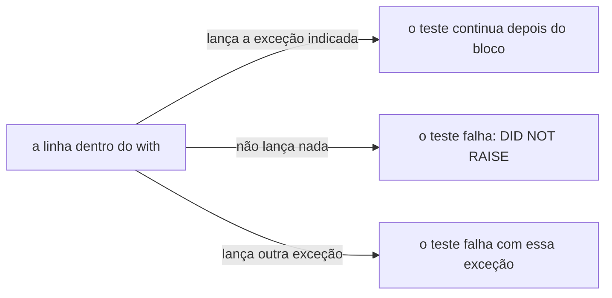
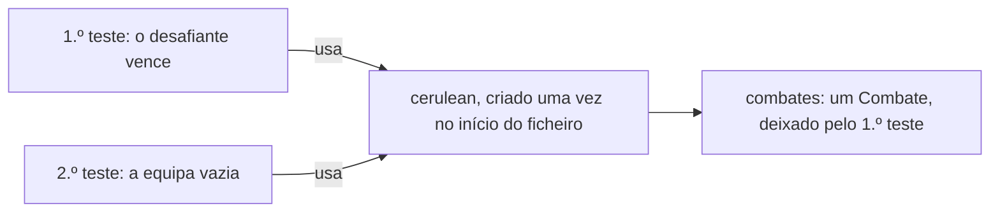
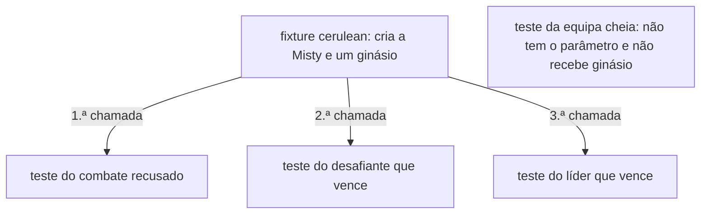
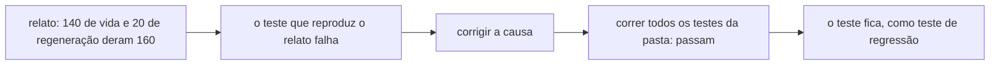

# Testes de comportamento com pytest

Neste guia, escreves testes: pequenas funções que correm o código do ginásio Pokémon e confirmam sozinhas que ele cumpre as regras do jogo. O pytest corre todos os testes com um só comando e, quando um falha, mostra-te os valores. Aprendes também a escolher os casos que apanham os erros, a testar as recusas do ginásio e a escrever o teste de um erro antes de o corrigires.

Usa, do guia 04, as exceções do ginásio, a recusa que vem antes da mudança e a rotina dos cinco passos, e, do guia 03, o `==` das dataclasses. Rever: [As exceções do ginásio](04-excecoes-depuracao-e-logging.md#as-exceções-do-ginásio), [A recusa vem antes da mudança](04-excecoes-depuracao-e-logging.md#a-recusa-vem-antes-da-mudança), [A rotina dos cinco passos](04-excecoes-depuracao-e-logging.md#a-rotina-dos-cinco-passos) e [Uma dataclass escreve o construtor por ti](03-objetos-e-composicao.md#uma-dataclass-escreve-o-construtor-por-ti). Para praticar: [laboratório](laboratorios/05-testes-com-pytest-laboratorio.md) e [ficha de exercícios](exercicios/05-testes-com-pytest-exercicios.md).

## Neste guia

1. [Parte 1: Escrever e correr testes](#parte-1-escrever-e-correr-testes)
2. [Parte 2: Escolher os casos](#parte-2-escolher-os-casos)
3. [Parte 3: Testar as recusas](#parte-3-testar-as-recusas)
4. [Parte 4: Organizar os testes e reproduzir erros](#parte-4-organizar-os-testes-e-reproduzir-erros)
5. [Exemplo guiado: os testes da escolha do líder](#exemplo-guiado-os-testes-da-escolha-do-líder)

## Parte 1: Escrever e correr testes

### O assert confirma uma condição

O último passo da rotina do guia 04 é voltar a testar tudo: correr outra vez todos os casos, também os que já passavam. Até aqui, isso queria dizer correr a demonstração do `ginasio.py` e ler cerca de trinta linhas, com as contas de cada ataque feitas de cabeça. Depois de umas quantas vezes, já não se lê com atenção, e um 50 no lugar de um 25 passa despercebido.

A comparação entre o que o programa dá e o que devia dar pode ser feita pelo próprio programa, com a instrução **`assert`**, do inglês "afirmar". Escreve-se `assert` seguido de uma condição, como as do `if`. Se a condição é verdadeira, o `assert` não faz nada, e o programa continua. Se é falsa, o `assert` lança uma exceção, o `AssertionError`, e o programa para.

Os programas deste guia importam os quatro ficheiros do ginásio da pasta [05-testes-com-pytest](../exemplos/python-avancado/pokemon/05-testes-com-pytest/) dos exemplos. São iguais aos da pasta 04, porque este tema não muda o ginásio: testa-o. Cria uma pasta nova, `testes-do-ginasio`, fora da pasta do repositório dos alunos, e copia para lá só esses quatro: o `pokemon.py`, o `erros.py`, o `anunciadores.py` e o `ginasio.py`. Os dois ficheiros de testes da pasta 05 ficam de fora. Abre a pasta no VS Code, com o menu File, Open Folder (em português, Ficheiro, Abrir Pasta), e o terminal do VS Code abre nela.

Neste programa, um Charmander, com 40 de ataque, calcula o dano contra um Bulbasaur. O fogo tem vantagem contra a planta, e por isso o dano é o dobro.

```python
# assert_dano.py: o assert confirma o dano de um ataque.
from pokemon import PokemonFogo, PokemonPlanta

charmander = PokemonFogo("Charmander", 90, 40)
bulbasaur = PokemonPlanta("Bulbasaur", 110, 25, 20)
dano = charmander.calcular_dano(bulbasaur)
assert dano == 80
print("O primeiro assert passou.")
assert dano == 40
print("O segundo assert passou.")
```

Que linhas escreve o programa?

```text
É super eficaz!
O primeiro assert passou.
Traceback (most recent call last):
  File "assert_dano.py", line 9, in <module>
    assert dano == 40
           ^^^^^^^^^^
AssertionError
```

A primeira linha vem do `calcular_dano`, que escreve "É super eficaz!" quando há vantagem. O dano é 80, e o primeiro `assert` deixa o programa seguir. O segundo afirma que o dano é 40, o que é falso, e o `AssertionError` para o programa antes do último `print`.

O traceback diz a linha do `assert` que falhou, mas não diz quanto valia o `dano`. Para o saberes, tinhas de acrescentar um `print`.

<details>
<summary>Para ires mais longe: uma mensagem no assert</summary>

O `assert` aceita uma mensagem, a seguir à condição e a uma vírgula: `assert dano == 40, "o dano devia ser 40"`. Quando a condição é falsa, a última linha do traceback passa a ser `AssertionError: o dano devia ser 40`. Com o pytest, que mostra os valores sozinho, a mensagem raramente faz falta.

Com a mensagem, há um engano frequente: pôr a condição e a mensagem entre parênteses, `assert (dano == 40, "o dano devia ser 40")`. Os parênteses com uma vírgula fazem um tuplo, um conjunto de valores, como o que um `return` com dois valores devolve. Um tuplo com valores conta como verdadeiro, e por isso este `assert` passa sempre, mesmo com o dano a 80. O Python avisa com `SyntaxWarning: assertion is always true, perhaps remove parentheses?`, "a afirmação é sempre verdadeira, talvez devas tirar os parênteses". O pytest mostra o mesmo aviso numa secção `warnings summary`. Escreve o `assert` sem parênteses.

</details>

### Um teste é uma função

Um programa cheio de `assert` para no primeiro que falha. Os que vêm a seguir já não correm, e não sabes se também falhavam. Cada confirmação precisa de ficar separada das outras, com um nome que diga o que confirma.

Um **teste** é uma função que corre uma parte do programa e confirma o resultado com `assert`. O nome da função começa por `test_` e diz, como uma frase, o que o teste confirma. Os testes ficam num ficheiro cujo nome também começa por `test_`, na mesma pasta que o código que testam.

Um teste não confirma o que aparece no ecrã: confirma o valor que um método devolve, o estado de um objeto ou a exceção lançada. Se o `calcular_dano` for reescrito de outra forma e der os mesmos números, o teste continua a passar. Por isso, estes testes chamam-se **testes de comportamento**: confirmam o que o código faz, e não como está escrito.

```python
# test_primeiro.py: o primeiro teste do ginásio.
from pokemon import PokemonFogo, PokemonPlanta


def test_fogo_contra_planta_tira_o_dobro():
    """O fogo tem vantagem contra a planta: o dano é o dobro do ataque."""
    charmander = PokemonFogo("Charmander", 90, 40)
    bulbasaur = PokemonPlanta("Bulbasaur", 110, 25, 20)
    dano = charmander.calcular_dano(bulbasaur)
    assert dano == 80
```

Se correres este ficheiro como um programa, com `python3 test_primeiro.py` ou com o triângulo do VS Code, o que aparece?

Não aparece nada, nem sequer o "É super eficaz!". O `def` só guarda a função com aquele nome, e ninguém a chama, por isso o corpo nunca corre.

Podias chamar a função numa linha no fim do ficheiro. Com vinte testes, eram vinte chamadas, e o primeiro `assert` falso voltava a parar tudo. Quem chama os testes, um a um, é outro programa: o pytest.

### Correr os testes com o pytest

O **pytest** é um programa que procura os testes, chama-os um a um e, no fim, diz quais passaram e quais falharam. Quando um teste falha, o pytest continua com os outros e mostra os valores que fizeram o teste falhar. O pytest não vem com o Python: instala-se uma vez em cada computador, como no passo [Preparar o projeto](laboratorios/05-testes-com-pytest-laboratorio.md#preparar-o-projeto) do laboratório.

Com o `test_primeiro.py` e o `assert_dano.py` na pasta, corre o pytest no terminal do VS Code. O `-m` pede ao Python que corra um módulo, aqui o pytest, com o mesmo Python dos teus programas. No Windows, se o `python3` não funcionar, escreve `py` no lugar dele.

```bash
python3 -m pytest
```

```text
============================= test session starts ==============================
platform darwin -- Python 3.14.8, pytest-9.1.1, pluggy-1.7.0
rootdir: /Users/.../testes-do-ginasio
collected 1 item

test_primeiro.py .                                                       [100%]

============================== 1 passed in 0.01s ===============================
```

A saída lê-se de cima para baixo. A linha `platform` diz o sistema e as versões, e a `rootdir` diz a pasta onde o pytest procurou: no teu computador, as duas são outras. Em `collected 1 item`, "collected" quer dizer recolhidos: o pytest recolheu um teste. Por baixo vem uma linha por ficheiro de testes, com um ponto por cada teste que passou, e o `[100%]` diz que parte dos testes já correu. A última linha resume: passou um teste, em 0,01 segundos, um tempo que muda de vez para vez. No terminal do VS Code, essa linha aparece a verde.

As saídas deste guia são as do Python 3.14, com o pytest 9.1.1. Com o Python 3.9 e o pytest 8, não aparecem as linhas com `^`, como a do traceback do `assert_dano.py`. A falha do `DID NOT RAISE`, na parte 3, também se mostra de forma um pouco diferente. Daqui em diante, as saídas começam na linha `collected`.

### O que o pytest procura e o que guarda

O pytest procura, na pasta onde o terminal está e nas pastas dentro dela, os ficheiros cujo nome começa por `test_`, e neles as funções cujo nome começa por `test_`. O `assert_dano.py` ficou de fora, porque o nome não começa por `test_`.

É por isso que a pasta `testes-do-ginasio` fica fora do repositório dos alunos e sem os ficheiros de testes da pasta 05. Um deles chama-se `test_ginasio.py`, como um dos ficheiros deste guia. Quando o pytest encontra dois ficheiros de testes com o mesmo nome, em pastas diferentes, para com `import file mismatch`.

Sem mais nada, `python3 -m pytest` corre todos os ficheiros de testes da pasta. Para correr só um, escreve o nome dele a seguir, como em `python3 -m pytest test_primeiro.py`. Cada exemplo deste guia tem o seu ficheiro e corre-se assim, com o nome.

O "É super eficaz!" do `calcular_dano` também não apareceu na saída. O pytest guarda o que os testes escrevem com `print` e só o mostra quando um teste falha, para o resultado não se perder no meio do texto do jogo.

### Um teste que falha

Quando um teste falha, interessam duas coisas: o que o pytest mostra, e quem está errado, o teste ou o código. Um dos dois testes deste ficheiro tem o valor esperado errado.

```python
# test_falha.py: dois testes, e um deles com o valor esperado errado.
from pokemon import PokemonAgua, PokemonFogo


def test_fogo_contra_agua_tira_so_o_ataque():
    """Sem vantagem, o dano é o próprio ataque."""
    charmander = PokemonFogo("Charmander", 90, 40)
    squirtle = PokemonAgua("Squirtle", 100, 30)
    dano = charmander.calcular_dano(squirtle)
    assert dano == 80


def test_agua_contra_fogo_tira_o_dobro():
    """A água tem vantagem contra o fogo: o dano é o dobro do ataque."""
    squirtle = PokemonAgua("Squirtle", 100, 30)
    charmander = PokemonFogo("Charmander", 90, 40)
    dano = squirtle.calcular_dano(charmander)
    assert dano == 60
```

Com `python3 -m pytest test_falha.py`, que teste falha, e que dois valores mostra o pytest?

```text
collected 2 items

test_falha.py F.                                                         [100%]

=================================== FAILURES ===================================
____________________ test_fogo_contra_agua_tira_so_o_ataque ____________________

    def test_fogo_contra_agua_tira_so_o_ataque():
        """Sem vantagem, o dano é o próprio ataque."""
        charmander = PokemonFogo("Charmander", 90, 40)
        squirtle = PokemonAgua("Squirtle", 100, 30)
        dano = charmander.calcular_dano(squirtle)
>       assert dano == 80
E       assert 40 == 80

test_falha.py:10: AssertionError
=========================== short test summary info ============================
FAILED test_falha.py::test_fogo_contra_agua_tira_so_o_ataque - assert 40 == 80
========================= 1 failed, 1 passed in 0.03s ==========================
```

A linha que mais interessa é a `E`, e cada parte da saída diz uma coisa:

| Parte da saída | O que diz |
| --- | --- |
| A linha `E`, de erro | A comparação, com os valores verdadeiros: `assert 40 == 80` |
| O sinal `>` | A linha do teste onde ele parou |
| `test_falha.py:10` | O ficheiro e o número dessa linha |
| `FAILURES`, que quer dizer falhas | O código de cada teste que falhou |
| `F.`, na linha do ficheiro | Um sinal por teste: `F` para o que falhou, um ponto para o que passou |
| A linha `FAILED` | Que teste falhou e porquê, em resumo |
| A última linha | Quantos testes falharam e quantos passaram, a vermelho no terminal |

Na linha `E`, o pytest trocou o nome `dano` pelo valor que ele tinha, sem precisares de um `print`. O valor da esquerda é o que o código deu, e o da direita é o que o teste esperava, porque o teste escreveu `dano == 80`, com o resultado à esquerda. O ponto de `F.` mostra que, depois da falha, o pytest continuou e correu o segundo teste.

Um teste que falha diz que o teste e o código não concordam, e não diz qual dos dois está errado. Quem decide são as regras do jogo. O fogo não tem vantagem contra a água, e por isso o dano é o próprio ataque, 40. O código está certo, e o teste é que está errado. Corrige a última linha do primeiro teste para `assert dano == 40`, e o pytest passa a dizer `2 passed`.

É a regra do primeiro passo da rotina: o resultado esperado tira-se do que o programa deve fazer, e não do código que se está a testar. Quem muda o valor esperado só para o teste passar, sem ir às regras, fica com um teste que não confirma nada.

### Preparar, fazer, confirmar

Os testes que viste até aqui têm a mesma forma, em três partes. Primeiro, criam os dois Pokémon de que precisam. Depois, fazem a ação que se testa, uma só: calcular o dano. No fim, confirmam o resultado com um `assert`. As três partes chamam-se **preparar, fazer e confirmar**. Em inglês, são Arrange, Act, Assert, e é com esses nomes que as encontras na internet.

A ação é uma só por uma razão. Se um teste fizesse duas e falhasse, não sabias qual delas tinha falhado. O nome do teste diz o comportamento confirmado. Quando o teste falha, é o nome que o pytest mostra primeiro, e ele deve bastar para saberes o que deixou de funcionar.

Este ficheiro tem quatro testes das vantagens de tipo. O primeiro leva um comentário em cada parte, e nos outros as partes estão separadas por uma linha em branco.

```python
# test_vantagens.py: as vantagens de tipo, com as três partes de cada teste.
from pokemon import PokemonAgua, PokemonFogo, PokemonPlanta


def test_fogo_contra_planta_tira_o_dobro():
    """O fogo tem vantagem contra a planta: o dano é o dobro do ataque."""
    # Preparar: o atacante e o alvo.
    charmander = PokemonFogo("Charmander", 90, 40)
    bulbasaur = PokemonPlanta("Bulbasaur", 110, 25, 20)
    # Fazer: só a ação que se está a testar.
    dano = charmander.calcular_dano(bulbasaur)
    # Confirmar: o valor que as regras do jogo pedem.
    assert dano == 80


def test_fogo_contra_agua_tira_so_o_ataque():
    """Sem vantagem, o dano é o próprio ataque."""
    charmander = PokemonFogo("Charmander", 90, 40)
    squirtle = PokemonAgua("Squirtle", 100, 30)

    dano = charmander.calcular_dano(squirtle)

    assert dano == 40


def test_agua_contra_fogo_tira_o_dobro():
    """A água tem vantagem contra o fogo: o dano é o dobro do ataque."""
    squirtle = PokemonAgua("Squirtle", 100, 30)
    charmander = PokemonFogo("Charmander", 90, 40)

    dano = squirtle.calcular_dano(charmander)

    assert dano == 60


def test_planta_contra_agua_tira_o_dobro():
    """A planta tem vantagem contra a água: o dano é o dobro do ataque."""
    bulbasaur = PokemonPlanta("Bulbasaur", 110, 25, 20)
    squirtle = PokemonAgua("Squirtle", 100, 30)

    dano = bulbasaur.calcular_dano(squirtle)

    assert dano == 50
```

Para veres o nome de cada teste, junta a opção `-v`, de "verbose", que quer dizer detalhado:

```bash
python3 -m pytest -v test_vantagens.py
```

```text
collecting ... collected 4 items

test_vantagens.py::test_fogo_contra_planta_tira_o_dobro PASSED           [ 25%]
test_vantagens.py::test_fogo_contra_agua_tira_so_o_ataque PASSED         [ 50%]
test_vantagens.py::test_agua_contra_fogo_tira_o_dobro PASSED             [ 75%]
test_vantagens.py::test_planta_contra_agua_tira_o_dobro PASSED           [100%]

============================== 4 passed in 0.01s ===============================
```

Os quatro passam: a água tira 60, o dobro de 30, e a planta tira 50, o dobro de 25. Com o `-v`, cada teste tem a sua linha, com o ficheiro, dois pontos duas vezes e o nome do teste, e `PASSED` quer dizer que passou. O pytest corre-os de cima para baixo, como estão no ficheiro.

## Parte 2: Escolher os casos

### Um teste tem de distinguir o certo do errado

No [exemplo guiado do guia 04](04-excecoes-depuracao-e-logging.md#exemplo-guiado-o-dano-a-dobrar), a linha `dano = dano * 2` da `PokemonPlanta` estava fora do `if`, e a planta tirava o dobro a qualquer alvo. Para saberes se os quatro testes do `test_vantagens.py` dão por esse erro, põe-no de volta. No `pokemon.py` da tua pasta, no `calcular_dano` da `PokemonPlanta`, tira quatro espaços à linha da multiplicação:

```python
    def calcular_dano(self, alvo):
        """Contra Água, a planta tira o dobro."""
        dano = super().calcular_dano(alvo)
        if alvo.tipo == "Água":
            print("É super eficaz!")
        dano = dano * 2
        return dano
```

Com o erro no `pokemon.py`, corre `python3 -m pytest test_vantagens.py`. Quais dos quatro testes falham?

```text
collected 4 items

test_vantagens.py ....                                                   [100%]

============================== 4 passed in 0.01s ===============================
```

Nenhum. O código tem um erro, e os quatro testes passam. O único em que a planta calcula o dano é o da água, e contra a água a planta tem vantagem: o código certo dá 50, e o errado também. Os outros três nem chamam o `calcular_dano` da planta.

Um teste só serve se der resultados diferentes com o código certo e com o código errado. Para este erro, é preciso a planta contra um alvo sem vantagem. Com o erro ainda no `pokemon.py`, acrescenta este teste ao fim do `test_vantagens.py` e corre outra vez os testes do ficheiro:

```python


def test_planta_contra_fogo_tira_so_o_ataque():
    """A planta não tem vantagem contra o fogo: o dano é o próprio ataque."""
    bulbasaur = PokemonPlanta("Bulbasaur", 110, 25, 20)
    charmander = PokemonFogo("Charmander", 90, 40)

    dano = bulbasaur.calcular_dano(charmander)

    assert dano == 25
```

```text
collected 5 items

test_vantagens.py ....F                                                  [100%]

=================================== FAILURES ===================================
___________________ test_planta_contra_fogo_tira_so_o_ataque ___________________

    def test_planta_contra_fogo_tira_so_o_ataque():
        """A planta não tem vantagem contra o fogo: o dano é o próprio ataque."""
        bulbasaur = PokemonPlanta("Bulbasaur", 110, 25, 20)
        charmander = PokemonFogo("Charmander", 90, 40)
    
        dano = bulbasaur.calcular_dano(charmander)
    
>       assert dano == 25
E       assert 50 == 25

test_vantagens.py:53: AssertionError
=========================== short test summary info ============================
FAILED test_vantagens.py::test_planta_contra_fogo_tira_so_o_ataque - assert 5...
========================= 1 failed, 4 passed in 0.03s ==========================
```

O teste novo apanhou o erro: a planta tirou 50 a um alvo de fogo, e as regras pedem 25. A linha `FAILED` acaba em reticências porque não coube na largura do terminal, e a comparação inteira está na linha `E`. Volta a indentar a multiplicação, para ficar dentro do `if`, e o pytest passa a dizer `5 passed`.

Os dois testes da planta, com as duas versões do código:

| Teste | Com o código certo | Com o código errado |
| --- | --- | --- |
| Planta contra água, espera 50 | 50: passa | 50: passa |
| Planta contra fogo, espera 25 | 25: passa | 50: falha |

Para escolheres os dados de um teste, pergunta: se o código tivesse este erro, o resultado era diferente? Se não era, o teste não distingue nada.

### Os casos de fronteira: o KO e os limites da vida

Os erros escondem-se onde as regras mudam. A vida de um Pokémon vai de 0 a 150. O set da propriedade `vida`, do [guia 03](03-objetos-e-composicao.md#propriedades-o-get-e-o-set-com-cara-de-atributo), corrige um valor acima de 150 para 150, e um abaixo de 0 para 0. Uma vida de 90 está longe dos limites. Uma vida de 150 é o último valor que fica como foi pedido, e 151 é o primeiro que é corrigido.

Um **caso de fronteira** é o valor em que a regra muda, ou o que vem logo a seguir. Para a vida máxima, as fronteiras são 150 e 151; para a mínima, 0 e -1. Um **caso normal** é um valor no meio da regra, como 90.

Os casos de fronteira apanham os erros que só se veem no próprio limite. Imagina que, no set da vida do `pokemon.py`, a comparação ficou com um número errado no lugar do `VIDA_MAXIMA`:

```python
    @vida.setter
    def vida(self, valor):
        """Set da vida: guarda o valor, sempre entre 0 e 150."""
        if valor < VIDA_MINIMA:
            valor = VIDA_MINIMA
        elif valor > 160:
            valor = VIDA_MAXIMA
        self._vida = valor
```

A linha de baixo continua a pôr o `VIDA_MAXIMA`, que é 150. A tabela mostra a vida com que fica um Pokémon com o set certo e com este:

| Vida pedida | Com o set certo | Com `valor > 160` |
| --- | --- | --- |
| 90 | 90 | 90 |
| 151 | 150 | 151 |
| 200 | 150 | 150 |

Só o 151 dá resultados diferentes. Um teste com 200 passava com as duas versões, e um com 90 também.

O KO também é uma fronteira. Um ataque que tira exatamente a vida que resta deixa o alvo com 0. Um ataque que tira mais do que isso também o tem de deixar com 0, e não com vida negativa.

```python
# test_fronteiras.py: os casos de fronteira do KO e dos limites da vida.
from pokemon import PokemonAgua, PokemonFogo


def test_ataque_que_tira_a_vida_toda_deixa_ko():
    """Um ataque que tira exatamente a vida que resta deixa o alvo com 0."""
    charmander = PokemonFogo("Charmander", 90, 40)
    squirtle = PokemonAgua("Squirtle", 40, 30)

    charmander.atacar(squirtle)

    assert squirtle.vida == 0


def test_ataque_maior_do_que_a_vida_nao_deixa_vida_negativa():
    """Um ataque maior do que a vida que resta deixa o alvo com 0, e não abaixo."""
    charmander = PokemonFogo("Charmander", 90, 40)
    squirtle = PokemonAgua("Squirtle", 25, 30)

    charmander.atacar(squirtle)

    assert squirtle.vida == 0


def test_vida_no_maximo_fica_como_esta():
    """150 é o último valor de vida que fica como foi pedido."""
    charmander = PokemonFogo("Charmander", 150, 40)

    assert charmander.vida == 150


def test_vida_acima_do_maximo_fica_no_maximo():
    """151 é o primeiro valor de vida acima do limite, e passa a 150."""
    charmander = PokemonFogo("Charmander", 151, 40)

    assert charmander.vida == 150


def test_vida_negativa_fica_a_zero():
    """-1 é o primeiro valor de vida abaixo do limite, e passa a 0."""
    charmander = PokemonFogo("Charmander", -1, 40)

    assert charmander.vida == 0
```

Com `python3 -m pytest test_fronteiras.py`, os cinco passam. No segundo, o Charmander tira 40 a um Squirtle com 25 de vida: a conta dá -15, e o set deixa a vida em 0. Nos três testes da vida, a ação é criar o Pokémon, porque é o construtor que passa a vida pelo set. A preparação e a ação são a mesma linha, e o teste só tem duas partes.

## Parte 3: Testar as recusas

### Testar uma recusa: pytest.raises

O `capturar` do `Treinador` aceita seis Pokémon e recusa o sétimo com a `EquipaCheia`. Um pedido que o código tem de recusar, como esta sétima captura, é um **caso de recusa**. Se um teste chamasse o `capturar` sete vezes, a exceção da sétima parava o teste, e o pytest dava-o como falhado. O teste tem de dizer o contrário: esta linha tem de lançar esta exceção.

É para isso que serve o **`pytest.raises`**, do inglês "raises", lança. Usa-se com um `with`, como o `with open(...)` do 10.º ano, e com a classe da exceção entre parênteses. Se a linha de dentro do bloco lançar essa exceção, o `pytest.raises` apanha-a, e o teste continua depois do bloco. Se não a lançar, o teste falha. Para o usares, o ficheiro de testes começa por `import pytest`. Até aqui não foi preciso, porque o `assert` é do Python; o `pytest.raises` é do pytest.

```python
# test_captura.py: a sétima captura tem de ser recusada.
import pytest

from erros import EquipaCheia
from ginasio import Treinador
from pokemon import Pokemon


def test_a_setima_captura_e_recusada():
    """A equipa aceita seis Pokémon e recusa o sétimo com EquipaCheia."""
    brock = Treinador("Brock")
    for numero in range(6):
        brock.capturar(Pokemon(f"Geodude {numero + 1}", "Pedra", 50, 20))

    with pytest.raises(EquipaCheia):
        brock.capturar(Pokemon("Onix", "Pedra", 50, 20))
```

Com `python3 -m pytest test_captura.py`, o teste passa. As seis capturas ficam fora do `with`, e por isso têm de correr sem exceção. A sétima é a única linha dentro do bloco, e é ela que tem de ser recusada. Assim, o teste confirma as duas fronteiras da equipa: a sexta captura entra, e a sétima não.

Agora troca o `range(6)` por `range(5)`. O Brock fica com cinco Pokémon antes do `with`, e a captura de dentro do bloco passa a ser a sexta. O que acontece ao teste?

```text
collected 1 item

test_captura.py F                                                        [100%]

=================================== FAILURES ===================================
_______________________ test_a_setima_captura_e_recusada _______________________

    def test_a_setima_captura_e_recusada():
        """A equipa aceita seis Pokémon e recusa o sétimo com EquipaCheia."""
        brock = Treinador("Brock")
        for numero in range(5):
            brock.capturar(Pokemon(f"Geodude {numero + 1}", "Pedra", 50, 20))
    
>       with pytest.raises(EquipaCheia):
             ^^^^^^^^^^^^^^^^^^^^^^^^^^
E       Failed: DID NOT RAISE EquipaCheia

test_captura.py:15: Failed
=========================== short test summary info ============================
FAILED test_captura.py::test_a_setima_captura_e_recusada - Failed: DID NOT RA...
============================== 1 failed in 0.02s ===============================
```

A equipa aceitou a sexta captura, não houve exceção, e o teste falhou com `DID NOT RAISE EquipaCheia`, que quer dizer "não lançou `EquipaCheia`". Volta a pôr o `range(6)`.

Como um `except`, o `pytest.raises` apanha a exceção indicada e as que descendem dela. Se a linha lançar outra, essa continua a subir, e o teste falha com ela, como falharia sem o bloco.



Há três saídas possíveis para a linha de dentro do `with`. Se lança a exceção indicada, o teste segue. Se não lança nada, ou lança outra, o teste falha.

Dentro do `with` fica só a linha que deve lançar a exceção, como no `try` do guia 04. Com mais linhas lá dentro, o teste passa assim que uma delas lança a exceção, mesmo que não seja a que querias testar. E as linhas que vêm depois da que a lançou nunca correm, porque a exceção salta logo para o fim do bloco.

### Depois da recusa, o estado

Uma recusa tem duas metades: o método lança a exceção, e o objeto fica como estava. O `pytest.raises` confirma a primeira. A segunda confirma-se com um `assert` depois do bloco, que só corre se a exceção foi lançada e apanhada.

Este ficheiro tem as duas recusas do ginásio. O primeiro teste é o da equipa cheia, agora com o `assert` do fim. O segundo é o combate sem Pokémon com vida: um treinador acabado de criar tem a equipa vazia, e o `escolher_pokemon` dele devolve `None`.

```python
# test_recusas.py: as duas recusas do ginásio, e o estado depois de cada uma.
import pytest

from erros import EquipaCheia, SemPokemonComVida
from ginasio import Ginasio, Lider, Treinador
from pokemon import Pokemon, PokemonAgua


def test_a_setima_captura_e_recusada_e_a_equipa_fica_com_seis():
    """A equipa aceita seis Pokémon, recusa o sétimo e fica como estava."""
    brock = Treinador("Brock")
    for numero in range(6):
        brock.capturar(Pokemon(f"Geodude {numero + 1}", "Pedra", 50, 20))

    with pytest.raises(EquipaCheia):
        brock.capturar(Pokemon("Onix", "Pedra", 50, 20))

    assert len(brock.equipa) == 6


def test_combate_sem_pokemon_com_vida_e_recusado():
    """Um desafiante com a equipa vazia não combate, e o ginásio fica como estava."""
    misty = Lider.com_equipa("Misty", [PokemonAgua("Starmie", 90, 35)])
    cerulean = Ginasio("Cerulean", misty)
    ash = Treinador("Ash")

    with pytest.raises(SemPokemonComVida):
        cerulean.combater(ash)

    assert cerulean.desafiantes == []
    assert cerulean.combates == []
```

Com `python3 -m pytest test_recusas.py`, os dois passam. No segundo, os dois `assert` do fim confirmam que o ginásio não guardou o desafiante nem o combate. O `combater` verifica primeiro se há Pokémon com vida, e só depois mexe nas listas. O aviso que o `combater` escreve no registo (o logging) também não aparece, porque o pytest guarda as mensagens do registo como guarda as do `print`.

Imagina um `capturar` que juntasse primeiro o Pokémon à equipa e só depois verificasse se ela passou de seis. A sétima captura lançava a exceção na mesma, e o `pytest.raises` ficava satisfeito. Mas a equipa ficava com sete, e o `assert` do fim falhava com `assert 7 == 6`. É esse `assert` que confirma que a recusa vem antes da mudança.

O teste não confirma o texto da mensagem da exceção. Confirma o que o objeto faz: lança a exceção certa e fica como estava. Se alguém mudar uma palavra da mensagem, o comportamento continua certo, e o teste continua a passar.

## Parte 4: Organizar os testes e reproduzir erros

### Cada teste começa do zero

O teste do combate recusado cria a sua Misty e o seu ginásio, e cada teste novo de um combate ia repetir essas linhas. É tentador criar o ginásio uma só vez, no início do ficheiro, para os testes o usarem todos. Este ficheiro faz isso, com dois testes: o primeiro faz um combate que o Ash ganha, e o segundo é o da equipa vazia.

```python
# test_partilhado.py: dois testes que usam o mesmo ginásio, criado fora deles.
import pytest

from erros import SemPokemonComVida
from ginasio import Combate, Ginasio, Lider, Treinador
from pokemon import PokemonAgua, PokemonPlanta

misty = Lider.com_equipa("Misty", [PokemonAgua("Starmie", 90, 35)])
cerulean = Ginasio("Cerulean", misty)


def test_o_desafiante_que_vence_fica_no_historico():
    """Quando o desafiante ganha, o combate fica no histórico com ele como vencedor."""
    ash = Treinador.com_equipa("Ash", [PokemonPlanta("Bulbasaur", 110, 25, 20)])

    cerulean.combater(ash)

    assert cerulean.combates == [Combate("Ash", "Bulbasaur", "Ash")]


def test_combate_sem_pokemon_com_vida_e_recusado():
    """Um desafiante com a equipa vazia não combate, e o ginásio fica como estava."""
    ash = Treinador("Ash")

    with pytest.raises(SemPokemonComVida):
        cerulean.combater(ash)

    assert cerulean.combates == []
```

O ginásio não tem erro nenhum. Com `python3 -m pytest test_partilhado.py`, os dois testes passam?

```text
collected 2 items

test_partilhado.py .F                                                    [100%]

=================================== FAILURES ===================================
_________________ test_combate_sem_pokemon_com_vida_e_recusado _________________

    def test_combate_sem_pokemon_com_vida_e_recusado():
        """Um desafiante com a equipa vazia não combate, e o ginásio fica como estava."""
        ash = Treinador("Ash")
    
        with pytest.raises(SemPokemonComVida):
            cerulean.combater(ash)
    
>       assert cerulean.combates == []
E       AssertionError: assert [Combate(desa...ncedor='Ash')] == []
E         
E         Left contains one more item: Combate(desafiante='Ash', pokemon_desafiante='Bulbasaur', vencedor='Ash')
E         Use -v to get more diff

test_partilhado.py:28: AssertionError
------------------------------ Captured log call -------------------------------
WARNING  ginasio:ginasio.py:143 Combate recusado em Cerulean: Ash contra Misty, sem Pokémon com vida.
=========================== short test summary info ============================
FAILED test_partilhado.py::test_combate_sem_pokemon_com_vida_e_recusado - Ass...
========================= 1 failed, 1 passed in 0.03s ==========================
```

O segundo falhou. Os dois testes usam o mesmo objeto `cerulean`, criado uma só vez, no início do ficheiro, e o histórico já tem o combate do primeiro. A secção `Captured log call` mostra o aviso que o ginásio escreveu no registo durante o teste, e o pytest só o mostra porque o teste falhou.



Os dois testes apontam para o mesmo objeto `cerulean`. Quando o segundo corre, a lista `combates` já tem o combate que o primeiro deixou.

O `AssertionError:` do início da linha `E` é o nome da exceção que o `assert` lançou. O pytest nem sempre o mostra, e a linha diz o mesmo com ele ou sem ele. O valor da esquerda vem encurtado, com reticências no meio, `[Combate(desa...ncedor='Ash')]`, para caber na linha. A linha `Left contains one more item` mostra-o inteiro: a lista da esquerda tem um elemento a mais, um `Combate`. Duas listas são iguais quando têm os mesmos elementos pela mesma ordem, e o `==` do `Combate` compara os três campos. O `Use -v to get more diff` sugere correr com `-v` para ver a diferença mais completa, mas aqui a linha de cima já diz o que interessa.

Para correres só o segundo teste, escreve o nome do ficheiro, dois pontos duas vezes e o nome do teste, como na linha `FAILED`:

```bash
python3 -m pytest test_partilhado.py::test_combate_sem_pokemon_com_vida_e_recusado
```

Sozinho, o mesmo teste passa, porque encontra o ginásio acabado de criar.

Um teste cujo resultado depende dos testes que correram antes passa sozinho e falha com os outros, e quem o lê não percebe porquê. A regra é cada teste começar do zero: prepara os seus próprios objetos e não depende da ordem por que os testes correm. Apaga o `test_partilhado.py`, ou muda-lhe o nome para um que não comece por `test_`, como `partilhado.py`, para o pytest não o correr com os outros testes da pasta.

### Uma fixture prepara o que vários testes repetem

Começar do zero tem um custo. Se quatro testes precisam de uma Misty e de um ginásio novos, são oito linhas iguais, e uma mudança na Starmie tem de se fazer em quatro sítios.

Uma **fixture** é uma função que prepara um objeto para os testes. Cria o objeto, devolve-o com `return` e leva por cima `@pytest.fixture`. Um teste que precisa desse objeto tem um parâmetro com o nome da fixture. Antes de correr o teste, o pytest chama a fixture e entrega-lhe, nesse parâmetro, o que ela devolveu. Em inglês, "fixture" é o que se prepara e se deixa fixo para um ensaio.

O pytest chama a fixture de novo para cada teste que a pede. Cada teste recebe um ginásio acabado de criar, e nenhum vê os combates dos outros. É a regra da secção anterior, sem repetir as linhas.

O `@pytest.fixture` é um decorador, como o `@property` do [guia 03](03-objetos-e-composicao.md#o-que-faz-a-arroba).

```python
# test_ginasio.py: os testes do ginásio, com uma fixture.
import pytest

from erros import EquipaCheia, SemPokemonComVida
from ginasio import Combate, Ginasio, Lider, Treinador
from pokemon import Pokemon, PokemonAgua, PokemonFogo, PokemonPlanta


@pytest.fixture
def cerulean():
    """Devolve um ginásio novo em Cerulean, com a Misty como líder e só a Starmie."""
    misty = Lider.com_equipa("Misty", [PokemonAgua("Starmie", 90, 35)])
    return Ginasio("Cerulean", misty)


def test_a_setima_captura_e_recusada_e_a_equipa_fica_com_seis():
    """A equipa aceita seis Pokémon, recusa o sétimo e fica como estava."""
    brock = Treinador("Brock")
    for numero in range(6):
        brock.capturar(Pokemon(f"Geodude {numero + 1}", "Pedra", 50, 20))

    with pytest.raises(EquipaCheia):
        brock.capturar(Pokemon("Onix", "Pedra", 50, 20))

    assert len(brock.equipa) == 6


def test_combate_sem_pokemon_com_vida_e_recusado(cerulean):
    """Um desafiante com a equipa vazia não combate, e o ginásio fica como estava."""
    ash = Treinador("Ash")

    with pytest.raises(SemPokemonComVida):
        cerulean.combater(ash)

    assert cerulean.desafiantes == []
    assert cerulean.combates == []


def test_o_desafiante_que_vence_fica_no_historico(cerulean):
    """Quando o desafiante ganha, o combate fica no histórico com ele como vencedor."""
    ash = Treinador.com_equipa("Ash", [PokemonPlanta("Bulbasaur", 110, 25, 20)])

    cerulean.combater(ash)

    assert cerulean.combates == [Combate("Ash", "Bulbasaur", "Ash")]


def test_o_lider_que_vence_fica_no_historico(cerulean):
    """Quando o líder ganha, o combate fica no histórico com o líder como vencedor."""
    ash = Treinador.com_equipa("Ash", [PokemonFogo("Charmander", 90, 40)])

    cerulean.combater(ash)

    assert cerulean.combates == [Combate("Ash", "Charmander", "Misty")]
```

Com `python3 -m pytest -v test_ginasio.py`, os quatro testes passam:

```text
collecting ... collected 4 items

test_ginasio.py::test_a_setima_captura_e_recusada_e_a_equipa_fica_com_seis PASSED [ 25%]
test_ginasio.py::test_combate_sem_pokemon_com_vida_e_recusado PASSED     [ 50%]
test_ginasio.py::test_o_desafiante_que_vence_fica_no_historico PASSED    [ 75%]
test_ginasio.py::test_o_lider_que_vence_fica_no_historico PASSED         [100%]

============================== 4 passed in 0.02s ===============================
```

O pytest chamou a função `cerulean` três vezes, uma por cada teste com o parâmetro `cerulean`, e cada um desses testes recebeu o seu ginásio. O teste da equipa cheia não pede a fixture, porque usa um Brock com seis Pokémon de pedra, que nenhum outro teste usa.



A docstring da fixture diz o que ela prepara. Quem lê um teste que a usa fica a saber que a Starmie tem 90 de vida e 35 de ataque. Com esses números, o Bulbasaur, que tem vantagem, deixa a Starmie KO ao segundo ataque, e a Starmie, com vantagem contra o Charmander, ganha o outro combate.

Uma fixture vale a pena quando vários testes preparam exatamente o mesmo, e a preparação tem mais do que uma linha ou pode vir a mudar. Para um só teste, ou para testes que precisam de dados diferentes, não vale: a fixture esconde a preparação, e quem lê o teste tem de a ir procurar.

### Um teste antes da correção

Imagina que um colega mudou o `recuperar` da `PokemonPlanta`. Na linha que soma a regeneração, `self.vida = self.vida + self.regeneracao`, trocou o `self.vida` da esquerda do `=` por `self._vida`, "para ser mais direto". Para seguires o exemplo, faz a mesma mudança no `pokemon.py` da tua pasta. A linha fica assim:

```python
        self._vida = self.vida + self.regeneracao
```

Dias depois, chega um relato: "Um Bulbasaur com 140 de vida recuperou e ficou com 160." O primeiro passo da rotina é observar e reproduzir o erro. Com testes, reproduzir o erro quer dizer escrever um teste que falha por causa dele, antes de mexer no código:

```python
# test_recuperar.py: o teste do relato, escrito antes da correção.
from pokemon import PokemonPlanta


def test_planta_recupera_ate_ao_maximo():
    """Uma planta com 140 de vida recupera só até 150."""
    bulbasaur = PokemonPlanta("Bulbasaur", 140, 25, 20)

    bulbasaur.recuperar()

    assert bulbasaur.vida == 150
```

Com o código do colega, corre `python3 -m pytest test_recuperar.py`. Repara na segunda linha `E`, que é nova:

```text
collected 1 item

test_recuperar.py F                                                      [100%]

=================================== FAILURES ===================================
______________________ test_planta_recupera_ate_ao_maximo ______________________

    def test_planta_recupera_ate_ao_maximo():
        """Uma planta com 140 de vida recupera só até 150."""
        bulbasaur = PokemonPlanta("Bulbasaur", 140, 25, 20)
    
        bulbasaur.recuperar()
    
>       assert bulbasaur.vida == 150
E       assert 160 == 150
E        +  where 160 = <pokemon.PokemonPlanta object at 0x107524ec0>.vida

test_recuperar.py:11: AssertionError
----------------------------- Captured stdout call -----------------------------
Bulbasaur recupera vida.
Bulbasaur tem 160/150 de vida.
=========================== short test summary info ============================
FAILED test_recuperar.py::test_planta_recupera_ate_ao_maximo - assert 160 == 150
============================== 1 failed in 0.02s ===============================
```

O teste falha pela razão certa: a vida ficou em 160, como no relato, e o erro está reproduzido. A segunda linha `E` diz `where 160 = <pokemon.PokemonPlanta object at 0x...>.vida`. Quer dizer "onde 160 é o `.vida` deste objeto": o pytest explica de onde veio o 160. O número depois de `at` é o sítio do objeto na memória e muda de vez para vez.

A secção `Captured stdout call` mostra o que o teste escreveu com `print` enquanto corria: as duas linhas do `recuperar`. O "stdout" é a saída normal de um programa, o ecrã, com o nome técnico em inglês.

A causa é o `self._vida`, que guarda o valor diretamente, sem passar pelo set que não deixa a vida passar de 150. Volta a pôr a linha como estava, `self.vida = self.vida + self.regeneracao`, e o teste passa. Depois, volta a testar tudo, o último passo da rotina: corre `python3 -m pytest`, sem o nome de um ficheiro, e o pytest corre todos os testes da pasta. Se fizeste os exemplos até aqui, o resumo diz `21 passed`.

O teste fica no ficheiro. Se alguém repetir a mudança do colega, daqui a um mês, o teste falha e diz o que se estragou. Uma **regressão** é um erro que volta, ou uma coisa que funcionava e deixou de funcionar depois de uma mudança. Um **teste de regressão** é o teste que fica a guardar o sítio onde um erro já apareceu. O teste da planta contra o fogo, no `test_vantagens.py`, é outro: guarda o dano a dobrar.



O relato passa a um teste que falha. Depois de corrigida a causa, o mesmo teste passa, com todos os outros da pasta, e fica no ficheiro.

O teste escreve-se antes da correção por duas razões. Ao vê-lo falhar, confirmas que ele reproduz o relato. Depois da correção, vê-lo passar prova que a correção resolveu esse erro. Um teste escrito só depois passa logo, e não sabes se teria apanhado o erro.

<details>
<summary>Para ires mais longe: os testes antes do código</summary>

Neste guia, os testes vieram sempre depois do código. Também se pode fazer ao contrário: escrever primeiro os testes de um método que ainda não existe, a partir do que ele deve fazer, e só depois o método. Os testes começam por falhar, e o método está pronto quando passam todos. A esta forma de trabalhar chama-se desenvolvimento guiado por testes.

</details>

## Exemplo guiado: os testes da escolha do líder

### O problema

> Escreve os testes do `escolher_pokemon` do `Lider` e confirma que eles apanham os erros mais prováveis neste método.

O método está no `ginasio.py`:

```python
class Lider(Treinador):
    """Um Lider É UM Treinador que escolhe sempre o Pokémon com mais vida."""

    def escolher_pokemon(self):
        """Devolve o Pokémon da equipa com mais vida, ou None se estão todos KO."""
        escolhido = None
        for pokemon in self.equipa:
            if pokemon.vida > 0:
                if escolhido is None or pokemon.vida > escolhido.vida:
                    escolhido = pokemon
        return escolhido
```

### O que o método promete

A docstring promete duas coisas: o líder escolhe o Pokémon com mais vida e, se estão todos KO, devolve `None`. Há um terceiro caso que a docstring não diz e que o ginásio usa: a equipa vazia. O `combater` conta com esse `None` para recusar o combate a um líder sem Pokémon. Os testes confirmam o que o método promete, e não o que o código faz linha a linha.

### Os casos que distinguem

Para cada promessa, um caso, com os dados escolhidos para dar resultados diferentes com o código certo e com um código errado:

| Caso | Equipa da Misty | Resultado esperado | Porque estes dados |
| --- | --- | --- | --- |
| Normal | Starmie com 90, Staryu com 120 | A Staryu | O mais forte não é o primeiro da lista |
| Fronteira | Psyduck com 0, Goldeen com 0 | `None` | Todos KO: é o limite em que deixa de haver escolha |
| Fronteira | Nenhum Pokémon | `None` | Zero Pokémon é o limite do tamanho da equipa |

No caso normal, a ordem conta. Com o mais forte em primeiro lugar, um método que escolhesse o primeiro Pokémon com vida, como o do `Treinador`, também passava.

### O primeiro teste, com o caso normal

Cada caso é um teste, com as três partes, num ficheiro novo, o `test_lider.py`. Aqui não há fixture, porque cada teste precisa de uma equipa diferente. Começa pelo caso normal:

```python
# test_lider.py: os testes da escolha do líder.
from ginasio import Lider
from pokemon import PokemonAgua


def test_o_lider_escolhe_o_pokemon_com_mais_vida():
    """O líder escolhe o Pokémon com mais vida, mesmo que não seja o primeiro."""
    misty = Lider.com_equipa("Misty", [PokemonAgua("Starmie", 90, 35), PokemonAgua("Staryu", 120, 20)])

    escolhido = misty.escolher_pokemon()

    assert escolhido.nome == "Staryu"
```

O teste compara o nome do escolhido, que é a forma mais simples de dizer que Pokémon se espera. Corre já este primeiro teste, com `python3 -m pytest test_lider.py`:

```text
collected 1 item

test_lider.py .                                                          [100%]

============================== 1 passed in 0.01s ===============================
```

### Os dois casos sem escolha

Os dois casos de fronteira acrescentam-se ao fim do `test_lider.py`. Usam `is None`, a pergunta do 10.º ano para o `None`, e o da equipa vazia cria a Misty só com o nome, sem Pokémon.

```python


def test_o_lider_com_todos_ko_nao_escolhe_nenhum():
    """Com todos os Pokémon KO, o líder não escolhe nenhum: devolve None."""
    misty = Lider.com_equipa("Misty", [PokemonAgua("Psyduck", 0, 35), PokemonAgua("Goldeen", 0, 20)])

    escolhido = misty.escolher_pokemon()

    assert escolhido is None


def test_o_lider_com_a_equipa_vazia_nao_escolhe_nenhum():
    """Com a equipa vazia, o líder também devolve None, sem dar erro."""
    misty = Lider("Misty")

    escolhido = misty.escolher_pokemon()

    assert escolhido is None
```

```text
collected 3 items

test_lider.py ...                                                        [100%]

============================== 3 passed in 0.01s ===============================
```

### Mudanças que partem o código

Falta saber se os testes falham com o código errado. Estas são três versões erradas do corpo do `escolher_pokemon`, que um colega podia escrever, cada uma com o seu erro. A primeira devolve o primeiro Pokémon com vida, como o `Treinador`:

```python
        escolhido = None
        for pokemon in self.equipa:
            if pokemon.vida > 0:
                return pokemon
        return escolhido
```

A segunda esquece-se de ver se o Pokémon tem vida:

```python
        escolhido = None
        for pokemon in self.equipa:
            if escolhido is None or pokemon.vida > escolhido.vida:
                escolhido = pokemon
        return escolhido
```

A terceira começa pelo primeiro Pokémon da equipa, em vez de começar por `None`, e só no fim vê se ele está KO:

```python
        escolhido = self.equipa[0]
        for pokemon in self.equipa:
            if pokemon.vida > escolhido.vida:
                escolhido = pokemon
        if escolhido.vida == 0:
            return None
        return escolhido
```

Para cada versão, qual dos três testes falha? Para confirmares, troca no teu `ginasio.py` o corpo do `escolher_pokemon` do `Lider` por cada versão, uma de cada vez, e corre `python3 -m pytest test_lider.py`. No fim, volta a pôr o código certo.

| Versão | O teste que falha | A linha `E` |
| --- | --- | --- |
| Primeira: o primeiro com vida | `test_o_lider_escolhe_o_pokemon_com_mais_vida` | `AssertionError: assert 'Starmie' == 'Staryu'` |
| Segunda: sem ver a vida | `test_o_lider_com_todos_ko_nao_escolhe_nenhum` | `assert <pokemon.PokemonAgua object at 0x...> is None` |
| Terceira: começa pelo primeiro | `test_o_lider_com_a_equipa_vazia_nao_escolhe_nenhum` | `IndexError: list index out of range` |

Na segunda versão, o Psyduck, com 0 de vida, é escolhido, e o `is None` falha. A terceira falha de uma forma nova: com a equipa vazia, o `self.equipa[0]` lança um `IndexError`, a exceção do Python para uma posição que não existe na lista. A saída dessa falha, a partir da linha `FAILURES`, é esta:

```text
=================================== FAILURES ===================================
______________ test_o_lider_com_a_equipa_vazia_nao_escolhe_nenhum ______________

    def test_o_lider_com_a_equipa_vazia_nao_escolhe_nenhum():
        """Com a equipa vazia, o líder também devolve None, sem dar erro."""
        misty = Lider("Misty")
    
>       escolhido = misty.escolher_pokemon()
                    ^^^^^^^^^^^^^^^^^^^^^^^^

test_lider.py:28: 
_ _ _ _ _ _ _ _ _ _ _ _ _ _ _ _ _ _ _ _ _ _ _ _ _ _ _ _ _ _ _ _ _ _ _ _ _ _ _ _ 

self = <ginasio.Lider object at 0x1087cb610>

    def escolher_pokemon(self):
        """Devolve o Pokémon da equipa com mais vida, ou None se estão todos KO."""
>       escolhido = self.equipa[0]
                    ^^^^^^^^^^^^^^
E       IndexError: list index out of range

ginasio.py:97: IndexError
=========================== short test summary info ============================
FAILED test_lider.py::test_o_lider_com_a_equipa_vazia_nao_escolhe_nenhum - In...
========================= 1 failed, 2 passed in 0.03s ==========================
```

A saída tem dois andares, como um traceback, separados pela linha de traços baixos, `_ _ _`. Lê-se de baixo para cima. O andar de baixo é o método, com o `>` na linha onde a exceção rebentou. A linha `E` tem a classe e a mensagem da exceção, e "list index out of range" quer dizer "índice da lista fora do intervalo". O andar de cima é o teste, com o `>` na linha que chamou o método. A causa está no método, e não no teste.

Três versões erradas, e cada uma é apanhada por um teste diferente. Sem qualquer um dos três testes, uma das versões passava sem ninguém dar por ela. Não é o número de testes que conta: é cada teste apanhar uma forma provável de errar.

Na pasta 05 dos exemplos, testes como os deste guia estão juntos em dois ficheiros, um por cada ficheiro do ginásio que testam: o [test_pokemon.py](../exemplos/python-avancado/pokemon/05-testes-com-pytest/test_pokemon.py) e o [test_ginasio.py](../exemplos/python-avancado/pokemon/05-testes-com-pytest/test_ginasio.py).

## Erros frequentes

### O pytest não encontra os testes

A saída diz `collected 0 items` e acaba em `no tests ran`, que quer dizer "nenhum teste correu". Há três causas. O nome do ficheiro não começa por `test_`, como em `testes_pokemon.py`. O nome da função não começa por `test_`. Ou o terminal está noutra pasta, sem ficheiros de testes. Confirma os nomes, e confirma a pasta com `pwd` (na linha de comandos clássica do Windows, `cd`).

### `ERROR: file or directory not found`

Com o nome de um ficheiro, como em `python3 -m pytest test_falha.py`, a saída acaba em `ERROR: file or directory not found: test_falha.py`. O pytest não encontra esse ficheiro na pasta onde o terminal está: ou o terminal está noutra pasta, ou o nome está mal escrito. Abre a pasta `testes-do-ginasio` no VS Code, com o menu File, Open Folder, e o terminal abre nela.

### O comando pytest não existe

Escrito sozinho, o comando `pytest` pode não existir, e o terminal responde com uma mensagem como `command not found: pytest`. O `pip` instala-o numa pasta onde o terminal não procura comandos, e é isso que diz o aviso do `pip` que acaba em `not on PATH`. Usa `python3 -m pytest`: assim, é o teu Python que procura o pytest.

### `No module named pytest`

O Python que estás a usar não tem o pytest. Instala-o como no passo [Preparar o projeto](laboratorios/05-testes-com-pytest-laboratorio.md#preparar-o-projeto) do laboratório, com `python3 -m pip install pytest`. Se já o instalaste e a mensagem continua, foi noutro Python: usa `python3 -m` nos dois comandos, para ser o mesmo.

### `ModuleNotFoundError: No module named 'pokemon'`

O ficheiro de testes não está na mesma pasta que o `pokemon.py`. Os ficheiros de testes ficam ao lado dos quatro ficheiros do ginásio.

### Dois testes com o mesmo nome

O pytest encontra menos testes do que os que escreveste. Quando duas funções do mesmo ficheiro têm o mesmo nome, a segunda substitui a primeira, e só essa corre. Acontece ao copiar um teste para escrever o seguinte e esquecer de mudar o nome. O `python3 -m pytest -v` mostra o nome de cada teste que correu.

### Um teste sem assert

Um teste que acaba em `dano == 40`, sem o `assert`, passa sempre. A comparação é feita, dá `True` ou `False`, e o resultado é deitado fora. O pytest só dá um teste como falhado quando há um `assert` falso ou uma exceção. Antes de dares um teste por bom, confirma que ele falha com o código errado, como fizeste com o dano a dobrar.

### Esquecer o import pytest

Sem a linha `import pytest` no início do ficheiro, o `pytest.raises` e o `@pytest.fixture` dão `NameError: name 'pytest' is not defined`: o nome `pytest` não existe nesse ficheiro. Com uma fixture, o erro aparece logo ao recolher os testes, e nenhum teste do ficheiro corre. Acrescenta o `import pytest` no início.

### Chamar a fixture como uma função

Um teste que escreve `ginasio = cerulean()`, em vez de receber `cerulean` como parâmetro, falha com `Fixture "cerulean" called directly. Fixtures are not meant to be called directly`. Quer dizer que as fixtures não se chamam diretamente: é o pytest que as chama, quando um teste as pede como parâmetro.

### O parâmetro com outro nome

Se o teste tiver o parâmetro `ginasio` e a fixture se chamar `cerulean`, o pytest não encontra a fixture. A saída diz `ERROR at setup of`, "erro na preparação de", e `fixture 'ginasio' not found`, "fixture não encontrada". Na lista `available fixtures`, logo a seguir, aparece o nome certo, `cerulean`. O nome do parâmetro tem de ser exatamente o nome da função da fixture.

Na linha de progresso, a do nome do ficheiro, este teste aparece com um `E`, e não com um `F`. O `F` quer dizer que o teste correu e falhou, e o `E` quer dizer que o pytest nem o conseguiu preparar. Não é a mesma coisa que as linhas que começam por `E` nos pormenores de uma falha, que mostram o erro.

## Palavras novas deste guia

- `assert`: a instrução que confirma uma condição; se ela for falsa, lança um `AssertionError`, e o programa para.
- Teste: uma função, com o nome a começar por `test_`, que corre uma parte do programa e confirma o resultado com `assert`.
- Teste de comportamento: um teste que confirma o que o código faz (valores, estado e exceções), e não como está escrito.
- pytest: o programa que procura os testes, os corre um a um e diz quais passaram e quais falharam, com os valores.
- Preparar, fazer e confirmar: as três partes de um teste, por esta ordem. Em inglês, Arrange, Act, Assert.
- Caso de fronteira: o valor em que a regra muda, ou o que vem logo a seguir, como 150 e 151 para a vida máxima.
- Caso normal: um valor no meio da regra, longe dos limites.
- Caso de recusa: um pedido que o código tem de recusar, como a sétima captura.
- `pytest.raises`: usado num `with`, confirma que a linha de dentro do bloco lança a exceção indicada.
- Fixture: uma função com `@pytest.fixture` que prepara um objeto, e que o pytest chama para cada teste que tem o nome dela como parâmetro.
- Regressão: um erro que volta, ou uma coisa que funcionava e deixou de funcionar depois de uma mudança.
- Teste de regressão: o teste que fica a guardar o sítio onde um erro já apareceu.

## O que vem a seguir

No tema seguinte, o Python idiomático, reescreves partes do ginásio de forma mais curta e mais clara, e estes testes confirmam que o comportamento fica igual.

## Para saber mais

- [Get Started](https://docs.pytest.org/en/stable/getting-started.html): o primeiro teste, o `pytest.raises` e as fixtures, na documentação oficial do pytest, em inglês.
- [How to write and report assertions in tests](https://docs.pytest.org/en/stable/how-to/assert.html): o `assert` no pytest e o que ele mostra quando falha, em inglês.
- [How to use fixtures](https://docs.pytest.org/en/stable/how-to/fixtures.html): as fixtures, com formas que este guia não usa, em inglês.


