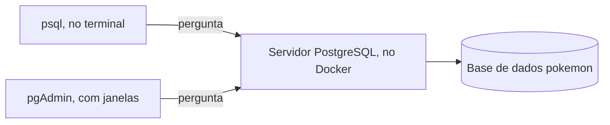
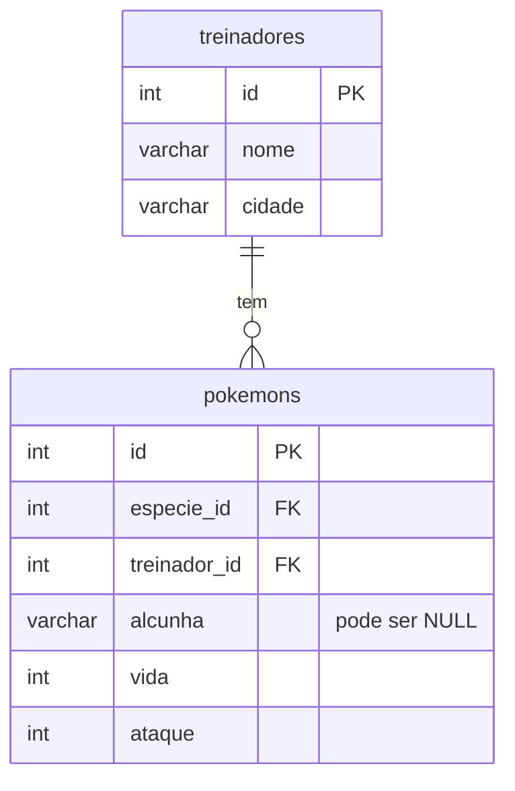
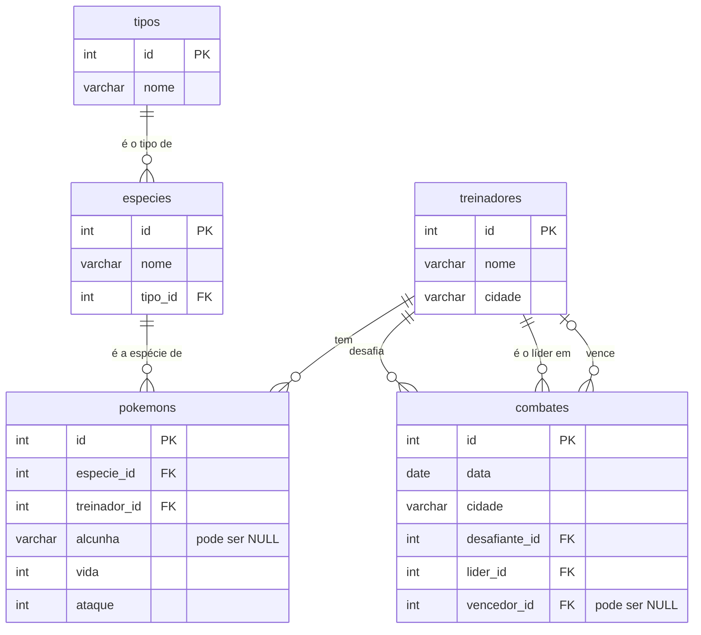

# Modelo relacional e ambiente PostgreSQL

Neste guia, os dados do ginásio Pokémon saem das listas do Python e passam para uma base de dados, em tabelas ligadas por chaves. Ligas-te ao PostgreSQL, fazes as primeiras perguntas em SQL e aprendes a desenhar as tabelas de um problema.

Usa, do guia 03 de Python avançado, o Pokémon guardado num dicionário e a equipa do treinador, e, do Python do 10.º ano, o valor `None`. Rever: [Num dicionário, os dados e as regras ficam separados](../01-python-avancado/03-objetos-e-composicao.md#num-dicionário-os-dados-e-as-regras-ficam-separados) e [Um objeto que guarda outros objetos](../01-python-avancado/03-objetos-e-composicao.md#um-objeto-que-guarda-outros-objetos). Para praticar: [laboratório](laboratorios/01-modelo-relacional-e-postgresql-laboratorio.md) e [ficha de exercícios](exercicios/01-modelo-relacional-e-postgresql-exercicios.md).

## Neste guia

1. [Parte 1: Bases de dados e ambientes](#parte-1-bases-de-dados-e-ambientes)
2. [Parte 2: Tabelas e consultas](#parte-2-tabelas-e-consultas)
3. [Parte 3: O NULL, as chaves e o modelo](#parte-3-o-null-as-chaves-e-o-modelo)
4. [Exemplo guiado: o modelo do ginásio](#exemplo-guiado-o-modelo-do-ginásio)

## Parte 1: Bases de dados e ambientes

### Os dados de um programa acabam com ele

No ginásio do tema 03, os treinadores, os Pokémon e os combates vivem em listas e em objetos do Python. Quando o `ginasio.py` acaba, tudo isso desaparece, e na vez seguinte os combates começam do zero. No 10.º ano, a solução era escrever os dados num ficheiro de texto ou de JSON e lê-los no início do programa seguinte.

Um ficheiro guarda os dados, mas deixa o resto contigo. Para saber que combates venceu o Ash, o programa tem de ler o ficheiro inteiro e percorrer os combates com um ciclo. Se dois programas escreverem no mesmo ficheiro ao mesmo tempo, um pode apagar o que o outro escreveu. E nada impede que um combate fique com um vencedor que não existe.

Uma **base de dados** é um conjunto de dados organizado, guardado fora dos programas, a que se fazem perguntas. Os dados continuam lá quando os programas acabam, e vários programas podem usá-los ao mesmo tempo. A própria base recusa os dados que não cumprem as suas regras, como um combate com um vencedor que não existe.

Neste tema, a base de dados chama-se `pokemon` e guarda o ginásio: os treinadores, os Pokémon que capturaram, as espécies, os tipos e os combates.

### O SGBD guarda as bases de dados

Uma base de dados não se abre num editor, como um ficheiro de JSON. Quem a guarda e responde às perguntas é um programa próprio, o **SGBD**, sistema de gestão de bases de dados. O SGBD deste tema é o PostgreSQL, que é gratuito e usado em aplicações a sério.

O PostgreSQL funciona como um **servidor**: um programa que fica ligado, à espera de pedidos, e responde a cada um. Um servidor pode guardar várias bases de dados, cada uma com o seu nome, e o das aulas guarda a base `pokemon`.

Nas aulas, o servidor corre dentro do Docker, um programa que põe o PostgreSQL a funcionar no teu computador sem o instalares. O ficheiro `compose.yaml` dos exemplos diz ao Docker que servidor arrancar e que base de dados criar, como no passo [Preparar o projeto](laboratorios/01-modelo-relacional-e-postgresql-laboratorio.md#preparar-o-projeto) do laboratório.

### O cliente faz as perguntas

O servidor não tem janelas: só responde a pedidos. Para lhe fazeres uma pergunta, usas um **cliente**, um programa que se liga ao servidor, envia a pergunta e mostra a resposta. Neste tema, usas dois clientes: o `psql`, no terminal, e o pgAdmin, com janelas e menus. Os dois falam com o mesmo servidor e veem a mesma base de dados.



O diagrama mostra os dois clientes, à esquerda, a enviar perguntas ao mesmo servidor, que guarda a base de dados `pokemon`. A resposta faz o caminho contrário, do servidor para o cliente que perguntou.

Entras no `psql` com um comando do Docker: o `docker compose exec db` corre o `psql` no Docker, junto do servidor, a que o `compose.yaml` chama `db`. O `-U postgres` diz o utilizador com que te ligas, e o `-d pokemon` diz a base de dados:

```bash
docker compose exec db psql -U postgres -d pokemon
```

```text
psql (17.12 (Debian 17.12-1.pgdg12+1))
Type "help" for help.

pokemon=#
```

A primeira linha diz a versão do `psql`, que no teu computador pode ser outra. O `pokemon=#` diz a base de dados em que estás e mostra que o `psql` está à espera de um comando.

O `psql` tem comandos próprios, que começam por uma barra invertida, `\`, e acabam quando carregas em Enter. São os **comandos do psql**: mostram como a base está arrumada e mudam a forma como o `psql` mostra as respostas. O `\dt` lista as tabelas da base, e o `\q` sai do `psql`.

```text
pokemon=# \dt
            List of relations
 Schema |    Name     | Type  |  Owner
--------+-------------+-------+----------
 public | combates    | table | postgres
 public | especies    | table | postgres
 public | pokemons    | table | postgres
 public | tipos       | table | postgres
 public | treinadores | table | postgres
(5 rows)
```

A resposta está em inglês. "List of relations" é a lista das tabelas, e a coluna `Name` tem o nome de cada uma: a base `pokemon` tem cinco. As colunas `Schema` e `Owner` dizem onde a tabela está arrumada e quem a criou, e neste tema são sempre `public` e `postgres`. O `(5 rows)`, "5 linhas", diz quantas linhas tem a resposta.

## Parte 2: Tabelas e consultas

### Uma tabela tem linhas e colunas

No guia 03, um Pokémon cabia num dicionário, com uma chave para cada dado. Numa lista de dicionários com as mesmas chaves, cabem todos os treinadores do ginásio:

```python
# Os treinadores do ginásio, numa lista de dicionários com as mesmas chaves.
treinadores = [
    {"id": 1, "nome": "Ash", "cidade": "Pallet"},
    {"id": 2, "nome": "Misty", "cidade": "Cerulean"},
    {"id": 3, "nome": "Brock", "cidade": "Pewter"},
    {"id": 4, "nome": "Gary", "cidade": "Pallet"},
]
```

Numa base de dados, os mesmos treinadores ficam numa **tabela**, a tabela `treinadores`:

| id | nome | cidade |
| ---: | --- | --- |
| 1 | Ash | Pallet |
| 2 | Misty | Cerulean |
| 3 | Brock | Pewter |
| 4 | Gary | Pallet |

Cada linha da tabela é um treinador, como cada dicionário da lista. Cada coluna é um dado que todos os treinadores têm, como cada chave dos dicionários: o `id`, o `nome` e a `cidade`. Há uma diferença: a tabela obriga todas as linhas a terem as mesmas colunas. Na lista, um dicionário podia ter uma chave a mais ou a menos, e nada o impedia.

Cada tabela guarda uma só coisa do problema: a `treinadores` guarda treinadores, a `pokemons` guarda Pokémon capturados e a `combates` guarda combates. Nestes materiais, o nome de uma tabela é o plural do que cada linha guarda.

### O SQL pergunta, e o SGBD responde

Os comandos do psql mostram que tabelas há, mas não mostram os dados que lá estão. Para os ver, fazes uma pergunta ao servidor numa linguagem que os SGBD entendem, o **SQL**. Uma pergunta em SQL chama-se **consulta**.

A primeira consulta mostra tudo o que está na tabela `treinadores`:

```sql
SELECT * FROM treinadores;
```

```text
 id | nome  |  cidade
----+-------+----------
  1 | Ash   | Pallet
  2 | Misty | Cerulean
  3 | Brock | Pewter
  4 | Gary  | Pallet
(4 rows)
```

Lê-se quase como uma frase em inglês: "seleciona tudo da tabela treinadores". O `SELECT` diz que queres ver dados, o `*` quer dizer todas as colunas, e o `FROM` diz de que tabela. O ponto e vírgula diz ao `psql` que a consulta acabou: só então ele a envia ao servidor, e por isso uma consulta pode ocupar várias linhas. O servidor responde com a tabela, e o `psql` mostra-a com uma linha de traços por baixo dos nomes das colunas.

As palavras do SQL, como `SELECT` e `FROM`, podem escrever-se em maiúsculas ou em minúsculas. Nestes materiais escrevem-se em maiúsculas, para se distinguirem dos nomes das tabelas e das colunas, que estão sempre em minúsculas.

Num ficheiro `.sql`, onde se guardam consultas, um comentário começa por dois hífenes, `--`, e vai até ao fim da linha, como o `#` do Python. O SGBD ignora-o:

```sql
-- Os treinadores, com todas as colunas.
SELECT * FROM treinadores;
```

### Escolher as colunas

Muitas vezes, não precisas de todas as colunas. Para uma lista com o nome e a cidade de cada treinador, o `id` está a mais. No lugar do `*`, escreves os nomes das colunas que queres ver, separados por vírgulas, pela ordem em que os queres ver:

```sql
SELECT nome, cidade FROM treinadores;
```

Antes de leres a resposta, quantas linhas e quantas colunas esperas?

```text
 nome  |  cidade
-------+----------
 Ash   | Pallet
 Misty | Cerulean
 Brock | Pewter
 Gary  | Pallet
(4 rows)
```

São quatro linhas e duas colunas. A consulta escolhe as colunas, e não as linhas: aparecem sempre os quatro treinadores.

Há um engano que não dá erro: esquecer a vírgula entre as colunas.

```sql
SELECT nome cidade FROM treinadores;
```

```text
 cidade
--------
 Ash
 Misty
 Brock
 Gary
(4 rows)
```

Sem a vírgula, o PostgreSQL lê `cidade` como um nome novo para a coluna `nome`, que é uma coisa que o SQL permite. Por isso, aparecem os nomes dos treinadores numa coluna chamada `cidade`. Quando uma resposta tem menos colunas do que esperavas, ou nomes de colunas que não batem com o conteúdo, procura uma vírgula em falta.

### Cada coluna tem um tipo de dados

Numa lista do Python, a vida de um Pokémon pode ser `90` num dicionário e `"noventa"` noutro, e só dás pelo erro quando fazes uma conta. Numa tabela, cada coluna tem um **tipo de dados**, que diz que valores aceita, e o SGBD recusa um valor que não seja desse tipo. A base `pokemon` usa três tipos de dados:

| Tipo de dados | O que guarda | Exemplo | No Python |
| --- | --- | --- | --- |
| `INTEGER` | Números inteiros | `90` | `int` |
| `VARCHAR(30)` | Texto, com 30 caracteres no máximo | `'Misty'` | `str`, sem limite |
| `DATE` | Uma data, no formato ano-mês-dia | `'2026-11-03'` | sem tipo básico |

Em SQL, um texto e uma data escrevem-se entre plicas, `'Misty'`, e não entre aspas. O número entre parênteses do `VARCHAR` é o limite: um nome com 31 letras não cabe numa coluna `VARCHAR(30)`, e o SGBD recusa-o.

O comando `\d`, seguido do nome de uma tabela, mostra as colunas dela e o tipo de dados de cada uma. O início da resposta é este:

```text
pokemon=# \d treinadores
                   Table "public.treinadores"
 Column |         Type          | Collation | Nullable | Default
--------+-----------------------+-----------+----------+---------
 id     | integer               |           | not null |
 nome   | character varying(30) |           | not null |
 cidade | character varying(30) |           | not null |
```

A coluna `Column` tem o nome de cada coluna da tabela, e a `Type` tem o tipo de dados. O PostgreSQL escreve os tipos de dados em minúsculas e com o nome completo: `character varying(30)` é o `VARCHAR(30)`. As colunas `Collation` e `Default` ficam vazias em toda esta base. A `Nullable` diz se a coluna pode ficar sem valor. Por baixo das colunas, o `\d` mostra outras regras da tabela.

### A mesma consulta no pgAdmin

O `psql` mostra as respostas como texto, no terminal. O pgAdmin é outro cliente, com janelas, que mostra a mesma resposta numa grelha, como uma folha de cálculo. A consulta é a mesma: escreves `SELECT * FROM treinadores;` na janela de consultas do pgAdmin, a Query Tool, e carregas em F5. As linhas aparecem por baixo, no separador Data Output.

A grelha do pgAdmin mostra mais do que o `psql`: por baixo do nome de cada coluna, aparece o tipo de dados dela, como `integer` ou `character varying (30)`.

Os comandos do psql não funcionam no pgAdmin, porque são do `psql` e não são SQL. Se escreveres `\dt` na Query Tool, o servidor responde com um erro. No pgAdmin, as tabelas veem-se na árvore do lado esquerdo, dentro da base `pokemon`.

## Parte 3: O NULL, as chaves e o modelo

### O NULL quer dizer que não há valor

O combate 3, no ginásio de Pewter, ainda não acabou: não tem vencedor. A coluna `vencedor_id` guarda o número do treinador que venceu, mas aqui não há nenhum para guardar. O `0` não serve, porque não há nenhum treinador com o número 0, e a base recusava-o.

O SQL tem uma marca para isto: o **NULL**, que quer dizer que não há valor. É como o `None` do Python. Na tabela `combates`, o `psql` mostra o NULL como uma célula vazia:

```sql
SELECT * FROM combates;
```

```text
 id |    data    |  cidade  | desafiante_id | lider_id | vencedor_id
----+------------+----------+---------------+----------+-------------
  1 | 2026-11-03 | Cerulean |             1 |        2 |           2
  2 | 2026-11-03 | Cerulean |             1 |        2 |           1
  3 | 2026-11-10 | Pewter   |             1 |        3 |
(3 rows)
```

Uma célula vazia pode enganar, porque um texto vazio também aparece assim. O comando `\pset null` diz ao `psql` que texto mostrar no lugar do NULL. Depois de `\pset null '(nulo)'`, o NULL passa a aparecer escrito:

```text
pokemon=# \pset null '(nulo)'
Null display is "(nulo)".
pokemon=# SELECT alcunha, vida FROM pokemons;
 alcunha | vida
---------+------
 (nulo)  |   90
 (nulo)  |  110
 Pika    |   80
 (nulo)  |    0
         |  100
 (nulo)  |  140
(6 rows)
```

Esta resposta mostra os três casos que se confundem. O NULL, na alcunha da primeira linha, quer dizer que o Pokémon não tem alcunha. A vida `0`, na quarta linha, é um valor: o Starmie da Misty está KO. A alcunha vazia, na quinta linha, também é um valor: um texto sem letras, `''`, que alguém escreveu e apagou numa aplicação.

| Na célula | Quer dizer | No Python |
| --- | --- | --- |
| `NULL` | Não há valor | `None` |
| `0` | O número zero | `0` |
| `''` | Um texto sem nenhum caractere | `""` |

O `\pset null` só muda o que o `psql` mostra, e dura até saíres dele. O pgAdmin mostra sempre o NULL como `[null]`.

Uma coluna pode aceitar o NULL ou recusá-lo. No `\d` de uma tabela, a coluna `Nullable` diz `not null` nas colunas que o recusam: nelas, uma linha nova tem sempre de trazer um valor. Na tabela `combates`, só a `vencedor_id` aceita o NULL, e na `pokemons`, só a `alcunha`.

### A chave primária identifica cada linha

Imagina que a Misty muda de nome, ou que chega ao ginásio um segundo treinador chamado Ash. Se os Pokémon e os combates apontassem para o treinador pelo nome, ficavam a apontar para o treinador errado, ou para dois de uma vez. Para apontar para uma linha, e só para essa, é preciso uma coluna cujo valor nunca se repete e nunca muda.

Essa coluna é a **chave primária**. Em inglês diz-se primary key, e por isso aparece muitas vezes como PK. Na base `pokemon`, todas as tabelas têm a chave primária `id`, um número que não quer dizer mais nada: só identifica a linha. O SGBD recusa duas linhas com o mesmo `id` e recusa uma linha sem `id`.

No `\d treinadores`, por baixo das colunas, as linhas de `Indexes` dizem que a chave primária da tabela é a coluna `id`:

```text
Indexes:
    "treinadores_pkey" PRIMARY KEY, btree (id)
```

O `treinadores_pkey` é o nome que o PostgreSQL dá a esta regra. No pgAdmin, a mesma chave aparece como a marca `[PK]`, por cima da coluna `id`.

### A chave estrangeira aponta para outra tabela

Cada Pokémon capturado pertence a um treinador. Uma forma de o guardar era escrever o nome do treinador em cada linha da tabela `pokemons`. O nome da Misty ficava escrito em todos os Pokémon dela, e se mudasse, tinhas de o mudar em todas essas linhas. Um engano, como `Mistty`, criava um treinador que não existe.

A forma da base de dados é outra: a tabela `pokemons` tem a coluna `treinador_id`, que guarda o `id` do treinador. Uma **chave estrangeira** é uma coluna cujos valores têm de existir na chave primária de outra tabela. Em inglês diz-se foreign key, FK. O SGBD recusa um Pokémon com o `treinador_id` 9, porque não há nenhum treinador com o `id` 9.

```text
pokemon=# SELECT * FROM pokemons;
 id | especie_id | treinador_id | alcunha | vida | ataque
----+------------+--------------+---------+------+--------
  1 |          1 |            1 | (nulo)  |   90 |     40
  2 |          3 |            1 | (nulo)  |  110 |     25
  3 |          4 |            1 | Pika    |   80 |     45
  4 |          5 |            2 | (nulo)  |    0 |     35
  5 |          6 |            2 |         |  100 |     20
  6 |          7 |            3 | (nulo)  |  140 |     30
(6 rows)
```

Para saber quem é o Pokémon 3, segue-se cada chave estrangeira até à linha da tabela para onde aponta:

| Em `pokemons`, linha 3 | Aponta para | Que é |
| --- | --- | --- |
| `especie_id` = 4 | `especies`, linha com `id` 4 | Pikachu |
| `treinador_id` = 1 | `treinadores`, linha com `id` 1 | Ash |

O Pokémon 3 é o Pikachu do Ash.

O `\d pokemons` mostra as duas chaves estrangeiras, nas linhas de `Foreign-key constraints`:

```text
Foreign-key constraints:
    "pokemons_especie_id_fkey" FOREIGN KEY (especie_id) REFERENCES especies(id)
    "pokemons_treinador_id_fkey" FOREIGN KEY (treinador_id) REFERENCES treinadores(id)
```

`FOREIGN KEY (treinador_id) REFERENCES treinadores(id)` lê-se "a coluna `treinador_id` aponta para a coluna `id` da tabela `treinadores`". No sentido contrário, o `\d treinadores` lista, em `Referenced by`, as tabelas que apontam para ela:

```text
Referenced by:
    TABLE "combates" CONSTRAINT "combates_desafiante_id_fkey" FOREIGN KEY (desafiante_id) REFERENCES treinadores(id)
    TABLE "combates" CONSTRAINT "combates_lider_id_fkey" FOREIGN KEY (lider_id) REFERENCES treinadores(id)
    TABLE "combates" CONSTRAINT "combates_vencedor_id_fkey" FOREIGN KEY (vencedor_id) REFERENCES treinadores(id)
    TABLE "pokemons" CONSTRAINT "pokemons_treinador_id_fkey" FOREIGN KEY (treinador_id) REFERENCES treinadores(id)
```

Apontam para os treinadores a `pokemons` e, três vezes, a `combates`.

### O modelo desenha-se antes das tabelas

Antes de uma base de dados ter tabelas, alguém decidiu que tabelas haveria, que colunas teria cada uma e que chaves as ligavam. Mudar esse desenho é fácil enquanto ele está num papel; numa base que já tem dados, obriga a mexer em todos eles. Por isso, o desenho faz-se primeiro.

Esse desenho chama-se **modelo relacional**: a lista das tabelas, cada uma com as suas colunas, a chave primária e as chaves estrangeiras. Escreve-se numa linha por tabela, com `PK` a seguir à chave primária e `FK` e uma seta a seguir a cada chave estrangeira. As colunas que podem ficar sem valor levam `NULL` a seguir:

```text
treinadores (id PK, nome, cidade)
pokemons (id PK, especie_id FK -> especies, treinador_id FK -> treinadores, alcunha NULL, vida, ataque)
```

Para saber em que tabela fica uma chave estrangeira, faz-se uma pergunta em dois sentidos. Um treinador tem quantos Pokémon? Muitos, ou nenhum. Um Pokémon tem quantos treinadores? Um só. É uma **relação de um para muitos**, e a chave estrangeira fica sempre do lado dos muitos: na tabela `pokemons`, e não na `treinadores`.

A chave estrangeira não pode ficar do lado do um, porque uma célula de uma tabela guarda um só valor. O Ash tem três Pokémon, e a tabela `treinadores` precisava de uma lista numa célula, como a lista `equipa` do `Treinador` do guia 03. As tabelas não guardam listas: guardam uma linha por Pokémon, e cada linha aponta para o seu treinador.

O mesmo modelo desenha-se num diagrama:



Cada caixa é uma tabela, com uma coluna por linha, as marcas `PK` e `FK` e a nota das colunas que aceitam o NULL. A linha entre as caixas é a ligação. O lado com três pontas, como um pé de galinha, é o lado dos muitos, e o círculo diz que pode não haver nenhum. Os dois riscos, do lado dos treinadores, querem dizer exatamente um. Lê-se: cada treinador tem zero ou mais Pokémon, e cada Pokémon tem exatamente um treinador.

## Exemplo guiado: o modelo do ginásio

Este exemplo desenha, do princípio ao fim, o modelo da base `pokemon` que usas no laboratório.

### O problema

Queremos guardar o ginásio Pokémon numa base de dados. Guardamos os treinadores, com a cidade de cada um, e os Pokémon que cada treinador capturou, com a espécie, a alcunha, se a tiver, a vida e o ataque. Cada espécie tem um tipo, como o Fogo ou a Água. Guardamos também os combates nos ginásios, com a data, a cidade, quem desafiou, o líder do ginásio e quem venceu. Um combate pode ainda não ter acabado.

### As tabelas

Cada coisa do problema que tem dados próprios é uma tabela. Lendo o enunciado, aparecem cinco: os treinadores, os Pokémon capturados, as espécies, os tipos e os combates.

As espécies e os Pokémon capturados parecem a mesma coisa, mas não são. O Pikachu do Ash e o Pikachu de outro treinador são dois Pokémon diferentes, cada um com a sua vida e a sua alcunha. Os dois são da espécie Pikachu. O tipo é da espécie: todos os Pikachu são Elétricos. Se o tipo ficasse em cada Pokémon capturado, repetia-se em todos os da mesma espécie e podia ficar diferente entre eles.

Os tipos ficam numa tabela à parte porque se repetem: há três espécies de Água. Com a tabela `tipos`, o nome `Água` escreve-se uma só vez. E uma espécie não pode ficar com um tipo que não existe, como `Agua`, sem acento.

### As colunas e os tipos de dados

Cada tabela recebe as colunas que o enunciado lhe dá, com um tipo de dados para cada uma:

- `treinadores`: o nome e a cidade, os dois em `VARCHAR(30)`.
- `especies`: o nome, em `VARCHAR(30)`, e o tipo de Pokémon da espécie, como o Fogo.
- `tipos`: o nome, em `VARCHAR(20)`, porque o nome de um tipo é curto.
- `pokemons`: a espécie, o treinador, a alcunha, em `VARCHAR(30)`, e a vida e o ataque, em `INTEGER`.
- `combates`: a data, em `DATE`, a cidade, em `VARCHAR(30)`, e os três treinadores do combate.

A vida e o ataque ficam nos Pokémon capturados, e não nas espécies, porque cada Pokémon tem os seus. O Starmie da Misty está KO, com a vida 0, e outro Starmie pode ter a vida 120.

### As chaves primárias

Cada tabela recebe a coluna `id`, um número inteiro, como chave primária. O nome não serve: há treinadores que mudam de nome, e dois Pokémon da mesma espécie podem não ter alcunha. Um número que só identifica a linha não muda, e é curto para copiar para as chaves estrangeiras.

### As ligações

Cada par de tabelas ligadas leva a pergunta nos dois sentidos, e a chave estrangeira fica no lado dos muitos:

| Ligação | Um de um lado, quantos do outro | A chave estrangeira |
| --- | --- | --- |
| Tipos e espécies | Um tipo, muitas espécies | `especies.tipo_id` |
| Espécies e Pokémon | Uma espécie, muitos Pokémon | `pokemons.especie_id` |
| Treinadores e Pokémon | Um treinador, muitos Pokémon | `pokemons.treinador_id` |
| Treinadores e combates | Um treinador, muitos combates | `combates.desafiante_id`, `combates.lider_id` e `combates.vencedor_id` |

Os combates ligam-se aos treinadores três vezes, porque um combate tem três treinadores, cada um no seu papel. Cada chave estrangeira tem um nome que diz o papel: quem desafiou, quem é o líder e quem venceu. As três apontam para a mesma coluna, `treinadores.id`.

### O combate sem vencedor

Um combate que ainda não acabou não tem vencedor, e a sua `vencedor_id` fica NULL. É a única coluna dos combates que aceita o NULL, porque todas as outras se conhecem quando o combate começa. O `0` não servia: não há treinador 0, e a chave estrangeira recusava-o. Também não faz falta uma coluna a dizer se o combate acabou, porque o NULL já o diz.

### O modelo completo

```text
tipos (id PK, nome)
especies (id PK, nome, tipo_id FK -> tipos)
treinadores (id PK, nome, cidade)
pokemons (id PK, especie_id FK -> especies, treinador_id FK -> treinadores, alcunha NULL, vida, ataque)
combates (id PK, data, cidade, desafiante_id FK -> treinadores, lider_id FK -> treinadores, vencedor_id FK -> treinadores NULL)
```



O diagrama mostra as cinco tabelas e as seis ligações. Os tipos ligam-se às espécies, as espécies e os treinadores aos Pokémon, e os treinadores aos combates, três vezes. Na ligação "vence", o lado dos treinadores tem um círculo em vez de dois riscos: um combate pode não ter vencedor.

A base `pokemon` das aulas segue este modelo. No `psql`, o `\dt` mostra as cinco tabelas e o `\d` de cada uma mostra as chaves; no pgAdmin, a opção ERD For Database desenha um diagrama como este.

## Erros frequentes

### O `psql` fica à espera, com `pokemon-#`

Escreveste uma consulta e carregaste em Enter, mas não apareceu resposta, e o início da linha passou de `pokemon=#` para `pokemon-#`. Sem o ponto e vírgula, o `psql` acha que a consulta continua na linha seguinte. Escreve `;` e carrega em Enter, e a consulta corre.

### `relation "treinador" does not exist`

O nome da tabela está errado: aqui, `treinador` no lugar de `treinadores`. "Relation" é uma tabela, e a mensagem diz que não existe nenhuma com esse nome. A linha `LINE 1:` repete a consulta, com um `^` debaixo do sítio do erro. Confirma os nomes com o `\dt`.

### `column "idade" does not exist`

O nome de uma coluna está errado, ou a coluna não existe nessa tabela. Às vezes, o PostgreSQL sugere outra, numa linha `HINT: Perhaps you meant to reference the column "treinadores.cidade".`, "talvez quisesses a coluna `cidade`". Confirma as colunas com o `\d` e o nome da tabela.

### `syntax error at or near "FROM"`

Ficou uma vírgula a mais depois da última coluna, como em `SELECT nome, FROM treinadores;`. A seguir a uma vírgula, o PostgreSQL espera outra coluna e encontra o `FROM`. Tira a vírgula antes do `FROM`.

### `syntax error at or near "'treinadores'"`

O nome da tabela está entre plicas, como em `SELECT * FROM 'treinadores';`. As plicas são para os textos e as datas; os nomes das tabelas e das colunas escrevem-se sem nada à volta.

## Palavras novas deste guia

- Base de dados: um conjunto de dados organizado, guardado fora dos programas, a que se fazem perguntas.
- SGBD: o sistema de gestão de bases de dados, o programa que guarda as bases de dados e responde às perguntas, como o PostgreSQL.
- Servidor: um programa que fica ligado, à espera de pedidos, e responde a cada um.
- Cliente: um programa que se liga ao servidor, envia as perguntas e mostra as respostas, como o `psql` e o pgAdmin.
- Comando do psql: um comando que começa por `\`, como o `\dt`, e que só o `psql` entende.
- Tabela: o sítio de uma base de dados onde se guarda uma coisa do problema, com uma linha por cada uma e uma coluna por cada dado.
- SQL: a linguagem em que se fazem as perguntas a uma base de dados.
- Consulta: uma pergunta em SQL, como `SELECT * FROM treinadores;`.
- Tipo de dados: o que uma coluna aceita, como números inteiros, texto ou datas.
- NULL: a marca de que não há valor numa célula; não é zero nem texto vazio.
- Chave primária: a coluna cujo valor identifica cada linha de uma tabela, nunca se repete e nunca muda.
- Chave estrangeira: a coluna cujos valores têm de existir na chave primária de outra tabela.
- Modelo relacional: o desenho das tabelas de uma base de dados, com as colunas e as chaves de cada uma.
- Relação de um para muitos: uma ligação em que uma linha de uma tabela corresponde a muitas linhas de outra.

## O que vem a seguir

No tema 02, DDL e integridade, crias tu as tabelas de um modelo, com as regras que a base de dados garante.

## Para saber mais

- [Tutorial do PostgreSQL](https://www.postgresql.org/docs/17/tutorial.html): o tutorial oficial, em inglês, com as tabelas, as primeiras consultas e as chaves.
- [Os comandos do psql](https://www.postgresql.org/docs/17/app-psql.html): a lista completa dos comandos do `psql`, em inglês, como o `\dt`, o `\d` e o `\pset`.
- [A Query Tool do pgAdmin](https://www.pgadmin.org/docs/pgadmin4/latest/query_tool.html): a janela de consultas do pgAdmin, em inglês, com o que faz cada botão.


