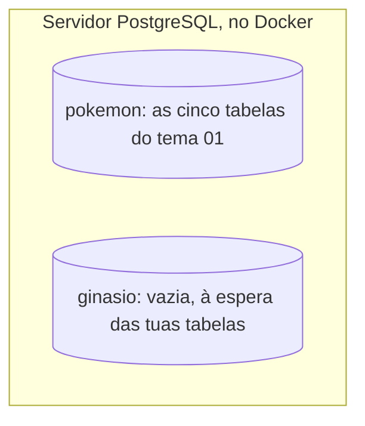
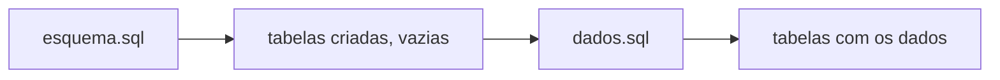
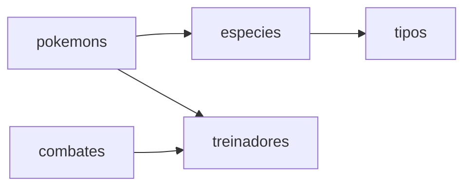

# DDL e integridade

No tema 01, a base `pokemon` veio pronta. Neste guia, escreves tu as tabelas do ginásio, num ficheiro que constrói a base de raiz, e dás-lhes as regras que a base de dados garante. A partir daí, a base recusa sozinha as linhas que não cumprem essas regras.

Usa, do tema 01, os tipos de dados, o NULL e as chaves, e, do guia 03 de Python avançado, a propriedade da vida. Rever, do tema 01: [Cada coluna tem um tipo de dados](01-modelo-relacional-e-postgresql.md#cada-coluna-tem-um-tipo-de-dados), [O NULL quer dizer que não há valor](01-modelo-relacional-e-postgresql.md#o-null-quer-dizer-que-não-há-valor), [A chave estrangeira aponta para outra tabela](01-modelo-relacional-e-postgresql.md#a-chave-estrangeira-aponta-para-outra-tabela). Do Python: [Propriedades: o get e o set com cara de atributo](../01-python-avancado/03-objetos-e-composicao.md#propriedades-o-get-e-o-set-com-cara-de-atributo). Para praticar: [laboratório](laboratorios/02-ddl-e-integridade-laboratorio.md) e [ficha de exercícios](exercicios/02-ddl-e-integridade-exercicios.md).

## Neste guia

1. [Parte 1: Criar a base e as tabelas](#parte-1-criar-a-base-e-as-tabelas)
2. [Parte 2: As regras que a base garante](#parte-2-as-regras-que-a-base-garante)
3. [Parte 3: Mudar uma tabela que já tem dados](#parte-3-mudar-uma-tabela-que-já-tem-dados)
4. [Exemplo guiado: o esquema do ginásio](#exemplo-guiado-o-esquema-do-ginásio)

## Parte 1: Criar a base e as tabelas

### Uma base de dados nova começa vazia

No tema 01, o servidor já trazia a base `pokemon`, criada pelo `pokemon.sql` na primeira vez que arrancou. Agora vais construir a base do ginásio tu mesmo, e queres experimentar à vontade sem estragar a `pokemon`, que continua a servir para as consultas do tema 01.

Um servidor guarda várias bases de dados, cada uma com as suas tabelas. Uma base nova cria-se com o `CREATE DATABASE`, seguido do nome:

```sql
CREATE DATABASE ginasio;
```

```text
CREATE DATABASE
```

O `psql` responde com o nome do comando, que é a forma de dizer que correu bem. A base `ginasio` fica no mesmo servidor que a `pokemon`, mas vazia: as tabelas de uma base não se veem da outra.



O diagrama mostra um só servidor com duas bases de dados lado a lado. A `pokemon` tem as tabelas do tema 01, e a `ginasio` ainda não tem nenhuma.

Para trabalhar na base nova, sais do `psql` com o `\q` e voltas a entrar, com o nome dela a seguir ao `-d`:

```bash
docker compose exec db psql -U postgres -d ginasio
```

O início da linha passa a ser `ginasio=#`, e o `\dt` responde `Did not find any relations.`, "não encontrei nenhuma tabela". O início da linha diz sempre em que base estás, e os comandos mexem nas tabelas dessa base. O `esquema.sql` deste tema, corrido na `pokemon`, apagava as tabelas dela e criava lá as do ficheiro.

### O CREATE TABLE escreve uma tabela do modelo

O modelo do tema 01 diz que tabelas há e que colunas tem cada uma, mas o PostgreSQL não lê desenhos. Cada tabela tem de ser escrita num comando de SQL.

Os comandos do SQL que criam, mudam e apagam tabelas formam a **DDL**, das iniciais de data definition language, "linguagem de definição de dados". O primeiro é o `CREATE TABLE`, que cria uma tabela com o nome, as colunas e o tipo de dados de cada coluna. As tabelas de uma base escrevem-se num ficheiro, o `esquema.sql`, para se poderem corrigir e voltar a criar. A primeira versão tem só os tipos:

```sql
-- esquema.sql: as tabelas da base ginasio, com as regras que a base de dados garante.
-- Corre-se no psql, ligado à base ginasio, com \i esquema.sql.

-- Os tipos dos Pokémon, como o Fogo e a Água.
CREATE TABLE tipos (
    id INTEGER PRIMARY KEY,
    nome VARCHAR(20) NOT NULL
);
```

Depois do nome da tabela, as colunas vêm entre parênteses, separadas por vírgulas, uma por linha. Cada coluna tem o nome, o tipo de dados e, se for preciso, uma regra. O `PRIMARY KEY` diz que o `id` é a chave primária, e o `NOT NULL` diz que o nome não pode ficar sem valor. A última coluna não leva vírgula, e o ponto e vírgula fecha o comando. São as colunas e as regras que o `\d` mostrava no tema 01, agora escritas por ti.

Ao conjunto das tabelas de uma base, com as colunas e as regras de cada uma, chama-se **esquema**. No `psql`, o comando `\i`, seguido do nome do ficheiro, corre os comandos do ficheiro, um a seguir ao outro, como se os escrevesses tu:

```text
ginasio=# \i esquema.sql
CREATE TABLE
```

O `\i` encontra o ficheiro na pasta do projeto, que o laboratório prepara em [Preparar o projeto](laboratorios/02-ddl-e-integridade-laboratorio.md#preparar-o-projeto). Como o `\dt` e o `\q`, é um comando do psql, e não SQL.

<details>
<summary>Para ires mais longe: outros tipos de dados</summary>

Neste tema chegam os três tipos de dados do tema 01: `INTEGER`, `VARCHAR(n)` e `DATE`. Noutras bases, vais encontrar outros. O `TEXT` guarda texto sem limite de tamanho. O `NUMERIC(6, 2)` guarda números com casas decimais exatas, como preços, aqui com seis algarismos, dois deles depois da vírgula. O `BOOLEAN` guarda `true` ou `false`, e o `TIMESTAMP` guarda uma data com as horas.

</details>

### Um ficheiro que se volta a correr começa por apagar

Acrescentas os treinadores no fim do `esquema.sql`, a seguir aos tipos, e corres outra vez o ficheiro:

```text
ginasio=# \i esquema.sql
psql:esquema.sql:8: ERROR:  relation "tipos" already exists
CREATE TABLE
```

O `psql` começa a mensagem pelo nome do ficheiro e pela linha onde acaba o comando que falhou: a linha 8 é a do `);` dos tipos. A tabela `tipos` já existia, da primeira vez que correste o ficheiro, e o PostgreSQL recusa criar outra com o mesmo nome. O `CREATE TABLE` dos treinadores, que ainda não existiam, correu bem.

Para o ficheiro poder correr sempre, começa por apagar as tabelas que vai criar. O `DROP TABLE` apaga uma tabela, com todas as linhas que ela tiver. O `IF EXISTS`, "se existir", faz o `DROP` saltar uma tabela que ainda não existe, em vez de dar erro. Estas linhas ficam a seguir aos dois comentários do início:

```sql
-- Apaga as tabelas, se existirem, para as criar de novo, vazias.
DROP TABLE IF EXISTS treinadores;
DROP TABLE IF EXISTS tipos;
```

Com estas linhas, o ficheiro corre as vezes que quiseres. Numa base onde as tabelas ainda não existem, o `DROP` escreve um aviso, e não um erro:

```text
psql:esquema.sql:5: NOTICE:  table "treinadores" does not exist, skipping
DROP TABLE
```

O `NOTICE` diz que a tabela não existia e que o `IF EXISTS` a saltou. Como o `DROP TABLE` apaga também os dados, só aparece no `esquema.sql`, que reconstrói a base de raiz. Nunca o escrevas à pressa numa base com dados que queres guardar.

### O INSERT acrescenta linhas

As tabelas estão criadas, mas vazias: o `SELECT * FROM tipos;` responde `(0 rows)`. No tema 01, os dados vinham no `pokemon.sql`. Agora és tu que os pões.

O `INSERT` acrescenta uma linha a uma tabela:

```sql
INSERT INTO tipos (id, nome) VALUES (1, 'Fogo');
```

```text
INSERT 0 1
```

O `INSERT INTO` diz a tabela e, entre parênteses, as colunas que vais preencher. O `VALUES` diz os valores, pela mesma ordem, e o texto vai entre plicas, como no tema 01. Na resposta, o `1` é o número de linhas que entraram, e o `0` podes ignorá-lo. Para acrescentar várias linhas de uma vez, separas cada linha da seguinte com uma vírgula, como no `pokemon.sql`:

```sql
INSERT INTO tipos (id, nome) VALUES
    (2, 'Água'),
    (3, 'Planta');
```

O `psql` responde `INSERT 0 2`, e o `SELECT * FROM tipos;` mostra agora o Fogo, a Água e a Planta. Os `INSERT` ficam noutro ficheiro, o `dados.sql`, que se corre depois do `esquema.sql`:



O esquema apaga as tabelas e cria-as vazias, e o `dados.sql` põe-lhes os dados. Por isso, os dois correm sempre por esta ordem.

### A base pode dar o número da chave primária

No `dados.sql`, cada linha leva o seu `id` escrito à mão. Para acrescentar um tipo, tens de ir ver que números já estão usados, e se te enganares, a chave primária recusa a linha. Quem sabe que números já existem é a base.

A chave primária pode ser gerada pela base:

```sql
CREATE TABLE tipos (
    id INTEGER GENERATED BY DEFAULT AS IDENTITY PRIMARY KEY,
    nome VARCHAR(20) NOT NULL
);
```

O `GENERATED ... AS IDENTITY` diz que é a base que gera o valor da coluna. Uma coluna assim é uma **coluna de identidade**: quando o `INSERT` não diz o `id`, a base dá o número seguinte, a começar no 1. O `BY DEFAULT` quer dizer que a base só dá o número quando o `INSERT` não o traz. No `\d tipos`, a coluna `Default` diz `generated by default as identity`.

O `id` sai do `INSERT`, e a base numera as linhas pela ordem em que entram:

```sql
INSERT INTO tipos (nome) VALUES
    ('Fogo'),
    ('Água');
```

```text
ginasio=# SELECT * FROM tipos;
 id | nome
----+------
  1 | Fogo
  2 | Água
(2 rows)
```

O Fogo entrou primeiro e ficou com o 1. Um número dado não volta a ser usado, nem quando o `INSERT` é recusado. Numa tabela `tipos` acabada de criar, estes três `INSERT`, um a seguir ao outro, dão isto:

| `INSERT` | O que acontece | `id` |
| --- | --- | --- |
| `INSERT INTO tipos (nome) VALUES ('Fogo');` | Entra | 1 |
| `INSERT INTO tipos (nome) VALUES (NULL);` | É recusado: o nome é `NOT NULL` | o 2 fica gasto |
| `INSERT INTO tipos (nome) VALUES ('Água');` | Entra | 3 |

Por isso, os `id` podem saltar números, e não faz mal: como viste no tema 01, o `id` só identifica a linha.

<details>
<summary>Para ires mais longe: o SERIAL</summary>

Em muitos tutoriais na internet, a chave gerada escreve-se `id SERIAL PRIMARY KEY`. O `SERIAL` é a forma antiga do PostgreSQL e faz quase o mesmo. O `GENERATED ... AS IDENTITY` é a forma do SQL padrão, que outros SGBD também entendem, e é a que se usa nestes materiais.

</details>

## Parte 2: As regras que a base garante

### Uma restrição é uma regra que a base garante

Antes de leres a resposta: a base aceita um treinador sem cidade?

```sql
INSERT INTO treinadores (id, nome) VALUES (5, 'Tracey');
```

```text
ERROR:  null value in column "cidade" of relation "treinadores" violates not-null constraint
DETAIL:  Failing row contains (5, Tracey, null).
```

Não aceita. A coluna que não vem no `INSERT` fica sem valor, e a `cidade` é `NOT NULL`. A mensagem diz que o valor nulo na coluna `cidade` viola a regra do `NOT NULL`, e o `DETAIL` mostra a linha recusada. A base recusa a linha inteira, e a tabela fica como estava.

Uma regra que a base verifica sempre que uma linha entra ou muda chama-se **restrição**. Em inglês diz-se constraint, a palavra que aparece nas mensagens de erro. Já usas duas: o `NOT NULL` e a chave primária, que recusa dois tipos com o mesmo `id`.

Os dados que cumprem as regras do problema dizem-se íntegros, e a **integridade** dos dados é essa garantia. Com as restrições, ela não depende de cada programa se lembrar das regras: a base recusa o que as viola, venha a linha de onde vier.

### A chave estrangeira recusa o que não existe

Na tabela `especies`, a coluna `tipo_id` diz o tipo de cada espécie. Se a coluna for só um `INTEGER`, nada impede uma espécie com o `tipo_id` 9, quando não há nenhum tipo 9. A espécie ficava a apontar para nada, como o combate com um vencedor que não existe, no tema 01.

A chave estrangeira escreve-se com o `REFERENCES`, a seguir ao tipo de dados da coluna:

```sql
-- As espécies. Cada espécie tem um tipo que existe.
CREATE TABLE especies (
    id INTEGER GENERATED BY DEFAULT AS IDENTITY PRIMARY KEY,
    nome VARCHAR(30) NOT NULL,
    tipo_id INTEGER NOT NULL REFERENCES tipos (id)
);
```

O `REFERENCES tipos (id)` lê-se "aponta para a coluna `id` da tabela `tipos`". É a ligação que o `\d` mostrava no tema 01, nas linhas `Foreign-key constraints`. Agora a base recusa a espécie que aponta para um tipo que não existe:

```sql
INSERT INTO especies (nome, tipo_id) VALUES ('Mewtwo', 9);
```

```text
ERROR:  insert or update on table "especies" violates foreign key constraint "especies_tipo_id_fkey"
DETAIL:  Key (tipo_id)=(9) is not present in table "tipos".
```

A mensagem diz que o `INSERT` na tabela `especies` viola a restrição de chave estrangeira `especies_tipo_id_fkey`. O `DETAIL` diz porquê: o valor 9 da coluna `tipo_id` não está na tabela `tipos`. O nome da restrição é dado pelo PostgreSQL: a tabela, a coluna e `fkey`, de foreign key.

O `NOT NULL` continua a fazer falta. Uma chave estrangeira aceita o NULL, como o `vencedor_id` de um combate por acabar. Com as duas regras, cada espécie tem sempre um tipo, e esse tipo existe.

### A ordem das tabelas segue as chaves estrangeiras

A chave estrangeira obriga a uma ordem. Numa base sem a tabela `tipos`, o `CREATE TABLE` das espécies aponta para uma tabela que ainda não existe, e o PostgreSQL recusa-o:

```text
ERROR:  relation "tipos" does not exist
```

Com os dados acontece o mesmo: uma espécie só pode apontar para um tipo que já lá esteja, e por isso os tipos entram primeiro no `dados.sql`. Ao apagar, a ordem é a contrária. Se apagares os tipos com as espécies ainda lá, com `DROP TABLE tipos;`, as espécies ficavam a apontar para uma tabela que já não existe, e o PostgreSQL recusa:

```text
ERROR:  cannot drop table tipos because other objects depend on it
DETAIL:  constraint especies_tipo_id_fkey on table especies depends on table tipos
HINT:  Use DROP ... CASCADE to drop the dependent objects too.
```

A mensagem diz que a tabela `tipos` não se apaga porque outras coisas dependem dela, e o `DETAIL` diz qual: a chave estrangeira das espécies. A regra é esta: cria e enche primeiro as tabelas para onde as outras apontam, e apaga-as por último. No ginásio, as ligações são estas:



Cada seta liga uma tabela que tem chaves estrangeiras à tabela para onde elas apontam. Os combates têm três chaves estrangeiras para os treinadores, e uma seta chega para as três. As setas não são a ordem de criação, que é a contrária: os tipos e os treinadores não apontam para nenhuma tabela, e criam-se primeiro. Os Pokémon e os combates não recebem setas, e apagam-se primeiro. Uma ordem que serve para criar é `tipos`, `especies`, `treinadores`, `pokemons` e `combates`, e para apagar, a mesma ao contrário.

<details>
<summary>Para ires mais longe: o CASCADE</summary>

A dica do erro, o `HINT`, sugere o `DROP TABLE tipos CASCADE;`. O `CASCADE` apaga a tabela e tira, sem perguntar, as chaves estrangeiras que apontam para ela. As espécies ficam, mas sem a regra: a partir daí aceitam qualquer `tipo_id`. Num ficheiro que reconstrói a base, a ordem certa dos `DROP` evita o `CASCADE`, e nenhuma regra se perde sem dares por isso.

</details>

### O UNIQUE recusa os repetidos

No tema 01, a tabela `tipos` existia para o nome `Água` se escrever uma só vez. Nada o garante: um segundo `INSERT` com a `Água` entra, com outro `id`, e passa a haver duas linhas `Água`. A chave primária não ajuda, porque os `id` são diferentes.

O `UNIQUE`, a seguir a uma coluna, faz a base recusar uma linha cujo valor nessa coluna já exista noutra:

```sql
CREATE TABLE tipos (
    id INTEGER GENERATED BY DEFAULT AS IDENTITY PRIMARY KEY,
    nome VARCHAR(20) NOT NULL UNIQUE
);
```

Com os tipos do `dados.sql` na tabela, uma segunda `Água` é recusada:

```sql
INSERT INTO tipos (nome) VALUES ('Água');
```

```text
ERROR:  duplicate key value violates unique constraint "tipos_nome_key"
DETAIL:  Key (nome)=(Água) already exists.
```

A mensagem diz que o valor repetido viola a restrição `tipos_nome_key`, e o `DETAIL` diz que já existe um nome `Água`. Nas mensagens, o PostgreSQL chama key, chave, a qualquer coluna que não aceita repetidos, e não só à chave primária. O nome das espécies leva a mesma regra.

Às vezes, o que não se pode repetir é um par de valores. Dois Pokémon podem ter a alcunha Pika, se forem de treinadores diferentes, mas o mesmo treinador não dá a mesma alcunha a dois. A regra é sobre o par `treinador_id` e `alcunha`, e escreve-se numa linha própria, no fim da tabela, com as duas colunas entre parênteses:

```sql
CREATE TABLE pokemons (
    id INTEGER GENERATED BY DEFAULT AS IDENTITY PRIMARY KEY,
    especie_id INTEGER NOT NULL REFERENCES especies (id),
    treinador_id INTEGER NOT NULL REFERENCES treinadores (id),
    alcunha VARCHAR(30),
    vida INTEGER NOT NULL,
    ataque INTEGER NOT NULL,
    UNIQUE (treinador_id, alcunha)
);
```

Um segundo Pika do Ash é recusado, com o `DETAIL` `Key (treinador_id, alcunha)=(1, Pika) already exists.`. Um Pika da Misty entra, porque o par `(2, Pika)` ainda não existia.

Antes de leres a resposta: o Ash já tem dois Pokémon sem alcunha, o Charmander e o Bulbasaur. A base aceita um terceiro, como este Squirtle?

```sql
INSERT INTO pokemons (especie_id, treinador_id, alcunha, vida, ataque) VALUES (2, 1, NULL, 100, 30);
```

Aceita, com `INSERT 0 1`. Para o `UNIQUE`, dois NULL não são repetidos, porque o NULL não é um valor: é a falta dele. Uma restrição `UNIQUE` só compara valores, e os Pokémon sem alcunha não têm nenhum para comparar.

### O CHECK recusa os valores fora da regra

No Python, a vida de um Pokémon fica sempre entre 0 e 150, porque a propriedade a corrige. Na tabela `pokemons`, a vida é um `INTEGER`, e um `INTEGER` aceita 200 ou -30.

O `CHECK` leva uma condição entre parênteses, e a base recusa a linha em que ela é falsa. Nos Pokémon, a vida e o ataque levam os limites do Python:

```sql
CREATE TABLE pokemons (
    id INTEGER GENERATED BY DEFAULT AS IDENTITY PRIMARY KEY,
    especie_id INTEGER NOT NULL REFERENCES especies (id),
    treinador_id INTEGER NOT NULL REFERENCES treinadores (id),
    alcunha VARCHAR(30),
    vida INTEGER NOT NULL CHECK (vida >= 0 AND vida <= 150),
    ataque INTEGER NOT NULL CHECK (ataque >= 1 AND ataque <= 50),
    UNIQUE (treinador_id, alcunha)
);
```

O `AND` é o `and` do Python: a condição só é verdadeira se as duas partes forem. Na base acabada de construir pelo `esquema.sql` e pelo `dados.sql`, um Squirtle do Ash com a vida 200 é recusado:

```sql
INSERT INTO pokemons (especie_id, treinador_id, alcunha, vida, ataque) VALUES (2, 1, NULL, 200, 30);
```

```text
ERROR:  new row for relation "pokemons" violates check constraint "pokemons_vida_check"
DETAIL:  Failing row contains (7, 2, 1, null, 200, 30).
```

A mensagem diz que a linha nova da tabela `pokemons` viola a restrição `pokemons_vida_check`, e o `DETAIL` mostra a linha inteira, com o `id` que ia receber. A vida 0 e a vida 150 entram, porque o `>=` e o `<=` incluem os limites.

O `CHECK` é parecido com a propriedade da vida, mas não faz o mesmo:

| Vida escrita | Propriedade do Python | `CHECK` da tabela |
| --- | --- | --- |
| 90 | fica 90 | a linha entra |
| 200 | fica 150 | a linha é recusada |
| -30 | fica 0 | a linha é recusada |

A propriedade corrigia o valor sem avisar. O `CHECK` não corrige: recusa, como um `raise`. A base não sabe o que querias escrever, e por isso não guarda um valor que ninguém escreveu. Quando faz sentido corrigir um valor, isso fica para o programa que escreve na base.

A condição pode usar as comparações do Python, `<`, `<=`, `>` e `>=`, e ainda o `=` para igual, só com um sinal, e o `<>` para diferente. Pode também usar mais do que uma coluna da mesma linha, ligadas pelo `AND` ou pelo `OR`, que é o `or` do Python. Uma regra que usa mais do que uma coluna escreve-se numa linha própria, no fim da tabela, como o `UNIQUE` de duas colunas.

Um `CHECK` só recusa quando a condição é falsa. Com uma coluna a NULL, a condição não é verdadeira nem falsa: dá NULL, um resultado desconhecido, e a linha passa. Por exemplo, a regra `CHECK (alcunha <> '')`, que recusa a alcunha vazia, recusava o Psyduck da Misty e deixava entrar os Pokémon sem alcunha.

## Parte 3: Mudar uma tabela que já tem dados

### O ALTER TABLE muda uma tabela sem perder os dados

O ginásio passa a guardar as medalhas de cada treinador. Imagina que já puseste à mão, no `psql`, um treinador novo e um combate de hoje. Esses dados não estão no `dados.sql`: se juntares a coluna ao `esquema.sql` e voltares a correr os dois ficheiros, perdes-os.

O `ALTER TABLE` muda uma tabela que já existe, e as linhas ficam. Com o `ADD COLUMN`, acrescenta uma coluna:

```sql
ALTER TABLE treinadores ADD COLUMN medalhas INTEGER NOT NULL;
```

```text
ERROR:  column "medalhas" of relation "treinadores" contains null values
```

O PostgreSQL recusa. Os treinadores que já lá estão ficavam sem valor na coluna nova, e o `NOT NULL` não deixa. Falta dizer que valor recebem.

O valor que uma coluna recebe quando ninguém lhe dá nenhum é o **valor por omissão**, e escreve-se com o `DEFAULT`. É o mesmo `DEFAULT` do `BY DEFAULT` das colunas de identidade, onde o valor por omissão é o número seguinte:

```sql
ALTER TABLE treinadores ADD COLUMN medalhas INTEGER NOT NULL DEFAULT 0 CHECK (medalhas >= 0 AND medalhas <= 8);
```

```text
ginasio=# SELECT * FROM treinadores;
 id | nome  |  cidade  | medalhas
----+-------+----------+----------
  1 | Ash   | Pallet   |        0
  2 | Misty | Cerulean |        0
  3 | Brock | Pewter   |        0
  4 | Gary  | Pallet   |        0
(4 rows)
```

Na base construída pelos dois ficheiros, os quatro treinadores ficaram com o 0; um treinador posto à mão ficava também. Um treinador novo fica com o 0, se o `INSERT` não disser as medalhas. O `CHECK` diz que há oito medalhas para ganhar.

Depois de um `ALTER TABLE`, o `esquema.sql` tem de dizer o mesmo que a base. Se não juntares a coluna ao `CREATE TABLE` dos treinadores, ela desaparece na próxima vez que correres o esquema. O `ALTER TABLE` muda a base que existe, e o `esquema.sql` diz como ela se constrói de raiz.

<details>
<summary>Para ires mais longe: outras mudanças com o ALTER TABLE</summary>

O `ALTER TABLE` faz mais do que acrescentar colunas. O `ALTER TABLE treinadores RENAME COLUMN cidade TO terra;` muda o nome de uma coluna, e os dados ficam. O `ALTER TABLE treinadores DROP COLUMN medalhas;` apaga uma coluna e os valores dela, sem perguntar. O `ALTER TABLE pokemons ADD CHECK (ataque <= 40);` junta uma regra a uma tabela que já existe, e o PostgreSQL recusa-a se alguma linha já não a cumprir.

</details>

## Exemplo guiado: o esquema do ginásio

Neste exemplo, as regras do ginásio passam de frases a restrições, até ao `esquema.sql` completo, e seis `INSERT` põem-nas à prova.

### O problema

Queremos guardar o ginásio do tema 01, agora com as regras que a base garante:

- Cada tipo tem um nome, que não se repete.
- Cada espécie tem um nome, que não se repete, e um tipo que existe.
- Cada treinador tem um nome, uma cidade e as medalhas que ganhou, de 0 a 8. Um treinador novo começa com 0.
- Cada Pokémon capturado é de uma espécie que existe e pertence a um treinador que existe. Pode ter uma alcunha, mas o mesmo treinador não dá a mesma alcunha a dois Pokémon. A vida vai de 0 a 150 e o ataque de 1 a 50, como no Python.
- Cada combate tem a data, a cidade, o desafiante e o líder, que existem. O vencedor fica sem valor enquanto o combate não acaba.
- Os números das linhas são dados pela base.

### De cada regra à restrição

Cada frase do enunciado passa a uma restrição. Uma coluna que se conhece sempre leva `NOT NULL`, e uma que pode faltar fica sem ele:

| Regra | Restrição |
| --- | --- |
| Cada tipo e cada espécie tem um nome | `nome VARCHAR(...) NOT NULL` |
| O nome não se repete | `UNIQUE`, a seguir ao nome |
| Um tipo, uma espécie ou um treinador que existe | `NOT NULL REFERENCES`, para a tabela certa |
| As medalhas vão de 0 a 8 | `CHECK (medalhas >= 0 AND medalhas <= 8)` |
| Um treinador novo começa com 0 | `DEFAULT 0` |
| O Pokémon pode ter uma alcunha | `alcunha VARCHAR(30)`, sem `NOT NULL` |
| O mesmo treinador não repete uma alcunha | `UNIQUE (treinador_id, alcunha)` |
| A vida vai de 0 a 150, e o ataque de 1 a 50 | um `CHECK` em cada coluna |
| O vencedor fica sem valor | `vencedor_id INTEGER REFERENCES treinadores (id)`, sem `NOT NULL` |
| Os números são dados pela base | `GENERATED BY DEFAULT AS IDENTITY` em cada `id` |

### A ordem

As tabelas criam-se pela ordem das ligações: primeiro os tipos e os treinadores, para onde as outras apontam, e as espécies antes dos Pokémon. A ordem escolhida é `tipos`, `especies`, `treinadores`, `pokemons` e `combates`. Os `DROP` do início do ficheiro seguem a ordem contrária.

### O esquema.sql completo

```sql
-- esquema.sql: as tabelas da base ginasio, com as regras que a base de dados garante.
-- Corre-se no psql, ligado à base ginasio, com \i esquema.sql.

-- Apaga as tabelas, se existirem, para as criar de novo, vazias.
-- As tabelas que apontam para outras apagam-se primeiro.
DROP TABLE IF EXISTS combates;
DROP TABLE IF EXISTS pokemons;
DROP TABLE IF EXISTS treinadores;
DROP TABLE IF EXISTS especies;
DROP TABLE IF EXISTS tipos;

-- Os tipos dos Pokémon, como o Fogo e a Água.
CREATE TABLE tipos (
    id INTEGER GENERATED BY DEFAULT AS IDENTITY PRIMARY KEY,
    nome VARCHAR(20) NOT NULL UNIQUE
);

-- As espécies. Cada espécie tem um tipo que existe.
CREATE TABLE especies (
    id INTEGER GENERATED BY DEFAULT AS IDENTITY PRIMARY KEY,
    nome VARCHAR(30) NOT NULL UNIQUE,
    tipo_id INTEGER NOT NULL REFERENCES tipos (id)
);

-- Os treinadores, com a cidade de onde vêm.
CREATE TABLE treinadores (
    id INTEGER GENERATED BY DEFAULT AS IDENTITY PRIMARY KEY,
    nome VARCHAR(30) NOT NULL,
    cidade VARCHAR(30) NOT NULL,
    -- Um treinador novo começa sem medalhas, e há oito medalhas para ganhar.
    medalhas INTEGER NOT NULL DEFAULT 0 CHECK (medalhas >= 0 AND medalhas <= 8)
);

-- Os Pokémon capturados. Cada um é de uma espécie e pertence a um treinador.
CREATE TABLE pokemons (
    id INTEGER GENERATED BY DEFAULT AS IDENTITY PRIMARY KEY,
    especie_id INTEGER NOT NULL REFERENCES especies (id),
    treinador_id INTEGER NOT NULL REFERENCES treinadores (id),
    -- A alcunha pode ficar sem valor: nem todos os Pokémon têm alcunha.
    alcunha VARCHAR(30),
    -- Os limites do Python, mas aqui um valor fora deles é recusado, e não corrigido.
    vida INTEGER NOT NULL CHECK (vida >= 0 AND vida <= 150),
    ataque INTEGER NOT NULL CHECK (ataque >= 1 AND ataque <= 50),
    -- O mesmo treinador não dá a mesma alcunha a dois Pokémon.
    UNIQUE (treinador_id, alcunha)
);

-- Os combates nos ginásios. Três colunas apontam para treinadores: quem desafiou,
-- o líder do ginásio e quem venceu. O vencedor fica sem valor enquanto o combate
-- não acaba.
CREATE TABLE combates (
    id INTEGER GENERATED BY DEFAULT AS IDENTITY PRIMARY KEY,
    data DATE NOT NULL,
    cidade VARCHAR(30) NOT NULL,
    desafiante_id INTEGER NOT NULL REFERENCES treinadores (id),
    lider_id INTEGER NOT NULL REFERENCES treinadores (id),
    vencedor_id INTEGER REFERENCES treinadores (id)
);
```

Lê-se em dois blocos. Os cinco `DROP` limpam a base, a começar pelas tabelas que apontam para outras. Os cinco `CREATE TABLE` reconstroem-na pela ordem contrária. Cada restrição fica a seguir à sua coluna, ou numa linha própria no fim da tabela, quando junta duas colunas. O `dados.sql` põe nestas tabelas os dados do tema 01, sem os `id`, e cada linha fica com o mesmo número que tinha na base `pokemon`.

### Prever o que a base aceita

Com a base acabada de construir pelo `esquema.sql` e pelo `dados.sql`, estes seis `INSERT` correm um a seguir ao outro. Para cada um, decide primeiro se a base o aceita e, se o recusa, que restrição o recusa:

```sql
INSERT INTO treinadores (nome, cidade) VALUES ('Tracey', 'Pallet');
INSERT INTO pokemons (especie_id, treinador_id, alcunha, vida, ataque) VALUES (4, 2, 'Pika', 60, 40);
INSERT INTO pokemons (especie_id, treinador_id, alcunha, vida, ataque) VALUES (1, 4, NULL, 150, 51);
INSERT INTO combates (data, cidade, desafiante_id, lider_id) VALUES ('2026-11-17', 'Pewter', 4, 3);
INSERT INTO especies (nome, tipo_id) VALUES ('Pikachu', 4);
INSERT INTO pokemons (especie_id, treinador_id, alcunha, vida, ataque) VALUES (2, 7, NULL, 50, 20);
```

As respostas, pela mesma ordem:

| `INSERT` | Resposta da base | Porquê |
| --- | --- | --- |
| O Tracey, de Pallet | Aceite, com o `id` 5 e 0 medalhas | O nome e a cidade estão lá, e as medalhas recebem o valor por omissão |
| Um Pika da Misty | Aceite, com o `id` 7 | O par `(2, Pika)` não existia: o Pika do Ash é o par `(1, Pika)` |
| Um Charmander do Gary com ataque 51 | Recusado, `pokemons_ataque_check` | A vida 150 está no limite e entra, mas o ataque passa de 50 |
| Um combate do Gary contra o Brock | Aceite, com o `id` 4 e o vencedor a NULL | O combate ainda não acabou, e o `vencedor_id` aceita o NULL |
| Outra espécie Pikachu | Recusado, `especies_nome_key` | O nome das espécies é `UNIQUE`, e o Pikachu já existe |
| Um Squirtle do treinador 7 | Recusado, `pokemons_treinador_id_fkey` | Só há treinadores do 1 ao 5 |

O `psql` confirma-o: três linhas `INSERT 0 1` e três `ERROR`, com os nomes das restrições da tabela de cima.

## Erros frequentes

### `syntax error at or near ")"` num `CREATE TABLE`

Ficou uma vírgula depois da última coluna, antes do parêntese que fecha a tabela. A seguir a uma vírgula, o PostgreSQL espera outra coluna e encontra o `)`. O `^` por baixo da linha que começa por `LINE` aponta para esse parêntese. Tira a vírgula da última coluna.

### `syntax error at or near "nome"` num `CREATE TABLE`

Falta a vírgula no fim da coluna anterior, e o PostgreSQL leu as duas colunas como uma só. O `^` por baixo da linha que começa por `LINE` aponta para o início da coluna seguinte, aqui o `nome`. Põe a vírgula no fim da linha de cima.

### `syntax error at or near "CREATE"` ao correr o ficheiro

Falta o ponto e vírgula no fim de um comando do ficheiro. O `psql` juntou-o ao comando seguinte, e o `^` aponta para o `CREATE` desse comando. Nenhum dos dois comandos correu. Fecha com `;` o comando de cima do `CREATE` que o `^` aponta, e corre o ficheiro outra vez.

### `invalid input syntax for type integer: "Fogo"`

O `INSERT` não tem a lista das colunas, como em `INSERT INTO tipos VALUES ('Fogo');`. Sem a lista, o `VALUES` preenche as colunas pela ordem da tabela, e o `'Fogo'` foi para o `id`, que é um número. Escreve sempre as colunas: `INSERT INTO tipos (nome) VALUES ('Fogo');`.

### `column "Fogo" does not exist`

O texto está entre aspas, como em Python, e não entre plicas. Em SQL, `"Fogo"` é o nome de uma coluna, e `'Fogo'` é um texto. Troca as aspas por plicas.

### `duplicate key value` ao correr o `dados.sql`

Correste o `dados.sql` duas vezes seguidas, e os nomes repetidos chocaram com os `UNIQUE`, como em `Key (nome)=(Fogo) already exists.`. As tabelas sem `UNIQUE`, os treinadores e os combates, aceitaram as linhas outra vez, e ficaram com tudo repetido. Corre primeiro o `\i esquema.sql`, que deixa as tabelas vazias, e só depois o `\i dados.sql`.

## Palavras novas deste guia

- DDL: os comandos do SQL que criam, mudam e apagam tabelas, como o `CREATE TABLE`, o `ALTER TABLE` e o `DROP TABLE`.
- Esquema: o conjunto das tabelas de uma base, com as colunas e as regras de cada uma.
- Coluna de identidade: uma coluna cujo valor é dado pela base, o número seguinte, quando o `INSERT` não o diz.
- Restrição: uma regra que a base verifica sempre que uma linha entra ou muda, como o `NOT NULL` ou o `CHECK`.
- Integridade: a garantia de que os dados cumprem as regras do problema, que as restrições dão.
- Valor por omissão: o valor que uma coluna recebe quando ninguém lhe dá nenhum, escrito com o `DEFAULT`.

## O que vem a seguir

No tema 03, DML e consultas com contexto, escolhes as linhas com o `WHERE`, mudas e apagas dados, e experimentas as mudanças de forma a poderes desfazê-las.

## Para saber mais

- [As restrições](https://www.postgresql.org/docs/17/ddl-constraints.html): o capítulo do manual do PostgreSQL, em inglês, sobre o `NOT NULL`, o `UNIQUE`, o `CHECK` e as chaves.
- [O CREATE TABLE](https://www.postgresql.org/docs/17/sql-createtable.html): todas as opções do `CREATE TABLE`, em inglês, incluindo as colunas de identidade.
- [O ALTER TABLE](https://www.postgresql.org/docs/17/sql-altertable.html): todas as mudanças que o `ALTER TABLE` faz, em inglês.


