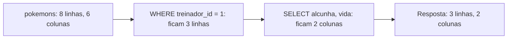
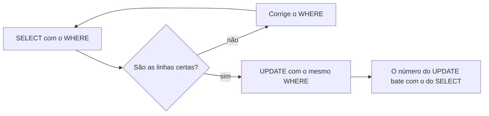
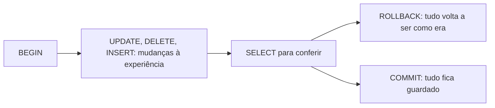
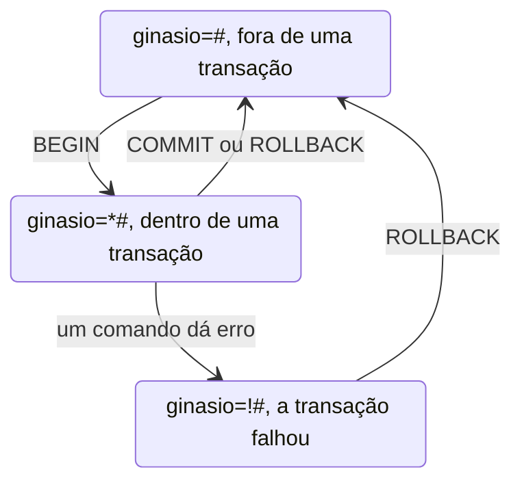

# DML e consultas com contexto

No tema 02, construíste a base `ginasio` e puseste-lhe os dados. Neste guia, fazes-lhe perguntas: escolhes as linhas que interessam, ordenas a resposta e cortas-lhe o tamanho. Depois, mudas e apagas dados dentro de uma transação, que te deixa desfazer um engano. Os comandos que leem e mudam os dados formam a **DML**, das iniciais de data manipulation language, "linguagem de manipulação de dados".

Usa, do tema 01, o `SELECT` das colunas e o NULL, e, do tema 02, a chave estrangeira e o `CHECK`. Rever, do tema 01: [Escolher as colunas](01-modelo-relacional-e-postgresql.md#escolher-as-colunas) e [O NULL quer dizer que não há valor](01-modelo-relacional-e-postgresql.md#o-null-quer-dizer-que-não-há-valor). Do tema 02: [A chave estrangeira recusa o que não existe](02-ddl-e-integridade.md#a-chave-estrangeira-recusa-o-que-não-existe) e [O CHECK recusa os valores fora da regra](02-ddl-e-integridade.md#o-check-recusa-os-valores-fora-da-regra). Para praticar: [laboratório](laboratorios/03-dml-e-consultas-com-contexto-laboratorio.md) e [ficha de exercícios](exercicios/03-dml-e-consultas-com-contexto-exercicios.md).

## Neste guia

1. [Parte 1: Escolher as linhas](#parte-1-escolher-as-linhas)
2. [Parte 2: Intervalos, listas e padrões](#parte-2-intervalos-listas-e-padrões)
3. [Parte 3: Ordenar e cortar o resultado](#parte-3-ordenar-e-cortar-o-resultado)
4. [Parte 4: Mudar e apagar dados](#parte-4-mudar-e-apagar-dados)
5. [Parte 5: Experimentar sem estragar](#parte-5-experimentar-sem-estragar)
6. [Exemplo guiado: curar os Pokémon KO da Misty](#exemplo-guiado-curar-os-pokémon-ko-da-misty)

## Parte 1: Escolher as linhas

### O WHERE escolhe as linhas

Os exemplos deste guia usam a base `ginasio` do tema 02, com mais duas espécies, dois Pokémon e um combate, que o laboratório acrescenta em [Preparar o projeto](laboratorios/03-dml-e-consultas-com-contexto-laboratorio.md#preparar-o-projeto). Os Pokémon passam a ser oito:

```sql
SELECT * FROM pokemons;
```

```text
 id | especie_id | treinador_id | alcunha | vida | ataque
----+------------+--------------+---------+------+--------
  1 |          1 |            1 |         |   90 |     40
  2 |          3 |            1 |         |  110 |     25
  3 |          4 |            1 | Pika    |   80 |     45
  4 |          5 |            2 |         |    0 |     35
  5 |          6 |            2 |         |  100 |     20
  6 |          7 |            3 |         |  140 |     30
  7 |          8 |            3 |         |    0 |     30
  8 |          9 |            2 |         |    0 |     25
(8 rows)
```

A tabela só tem números para a espécie e para o treinador. Com o `dados.sql` ao lado, cada linha lê-se assim:

| `id` | Espécie | Treinador | Vida |
| --- | --- | --- | --- |
| 1 | Charmander | Ash | 90 |
| 2 | Bulbasaur | Ash | 110 |
| 3 | Pikachu, o Pika | Ash | 80 |
| 4 | Starmie | Misty | 0, KO |
| 5 | Psyduck, com a alcunha vazia | Misty | 100 |
| 6 | Onix | Brock | 140 |
| 7 | Geodude | Brock | 0, KO |
| 8 | Staryu | Misty | 0, KO |

Queres ver os Pokémon do Ash. A resposta do `SELECT * FROM pokemons;` traz os oito, de todos os treinadores, e tens de procurar as linhas com o `treinador_id` 1. Numa tabela com mil Pokémon, isso já não se faz a olhar.

O `WHERE` diz que linhas entram na resposta. Escreve-se depois do `FROM`, seguido de uma condição:

```sql
SELECT * FROM pokemons WHERE treinador_id = 1;
```

```text
 id | especie_id | treinador_id | alcunha | vida | ataque
----+------------+--------------+---------+------+--------
  1 |          1 |            1 |         |   90 |     40
  2 |          3 |            1 |         |  110 |     25
  3 |          4 |            1 | Pika    |   80 |     45
(3 rows)
```

O servidor experimenta a condição em cada linha da tabela. Uma linha entra na resposta quando a condição é verdadeira para ela, e fica de fora quando é falsa. É o mesmo tipo de condição do `CHECK` do tema 02, com outro efeito: o `CHECK` recusa a linha, e o `WHERE` só a deixa fora da resposta. A tabela não muda.

O `WHERE` junta-se às colunas que já sabias escolher. O `SELECT` escolhe as colunas, e o `WHERE` escolhe as linhas:

```sql
SELECT alcunha, vida FROM pokemons WHERE treinador_id = 1;
```



O diagrama mostra a consulta a passar pela tabela em dois cortes: o `WHERE` tira as linhas dos outros treinadores, e o `SELECT` tira as colunas que não pediste. A resposta tem três linhas, com a alcunha e a vida de cada Pokémon do Ash.

### As comparações servem para números, textos e datas

No `WHERE` usas as comparações que o `CHECK` já usava: `=`, `<>`, `<`, `<=`, `>` e `>=`. Servem para números, como a vida, e também para textos e datas.

Um texto escreve-se entre plicas, como no `INSERT`. Os treinadores de Pallet são o Ash e o Gary:

```sql
SELECT * FROM treinadores WHERE cidade = 'Pallet';
```

```text
 id | nome | cidade | medalhas
----+------+--------+----------
  1 | Ash  | Pallet |        0
  4 | Gary | Pallet |        0
(2 rows)
```

O `=` compara os textos letra a letra, e as maiúsculas contam. O `WHERE cidade = 'pallet'` responde `(0 rows)`, porque nenhuma cidade se escreve com o p pequeno. Não dá erro: a consulta está bem escrita, só não há linhas que a cumpram.

Uma data escreve-se também entre plicas, na forma do PostgreSQL, ano, mês e dia: `'2026-11-10'`. Numa data, "maior" quer dizer "mais tarde". Os combates de 10 de novembro em diante são os dois últimos:

```sql
SELECT * FROM combates WHERE data >= '2026-11-10';
```

```text
 id |    data    | cidade | desafiante_id | lider_id | vencedor_id
----+------------+--------+---------------+----------+-------------
  3 | 2026-11-10 | Pewter |             1 |        3 |
  4 | 2026-11-17 | Pewter |             2 |        3 |           3
(2 rows)
```

O `>=` inclui o próprio dia 10, como incluía o limite no `CHECK`. Com o `>`, ficava só o combate de 17 de novembro.

Antes de leres a resposta: quantos treinadores dá o `WHERE cidade <> 'Pallet'`?

São dois, a Misty e o Brock. O `<>` quer dizer "diferente de", e deixa de fora as duas linhas de Pallet.

### O AND, o OR e o NOT juntam condições

Os Pokémon KO da Misty são os que têm a vida 0 e são do treinador 2. São duas condições, e as duas têm de ser verdadeiras. O `AND` junta-as, como no `CHECK` do tema 02:

```sql
SELECT * FROM pokemons WHERE treinador_id = 2 AND vida = 0;
```

```text
 id | especie_id | treinador_id | alcunha | vida | ataque
----+------------+--------------+---------+------+--------
  4 |          5 |            2 |         |    0 |     35
  8 |          9 |            2 |         |    0 |     25
(2 rows)
```

São o Starmie e o Staryu. O Psyduck da Misty fica de fora, porque tem vida, e o Geodude do Brock também, porque é de outro treinador.

O `OR` junta duas condições de forma que basta uma ser verdadeira. Os treinadores de Pallet ou de Pewter são o Ash, o Brock e o Gary:

```sql
SELECT * FROM treinadores WHERE cidade = 'Pallet' OR cidade = 'Pewter';
```

O `NOT`, antes de uma condição, troca o verdadeiro pelo falso. O `WHERE NOT cidade = 'Pallet'` dá o mesmo que o `WHERE cidade <> 'Pallet'`: a Misty e o Brock.

Com as três palavras na mesma condição, a ordem conta. Queres os Pokémon KO da Misty ou do Brock, e escreves:

```sql
SELECT * FROM pokemons WHERE vida = 0 AND treinador_id = 2 OR treinador_id = 3;
```

```text
 id | especie_id | treinador_id | alcunha | vida | ataque
----+------------+--------------+---------+------+--------
  4 |          5 |            2 |         |    0 |     35
  6 |          7 |            3 |         |  140 |     30
  7 |          8 |            3 |         |    0 |     30
  8 |          9 |            2 |         |    0 |     25
(4 rows)
```

Apareceu o Onix do Brock, que tem a vida 140. O `AND` é feito antes do `OR`, como a multiplicação antes da soma, e o servidor leu a condição assim: "(vida 0 e treinador 2) ou treinador 3". Na linha do Onix, as partes valem isto:

| Parte da condição | No Onix, com a vida 140 e o treinador 3 |
| --- | --- |
| `vida = 0` | falso |
| `treinador_id = 2` | falso |
| `vida = 0 AND treinador_id = 2` | falso, porque basta uma parte ser falsa |
| `treinador_id = 3` | verdadeiro |
| a condição inteira, com o `OR` | verdadeiro, porque basta uma parte |

Os parênteses mudam a ordem, como na matemática. Com eles, o `OR` é feito primeiro, e a vida 0 vale para os dois treinadores:

```sql
SELECT * FROM pokemons WHERE vida = 0 AND (treinador_id = 2 OR treinador_id = 3);
```

A resposta tem três linhas, os Pokémon 4, 7 e 8, e o Onix já não aparece. Quando uma condição tem o `AND` e o `OR`, põe sempre os parênteses, mesmo quando a ordem já está certa sem eles: quem lê a consulta não tem de adivinhar.

### O IS NULL encontra o que não tem valor

Queres os combates que ainda não acabaram. São os que não têm vencedor, e escreves `WHERE vencedor_id = NULL`. A resposta é `(0 rows)`, e o combate 3, que não tem vencedor, não aparece.

Como viste no tema 01, o NULL não é um valor, é a falta dele. Comparar uma coluna com o NULL não dá verdadeiro nem falso: dá NULL, um resultado desconhecido, como no `CHECK` do tema 02. No `CHECK`, um resultado desconhecido deixava a linha entrar. O `WHERE` faz o contrário: só deixa na resposta as linhas em que a condição é verdadeira. Por isso, o `= NULL` nunca escolhe linha nenhuma.

Para perguntar se uma coluna não tem valor, há uma forma própria, o `IS NULL`. Com o `\pset null '(nulo)'` do tema 01, o NULL aparece escrito. Nos outros exemplos deste guia, aparece em branco, como num `psql` acabado de abrir, ou depois do `\pset null ''`:

```sql
SELECT * FROM combates WHERE vencedor_id IS NULL;
```

```text
 id |    data    | cidade | desafiante_id | lider_id | vencedor_id
----+------------+--------+---------------+----------+-------------
  3 | 2026-11-10 | Pewter |             1 |        3 |      (nulo)
(1 row)
```

O contrário é o `IS NOT NULL`, que dá os três combates que já têm vencedor. Na alcunha, o `IS NULL` dá os seis Pokémon sem alcunha, e o `alcunha = ''` dá o Psyduck, com a alcunha vazia. Um texto sem letras é um valor, e o NULL não é.

O mesmo acontece com o `<>`. Os combates que o Ash não venceu parecem ser os do `WHERE vencedor_id <> 1`, mas essa condição dá só os combates 1 e 4. O combate 3, que ainda não tem vencedor, fica de fora, porque o `<>` com o NULL também dá um resultado desconhecido. Se o combate por acabar tem de entrar, a condição diz-o: `WHERE vencedor_id <> 1 OR vencedor_id IS NULL`.

## Parte 2: Intervalos, listas e padrões

### O BETWEEN escolhe um intervalo

Os Pokémon com a vida de 80 a 110 escolhem-se com duas comparações, `vida >= 80 AND vida <= 110`. É uma condição frequente, e tem uma forma mais curta, o `BETWEEN`, "entre":

```sql
SELECT * FROM pokemons WHERE vida BETWEEN 80 AND 110;
```

```text
 id | especie_id | treinador_id | alcunha | vida | ataque
----+------------+--------------+---------+------+--------
  1 |          1 |            1 |         |   90 |     40
  2 |          3 |            1 |         |  110 |     25
  3 |          4 |            1 | Pika    |   80 |     45
  5 |          6 |            2 |         |  100 |     20
(4 rows)
```

O `BETWEEN` inclui os dois limites: o Pikachu, com 80, e o Bulbasaur, com 110, estão na resposta. O limite de baixo vem primeiro. O `BETWEEN 110 AND 80` responde `(0 rows)`, porque nenhum número é ao mesmo tempo maior ou igual a 110 e menor ou igual a 80.

O `BETWEEN` serve também para datas. Os combates de 1 a 10 de novembro são os do `WHERE data BETWEEN '2026-11-01' AND '2026-11-10'`: os combates 1, 2 e 3. Com o `NOT` à frente, o `NOT BETWEEN` dá o que está fora do intervalo.

### O IN escolhe de uma lista

Os treinadores de Pallet ou de Pewter pediam um `OR`. Com três ou quatro cidades, a condição ficava longa: `cidade = 'Pallet' OR cidade = 'Pewter' OR cidade = ...`. O `IN`, "em", diz a lista dos valores aceites, entre parênteses e separados por vírgulas:

```sql
SELECT * FROM treinadores WHERE cidade IN ('Pallet', 'Pewter');
```

A resposta é a mesma do `OR`: o Ash, o Brock e o Gary. Uma linha entra quando o valor da coluna é um dos valores da lista. A lista pode ter números, como em `WHERE especie_id IN (1, 4, 7)`, que dá o Charmander, o Pikachu e o Onix.

O `NOT IN` dá as linhas cujo valor não está na lista. O `WHERE cidade NOT IN ('Pallet')` dá a Misty e o Brock.

### O LIKE procura um padrão num texto

Queres as espécies cujo nome começa por S. O `=` compara o texto inteiro, e não há nenhuma espécie chamada só "S". Precisas de dizer "um S, e depois qualquer coisa".

O `LIKE` compara um texto com um **padrão**: um texto com sinais que valem por outros caracteres. O `%` vale por qualquer sequência de caracteres, incluindo nenhuma:

```sql
SELECT * FROM especies WHERE nome LIKE 'S%';
```

```text
 id |   nome   | tipo_id
----+----------+---------
  2 | Squirtle |       2
  5 | Starmie  |       2
  9 | Staryu   |       2
(3 rows)
```

O outro sinal, o `_`, vale por um só caractere. Com os dois, escrevem-se padrões como estes:

| Padrão | Quer dizer | Nas espécies, dá |
| --- | --- | --- |
| `'S%'` | começa por S | o Squirtle, o Starmie e o Staryu |
| `'%e'` | acaba em e | o Squirtle, o Starmie e o Geodude |
| `'%u%'` | tem um u em qualquer sítio | seis espécies, do Squirtle ao Staryu |
| `'_nix'` | um caractere, e depois `nix` | o Onix |

As maiúsculas contam, como no `=`. O `LIKE 's%'`, com o s pequeno, responde `(0 rows)`.

<details>
<summary>Para ires mais longe: o ILIKE</summary>

O PostgreSQL tem também o `ILIKE`, que compara sem olhar para as maiúsculas: o `nome ILIKE 's%'` dá as mesmas três espécies que o `LIKE 'S%'`. O `ILIKE` não faz parte da norma do SQL, e noutros SGBD não existe ou tem outro nome.

</details>

## Parte 3: Ordenar e cortar o resultado

### O ORDER BY ordena o resultado

Até aqui, as linhas apareceram pela ordem em que entraram na tabela. Essa ordem não está garantida. Como viste em [O servidor decide como ir buscar os dados](01-modelo-relacional-e-postgresql.md#o-servidor-decide-como-ir-buscar-os-dados), no tema 01, o servidor escolhe o caminho, e as linhas vêm pela ordem desse caminho. Quando uma linha muda, por exemplo, pode passar para o fim.

Quando a ordem interessa, a consulta diz-a com o `ORDER BY`, "ordenado por", seguido da coluna. O `DESC`, de descending, "a descer", ordena do maior para o menor:

```sql
SELECT * FROM pokemons ORDER BY ataque DESC;
```

```text
 id | especie_id | treinador_id | alcunha | vida | ataque
----+------------+--------------+---------+------+--------
  3 |          4 |            1 | Pika    |   80 |     45
  1 |          1 |            1 |         |   90 |     40
  4 |          5 |            2 |         |    0 |     35
  6 |          7 |            3 |         |  140 |     30
  7 |          8 |            3 |         |    0 |     30
  8 |          9 |            2 |         |    0 |     25
  2 |          3 |            1 |         |  110 |     25
  5 |          6 |            2 |         |  100 |     20
(8 rows)
```

Sem o `DESC`, a ordem é do menor para o maior, que também se pode escrever `ASC`, de ascending, "a subir". Num texto, a ordem é a alfabética: o `SELECT * FROM treinadores ORDER BY nome;` dá o Ash, o Brock, o Gary e a Misty.

Há empates. O Onix e o Geodude têm os dois o ataque 30, e o Staryu e o Bulbasaur têm os dois o 25. Entre linhas empatadas, a ordem também não está garantida. Uma segunda coluna, a seguir a uma vírgula, desempata:

```sql
SELECT * FROM pokemons ORDER BY ataque DESC, id;
```

A primeira coluna manda, e a segunda só conta entre as linhas com o mesmo ataque. Nesta consulta, o Bulbasaur, com o `id` 2, passa para a frente do Staryu, com o 8. O `DESC` vale só para a coluna que tem à frente, e o `id` fica a subir.

O `ORDER BY` vem depois do `WHERE`, porque ordena as linhas que o `WHERE` deixou ficar. Os Pokémon que não estão KO, do que tem mais vida para o que tem menos, são estes:

```sql
SELECT * FROM pokemons WHERE vida > 0 ORDER BY vida DESC;
```

A resposta tem cinco linhas, do Onix, com 140, ao Pikachu, com 80. Os três Pokémon KO ficaram de fora antes de a ordem ser feita.

<details>
<summary>Para ires mais longe: onde ficam os NULL</summary>

Num `ORDER BY`, o PostgreSQL põe os NULL depois dos valores, como se fossem maiores do que todos. Por isso, a subir ficam no fim e, com o `DESC`, ficam no princípio. O `ORDER BY alcunha NULLS FIRST` e o `ORDER BY alcunha DESC NULLS LAST` escolhem o sítio deles.

</details>

### O LIMIT corta o resultado

Queres os três Pokémon com mais vida. O `ORDER BY vida DESC` põe-nos no princípio, mas a resposta traz os oito. O `LIMIT`, "limite", diz quantas linhas a resposta pode ter, e escreve-se no fim da consulta:

```sql
SELECT * FROM pokemons ORDER BY vida DESC LIMIT 3;
```

```text
 id | especie_id | treinador_id | alcunha | vida | ataque
----+------------+--------------+---------+------+--------
  6 |          7 |            3 |         |  140 |     30
  2 |          3 |            1 |         |  110 |     25
  5 |          6 |            2 |         |  100 |     20
(3 rows)
```

O servidor ordena primeiro, e só depois corta. Sem o `ORDER BY`, o `LIMIT 3` dá três linhas quaisquer, as primeiras do caminho que o servidor escolheu, e não "os três primeiros" de coisa nenhuma.

As partes de uma consulta vêm sempre por esta ordem: o `SELECT` com as colunas, o `FROM` com a tabela, o `WHERE` com a condição, o `ORDER BY` e o `LIMIT`. As que não fazem falta não se escrevem, e as outras ficam por esta ordem.

<details>
<summary>Para ires mais longe: o OFFSET</summary>

O `OFFSET`, a seguir ao `LIMIT`, salta linhas antes de começar a contar. O `ORDER BY vida DESC LIMIT 3 OFFSET 3` dá do quarto ao sexto Pokémon com mais vida. É assim que uma página de resultados mostra os resultados de três em três.

</details>

### O Transact-SQL escreve o LIMIT de outra maneira

O SQL tem uma norma, que os SGBD seguem nas consultas mais simples, como a maior parte das deste guia. Mas cada SGBD acrescenta palavras e regras suas. A forma de SQL de um SGBD chama-se **dialeto**. O PostgreSQL tem o seu, e o SQL Server, o SGBD da Microsoft, tem o Transact-SQL, ou T-SQL.

Os três Pokémon com mais vida escrevem-se assim no SQL Server:

```sql
SELECT TOP 3 * FROM pokemons ORDER BY vida DESC;
```

No PostgreSQL, a mesma consulta dá um erro:

```text
ERROR:  syntax error at or near "3"
LINE 1: SELECT TOP 3 * FROM pokemons ORDER BY vida DESC;
                   ^
```

O PostgreSQL não conhece o `TOP`. Leu-o como o nome de uma coluna, e o `3` a seguir já não fez sentido. A ideia é a mesma nos dois, mas escreve-se em sítios diferentes:

| O que se quer | PostgreSQL | SQL Server (T-SQL) |
| --- | --- | --- |
| Os três com mais vida | `SELECT * FROM pokemons ORDER BY vida DESC LIMIT 3;` | `SELECT TOP 3 * FROM pokemons ORDER BY vida DESC;` |
| Onde se diz o número | no fim, com o `LIMIT` | logo a seguir ao `SELECT`, com o `TOP` |

Cada um tem opções que o outro não tem, e uma consulta escrita para um SGBD pode não correr noutro. Quando encontras SQL na internet, confirma para que SGBD foi escrito.

O nome engana. O "Transact" lembra a palavra transação, mas o Transact-SQL não é a matéria da [Parte 5](#parte-5-experimentar-sem-estragar). É o dialeto inteiro do SQL Server, com as consultas, as alterações e muito mais.

## Parte 4: Mudar e apagar dados

### O UPDATE muda as linhas que o WHERE escolhe

O Ash venceu a Misty no combate 2, em Cerulean, e ganhou a sua primeira medalha. A coluna `medalhas` do Ash tem de passar de 0 a 1. Apagar o treinador e voltar a pô-lo com um `INSERT` não serve. Os Pokémon e os combates apontam para o `id` 1, e a linha do Ash tem de ficar, com o mesmo `id`. Só as medalhas mudam.

Os exemplos desta parte correm um a seguir ao outro, na base acabada de construir pelo `esquema.sql` e pelo `dados.sql`. O `UPDATE` muda os valores de linhas que já estão na tabela. Diz a tabela, a coluna e o valor novo, a seguir ao `SET`, e as linhas a mudar, no `WHERE`:

```sql
UPDATE treinadores SET medalhas = medalhas + 1 WHERE id = 1;
```

```text
UPDATE 1
```

O número da resposta diz quantas linhas o `WHERE` escolheu, como o `INSERT 0 1` dizia quantas entraram. O valor novo pode usar o valor que lá estava: o `medalhas + 1` é o `medalhas += 1` do Python. Para mudar duas colunas no mesmo `UPDATE`, separas-as com vírgulas, como em `SET vida = 100, ataque = 30`.

As restrições do tema 02 continuam a valer, porque verificam cada linha que entra ou muda. Um `UPDATE` que dê nove medalhas ao Ash é recusado:

```sql
UPDATE treinadores SET medalhas = 9 WHERE id = 1;
```

```text
ERROR:  new row for relation "treinadores" violates check constraint "treinadores_medalhas_check"
DETAIL:  Failing row contains (1, Ash, Pallet, 9).
```

O `SELECT`, o `INSERT`, o `UPDATE` e o `DELETE`, que vem a seguir, são os comandos da DML. A DDL do tema 02 mexe nas tabelas, e a DML mexe nas linhas que estão dentro delas.

### Antes de mudar, o mesmo WHERE num SELECT

O `WHERE` de um `UPDATE` é a parte que mais conta. Sem ele, o `UPDATE` muda todas as linhas da tabela. Não corras este na tua base: na Parte 5, vais vê-lo dentro de uma transação, que o desfaz.

```sql
UPDATE pokemons SET vida = 100;
```

```text
UPDATE 8
```

Os oito Pokémon ficaram com a vida 100, também os que estavam KO e os que tinham 140. O PostgreSQL não pergunta se tens a certeza, e não há um Ctrl+Z para o desfazer. Um `WHERE` com a condição errada faz o mesmo estrago, só que em menos linhas.

Por isso, antes de um `UPDATE`, escreve-se a mesma condição num `SELECT` e vê-se o que vai mudar. O Onix do Brock comeu uma baga e ganhou 10 de vida:

```sql
SELECT * FROM pokemons WHERE id = 6;
```

```text
 id | especie_id | treinador_id | alcunha | vida | ataque
----+------------+--------------+---------+------+--------
  6 |          7 |            3 |         |  140 |     30
(1 row)
```

É uma linha, e é o Onix. Agora, o `UPDATE`, com o `WHERE` copiado do `SELECT`, letra a letra:

```sql
UPDATE pokemons SET vida = vida + 10 WHERE id = 6;
```

```text
UPDATE 1
```

O `UPDATE 1` bate com o `(1 row)` do `SELECT`. Quando os dois números não batem, o `WHERE` do `UPDATE` não é o do `SELECT`, e o `UPDATE` mudou linhas a mais ou a menos.



O diagrama mostra o hábito: primeiro o `SELECT`, que não muda nada, até as linhas serem as certas, e só depois o `UPDATE`, com o mesmo `WHERE`.

Um `UPDATE 0` não é um erro. Quer dizer que nenhuma linha cumpria o `WHERE`, como no `UPDATE treinadores SET medalhas = medalhas + 1 WHERE nome = 'Tracey';`, porque não há nenhum Tracey no `dados.sql`.

### O DELETE apaga linhas

O combate 3, do Ash contra o Brock em Pewter, foi cancelado e tem de sair da tabela. O `DELETE` apaga as linhas que o `WHERE` escolhe. Também aqui, primeiro vês o que vai sair, com o `SELECT * FROM combates WHERE id = 3;`, e depois apagas:

```sql
DELETE FROM combates WHERE id = 3;
```

```text
DELETE 1
```

O `DELETE` não tem colunas, porque apaga linhas inteiras. Sem `WHERE`, apaga todas as linhas da tabela, e a tabela fica vazia. É diferente do `DROP TABLE` do tema 02, que apaga a própria tabela.

A chave estrangeira também protege o `DELETE`. O Brock tem Pokémon, e eles apontam para ele:

```sql
DELETE FROM treinadores WHERE id = 3;
```

```text
ERROR:  update or delete on table "treinadores" violates foreign key constraint "pokemons_treinador_id_fkey" on table "pokemons"
DETAIL:  Key (id)=(3) is still referenced from table "pokemons".
```

A mensagem diz que o `DELETE` na tabela `treinadores` viola a chave estrangeira dos Pokémon, e o `DETAIL` diz porquê: o `id` 3 ainda é referido na tabela `pokemons`. Se a base apagasse o Brock, o Onix e o Geodude ficavam a apontar para um treinador que não existe.

Antes de leres a resposta: a base deixa apagar o Gary?

Deixa, com `DELETE 1`. O Gary não tem Pokémon nem combates, e nenhuma linha aponta para ele. É a regra de apagar do tema 02, agora com as linhas: apaga-se primeiro o que aponta para outra linha, e só depois a linha para onde aponta.

## Parte 5: Experimentar sem estragar

### Uma transação deixa desfazer as mudanças

Os `UPDATE` e os `DELETE` da Parte 4 ficaram feitos logo, cada um no momento em que o correste. Para voltar atrás, só reconstruindo a base com o `esquema.sql` e o `dados.sql`, e perdes tudo o que mudaste à mão desde então. Os exemplos desta parte partem também da base acabada de construir.

Uma **transação** é um conjunto de comandos que a base confirma todos ou desfaz todos. Começa com o `BEGIN`. A partir daí, o que mudas fica à experiência: vês as mudanças, mas ainda não estão confirmadas. O `ROLLBACK` desfaz tudo o que a transação fez:

```text
ginasio=# BEGIN;
BEGIN
ginasio=*# UPDATE pokemons SET vida = 100;
UPDATE 8
ginasio=*# ROLLBACK;
ROLLBACK
ginasio=# SELECT id, vida FROM pokemons ORDER BY id;
 id | vida
----+------
  1 |   90
  2 |  110
  3 |   80
  4 |    0
  5 |  100
  6 |  140
  7 |    0
  8 |    0
(8 rows)
```

Lê-se de cima para baixo. O `BEGIN` abriu a transação, e o início da linha passou de `ginasio=#` a `ginasio=*#`: o asterisco diz que estás dentro de uma. O `UPDATE` sem `WHERE` mudou os oito Pokémon, e um `SELECT` nessa altura mostrava-os todos com 100. O `ROLLBACK` fechou a transação e desfez o `UPDATE`, e a vida de cada Pokémon voltou a ser a que era.

Quando as mudanças estão certas, o `COMMIT` confirma-as, e só a partir daí ficam guardadas:

```sql
BEGIN;
UPDATE pokemons SET alcunha = 'Estrela' WHERE id = 8;
SELECT * FROM pokemons WHERE id = 8;
COMMIT;
```

A Misty deu ao Staryu a alcunha Estrela. Entre o `UPDATE` e o `COMMIT`, o `SELECT` mostra o Staryu com a alcunha nova, e é a altura de conferir. Depois do `COMMIT`, o início da linha volta a `ginasio=#`, e a mudança já não se desfaz com o `ROLLBACK`.



O diagrama mostra os dois fins de uma transação. Entre o `BEGIN` e o fim, confere-se com o `SELECT`, e escolhe-se: o `ROLLBACK` deita tudo fora, e o `COMMIT` guarda tudo.

Sem o `BEGIN`, cada comando é uma transação sozinha, que a base confirma logo a seguir. Por isso, os comandos da Parte 4 ficaram feitos sem nenhum `COMMIT`.

### Um erro a meio desfaz a transação inteira

O Ash e a Misty fazem uma troca: o Ash dá o Bulbasaur à Misty, e a Misty dá o Psyduck ao Ash. São dois `UPDATE`, e a troca só é troca se os dois ficarem feitos. Se o primeiro ficasse e o segundo falhasse, o Ash dava o Bulbasaur e não recebia nada.

Numa transação, um erro a meio estraga a transação inteira. No segundo `UPDATE` há um engano, o treinador 9, que não existe:

```text
ginasio=# BEGIN;
BEGIN
ginasio=*# UPDATE pokemons SET treinador_id = 2 WHERE id = 2;
UPDATE 1
ginasio=*# UPDATE pokemons SET treinador_id = 9 WHERE id = 5;
ERROR:  insert or update on table "pokemons" violates foreign key constraint "pokemons_treinador_id_fkey"
DETAIL:  Key (treinador_id)=(9) is not present in table "treinadores".
ginasio=!# SELECT * FROM pokemons WHERE id = 2;
ERROR:  current transaction is aborted, commands ignored until end of transaction block
ginasio=!# ROLLBACK;
ROLLBACK
```

Depois do erro, o início da linha passou a `ginasio=!#`. O ponto de exclamação diz que a transação falhou. A base já não aceita mais nenhum comando nela, nem um `SELECT`. A mensagem diz que a transação foi abortada, e que os comandos são ignorados até ela fechar.

O único caminho é fechá-la. O `ROLLBACK` desfaz também o primeiro `UPDATE`, que tinha corrido bem, e o Bulbasaur volta a ser do Ash. Se escreveres `COMMIT` numa transação que falhou, o `psql` responde `ROLLBACK`, porque uma transação que falhou só se pode desfazer.



O diagrama mostra os três inícios da linha do `psql` e o que te leva de um a outro. O `BEGIN` abre a transação, e o `COMMIT` ou o `ROLLBACK` fecham-na. Depois de um erro, só o `ROLLBACK` te tira dali.

É isto que se quer de uma troca: ou ficam as duas mudanças, ou não fica nenhuma. Para a fazer, abre-se uma transação nova, com o `BEGIN`, os dois `UPDATE` e o treinador 1 no segundo. Acaba com o `COMMIT`, e a troca fica feita.

## Exemplo guiado: curar os Pokémon KO da Misty

Neste exemplo, uma mudança passa pelos passos todos: a pergunta, o `SELECT` que confere, a mudança numa transação, o engano apanhado e a confirmação.

### O problema

O centro Pokémon de Cerulean cura os Pokémon KO da Misty: põe-lhes a vida a 100. Os Pokémon KO dos outros treinadores ficam como estão. A base é a do `esquema.sql` e do `dados.sql`, acabada de construir.

### Quem é a Misty, e que Pokémon dela estão KO

A tabela `pokemons` não tem o nome dos treinadores, tem o `treinador_id`. A primeira pergunta é o número da Misty:

```sql
SELECT id FROM treinadores WHERE nome = 'Misty';
```

```text
 id
----
  2
(1 row)
```

Um Pokémon KO tem a vida 0. Os da Misty são os que cumprem as duas condições, ligadas pelo `AND`:

```sql
SELECT * FROM pokemons WHERE treinador_id = 2 AND vida = 0;
```

```text
 id | especie_id | treinador_id | alcunha | vida | ataque
----+------------+--------------+---------+------+--------
  4 |          5 |            2 |         |    0 |     35
  8 |          9 |            2 |         |    0 |     25
(2 rows)
```

São o Starmie e o Staryu, duas linhas. É este número que o `UPDATE` tem de dar.

### Um engano que a transação apanha

A mudança faz-se numa transação. Na primeira tentativa, escreve-se o `OR` no lugar do `AND`:

```text
ginasio=# BEGIN;
BEGIN
ginasio=*# UPDATE pokemons SET vida = 100 WHERE treinador_id = 2 OR vida = 0;
UPDATE 4
```

O `UPDATE 4` não bate com as duas linhas do `SELECT`. Com o `OR`, o `WHERE` escolheu os Pokémon da Misty, mesmo o Psyduck, que não estava KO, e os KO de todos os treinadores, como o Geodude do Brock. Como a transação ainda está aberta, o engano desfaz-se:

```text
ginasio=*# ROLLBACK;
ROLLBACK
```

### A mudança certa, conferida antes do COMMIT

Na segunda tentativa, o `WHERE` é o do `SELECT`, copiado letra a letra:

```text
ginasio=# BEGIN;
BEGIN
ginasio=*# UPDATE pokemons SET vida = 100 WHERE treinador_id = 2 AND vida = 0;
UPDATE 2
```

O `UPDATE 2` bate com o `SELECT`. Antes do `COMMIT`, ainda dentro da transação, confere-se o resultado de dois lados. Os Pokémon KO que ficaram devem ser só os dos outros treinadores:

```sql
SELECT * FROM pokemons WHERE vida = 0 ORDER BY id;
```

```text
 id | especie_id | treinador_id | alcunha | vida | ataque
----+------------+--------------+---------+------+--------
  7 |          8 |            3 |         |    0 |     30
(1 row)
```

Ficou só o Geodude do Brock. E os Pokémon da Misty devem estar todos com vida:

```sql
SELECT * FROM pokemons WHERE treinador_id = 2 ORDER BY id;
```

```text
 id | especie_id | treinador_id | alcunha | vida | ataque
----+------------+--------------+---------+------+--------
  4 |          5 |            2 |         |  100 |     35
  5 |          6 |            2 |         |  100 |     20
  8 |          9 |            2 |         |  100 |     25
(3 rows)
```

O Starmie e o Staryu passaram a 100, e o Psyduck continua com os 100 que já tinha. O resultado está certo, e a transação acaba com o `COMMIT`:

```text
ginasio=*# COMMIT;
COMMIT
```

### Os passos

O exemplo seguiu cinco passos, que servem para qualquer mudança:

1. A pergunta: o que vai mudar, em frases, como "os Pokémon KO da Misty".
2. O `SELECT` com o `WHERE`, até as linhas serem as certas, e o número delas.
3. O `BEGIN`, e o `UPDATE` ou o `DELETE` com o mesmo `WHERE`.
4. O número da resposta comparado com o do `SELECT`, e um `SELECT` para conferir o resultado.
5. O `COMMIT`, se está tudo certo, ou o `ROLLBACK`, se não está.

## Erros frequentes

### `syntax error at or near "WHERE"`

O `ORDER BY` está antes do `WHERE`, como em `SELECT * FROM pokemons ORDER BY ataque WHERE vida > 0;`. O `^` por baixo da linha que começa por `LINE` aponta para o `WHERE`. As partes da consulta têm uma ordem fixa: o `SELECT`, o `FROM`, o `WHERE`, o `ORDER BY` e o `LIMIT`. Põe o `WHERE` logo a seguir ao `FROM`.

### `column "misty" does not exist`

O texto ficou sem plicas, como em `WHERE nome = Misty`. Sem plicas, o PostgreSQL lê `Misty` como o nome de uma coluna e procura-a, em minúsculas, na tabela. Escreve o texto entre plicas: `WHERE nome = 'Misty'`.

### `date/time field value out of range: "17-11-2026"`

A data está escrita com o dia primeiro, como em Portugal. O PostgreSQL leu o `17` como o mês, e não há mês 17. A mensagem traz também uma linha `HINT`, sobre o `datestyle`, que podes ignorar. Escreve a data com o ano primeiro, depois o mês e o dia: `'2026-11-17'`.

Com o dia até 12, a mesma troca não dá erro nenhum, e é pior. O `'10-11-2026'` é lido como 11 de outubro, e a consulta responde `(0 rows)` sem avisar.

### O `LIKE` responde `(0 rows)`, e esperavas linhas

O padrão tem um `*`, como em `LIKE 'S*'`, que é como se escreve nos nomes de ficheiros. No `LIKE`, o `*` é um caractere como os outros, e nenhum nome é "S*". Troca-o pelo `%`: `LIKE 'S%'`.

### As mudanças desapareceram depois de saíres do `psql`

Fizeste o `BEGIN`, mudaste os dados e saíste com o `\q` sem o `COMMIT`. Uma transação que fica aberta quando o `psql` fecha é desfeita, como num `ROLLBACK`. Antes de saíres, olha para o início da linha: se tiver o `*`, ainda estás numa transação, e falta o `COMMIT` ou o `ROLLBACK`.

## Palavras novas deste guia

- Padrão: um texto com os sinais `%` e `_`, que valem por outros caracteres, e que o `LIKE` compara com os textos de uma coluna.
- Dialeto: a forma de SQL de um SGBD, com as palavras e as regras que só ele tem, como o Transact-SQL do SQL Server.
- DML: os comandos do SQL que leem e mudam os dados das tabelas, o `SELECT`, o `INSERT`, o `UPDATE` e o `DELETE`.
- Transação: um conjunto de comandos que a base confirma todos, com o `COMMIT`, ou desfaz todos, com o `ROLLBACK`.

## O que vem a seguir

No tema 04, JOIN e agregação introdutórios, juntas numa só consulta as linhas de duas tabelas, como cada Pokémon com o nome do seu treinador. Depois, contas e somas o que as consultas encontram.

## Para saber mais

- [O SELECT](https://www.postgresql.org/docs/17/sql-select.html): todas as partes do `SELECT`, em inglês, incluindo o `WHERE`, o `ORDER BY` e o `LIMIT`.
- [As comparações](https://www.postgresql.org/docs/17/functions-comparison.html): os operadores de comparação, o `BETWEEN` e o `IS NULL`, no manual do PostgreSQL, em inglês.
- [Os padrões](https://www.postgresql.org/docs/17/functions-matching.html): o `LIKE` e o `ILIKE`, e outras formas de procurar padrões, em inglês.
- [O UPDATE](https://www.postgresql.org/docs/17/sql-update.html) e [o DELETE](https://www.postgresql.org/docs/17/sql-delete.html): todas as opções de cada um, em inglês.
- [As transações](https://www.postgresql.org/docs/17/tutorial-transactions.html): o capítulo do tutorial do PostgreSQL sobre o `BEGIN`, o `COMMIT` e o `ROLLBACK`, em inglês.
- [O TOP do SQL Server](https://learn.microsoft.com/sql/t-sql/queries/top-transact-sql): a documentação da Microsoft sobre o `TOP` do Transact-SQL, em inglês.


