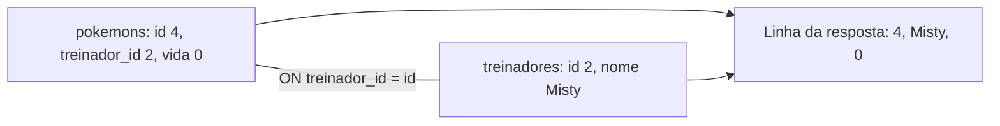
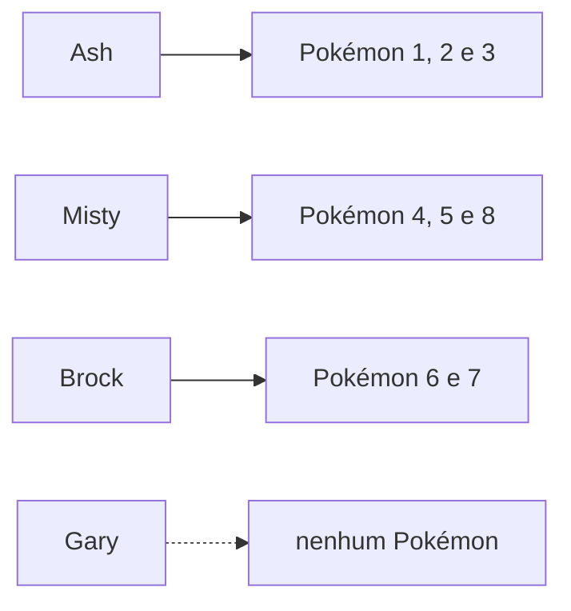
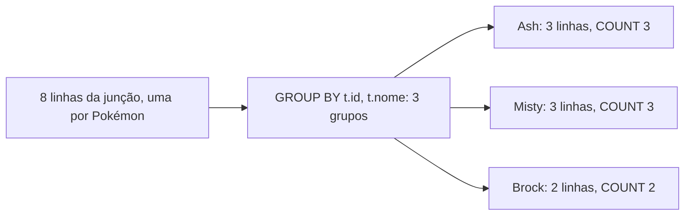
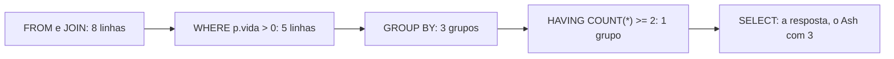

# JOIN e agregação introdutórios

No tema 03, a tabela dos Pokémon só tinha o número do treinador, e o nome da Misty pedia uma consulta à parte. Neste guia, juntas numa só consulta as linhas de duas ou mais tabelas, pelas chaves estrangeiras que as ligam. Depois, resumes o que encontras: contas, somas e médias, para a tabela inteira ou para cada treinador.

Usa, do tema 01, a chave estrangeira e, do tema 03, o `WHERE`, o `IS NULL` e o `ORDER BY`. Rever, do tema 01: [A chave estrangeira aponta para outra tabela](01-modelo-relacional-e-postgresql.md#a-chave-estrangeira-aponta-para-outra-tabela). Do tema 03: [O WHERE escolhe as linhas](03-dml-e-consultas-com-contexto.md#o-where-escolhe-as-linhas), [O IS NULL encontra o que não tem valor](03-dml-e-consultas-com-contexto.md#o-is-null-encontra-o-que-não-tem-valor) e [O ORDER BY ordena o resultado](03-dml-e-consultas-com-contexto.md#o-order-by-ordena-o-resultado). Para praticar: [laboratório](laboratorios/04-join-e-agregacao-introdutorios-laboratorio.md) e [ficha de exercícios](exercicios/04-join-e-agregacao-introdutorios-exercicios.md).

## Neste guia

1. [Parte 1: Juntar tabelas](#parte-1-juntar-tabelas)
2. [Parte 2: As linhas sem par](#parte-2-as-linhas-sem-par)
3. [Parte 3: Contar e resumir](#parte-3-contar-e-resumir)
4. [Exemplo guiado: os Pokémon de cada treinador, com o Gary](#exemplo-guiado-os-pokémon-de-cada-treinador-com-o-gary)

## Parte 1: Juntar tabelas

### O JOIN junta as linhas de duas tabelas

Os exemplos deste guia usam a base `ginasio` do tema 03, acabada de construir pelo `esquema.sql` e pelo `dados.sql`. Queres a lista dos Pokémon com o nome do treinador de cada um. A tabela `pokemons` só tem o `treinador_id`, e o nome está noutra tabela, a `treinadores`. No tema 03, fazias uma consulta a cada tabela e juntavas as respostas de cabeça.

O `JOIN`, "junta", faz isso numa só consulta. A seguir ao `FROM` e à primeira tabela, diz a segunda tabela e, depois do `ON`, a condição que liga cada linha de uma à linha da outra:

```sql
SELECT pokemons.id, treinadores.nome, pokemons.vida
FROM pokemons
JOIN treinadores ON pokemons.treinador_id = treinadores.id
ORDER BY pokemons.id;
```

```text
 id | nome  | vida
----+-------+------
  1 | Ash   |   90
  2 | Ash   |  110
  3 | Ash   |   80
  4 | Misty |    0
  5 | Misty |  100
  6 | Brock |  140
  7 | Brock |    0
  8 | Misty |    0
(8 rows)
```

A consulta ocupa três linhas, uma por parte. Enquanto o ponto e vírgula não chega, o `psql` espera pelo resto, e o início da linha passa a `ginasio-#`. A condição do `ON` é a chave estrangeira do tema 01, escrita como uma comparação: o `treinador_id` de cada Pokémon é igual ao `id` de um treinador. O servidor junta cada linha dos Pokémon à linha dos treinadores que cumpre a condição, e cada par passa a ser uma linha da resposta. Uma consulta assim chama-se **junção**.

As duas tabelas têm colunas com o mesmo nome, como o `id`. Por isso, cada coluna escreve-se com o nome da tabela à frente, separado por um ponto. O `pokemons.id` é o `id` dos Pokémon, e o `treinadores.nome` é o nome do treinador.



O diagrama mostra uma linha da resposta a nascer de duas. O Starmie, o Pokémon 4, tem o `treinador_id` 2, e o `ON` liga-o à linha da Misty, que tem o `id` 2. A linha da resposta leva colunas das duas tabelas: o `id` e a vida do Pokémon, e o nome da Misty.

Os nomes das tabelas repetem-se muito. Cada tabela pode ter um **nome curto**, escrito a seguir ao `AS`, que vale para toda a consulta. Em inglês, diz-se alias. O `AS` pode faltar, como em `FROM pokemons p`, e vais encontrá-lo assim na internet; nestes materiais, escreve-se sempre. A mesma junção, com os nomes curtos `p` e `t`, fica assim:

```sql
SELECT p.id, t.nome, p.vida
FROM pokemons AS p
JOIN treinadores AS t ON p.treinador_id = t.id
ORDER BY p.id;
```

A resposta é a mesma. A partir daqui, as junções deste guia usam os nomes curtos.

### Os nomes das colunas dizem de que tabela vêm

Numa junção, uma coluna sem o nome da tabela pode ser de qualquer uma das duas. Quando as duas tabelas a têm, o PostgreSQL não sabe qual escolher:

```sql
SELECT id, nome, vida
FROM pokemons AS p
JOIN treinadores AS t ON p.treinador_id = t.id;
```

```text
ERROR:  column reference "id" is ambiguous
LINE 1: SELECT id, nome, vida
               ^
```

A mensagem diz que a referência à coluna `id` é ambígua: há um `id` nos Pokémon e outro nos treinadores. A `vida` só existe nos Pokémon, e não daria erro. Mesmo assim, escreve sempre o nome curto à frente de cada coluna de uma junção, para quem lê não ter de ir ver a que tabela pertence.


### Três tabelas numa consulta

Cada Pokémon aponta para uma espécie e para um treinador. Para a lista com os dois nomes, junta-se uma terceira tabela, com outro `JOIN`. Cada `JOIN` tem o seu `ON`. Com o `p.id`, o `e.nome` e o `t.nome` no `SELECT`, a resposta tem duas colunas com o mesmo nome no cabeçalho. São estas as duas primeiras linhas:

```text
 id |    nome    | nome
----+------------+------
  1 | Charmander | Ash
  2 | Bulbasaur  | Ash
```

Para se saber qual é qual, o `AS` dá um nome a cada coluna da resposta, como em `e.nome AS especie`. É o que o `SELECT nome cidade` do tema 01 fazia por engano, sem o `AS`. Os nomes das colunas da resposta só existem na resposta, e não mudam as tabelas:

```sql
SELECT p.id, e.nome AS especie, t.nome AS treinador
FROM pokemons AS p
JOIN especies AS e ON p.especie_id = e.id
JOIN treinadores AS t ON p.treinador_id = t.id
ORDER BY p.id;
```

```text
 id |  especie   | treinador
----+------------+-----------
  1 | Charmander | Ash
  2 | Bulbasaur  | Ash
  3 | Pikachu    | Ash
  4 | Starmie    | Misty
  5 | Psyduck    | Misty
  6 | Onix       | Brock
  7 | Geodude    | Brock
  8 | Staryu     | Misty
(8 rows)
```

É a tabela que o guia do tema 03 escrevia à mão, a partir do `dados.sql`, sem a vida: agora é a base que a faz. O primeiro `JOIN` junta a cada Pokémon a sua espécie, e o segundo junta a esse par o treinador. As ligações seguem as setas do modelo: dos Pokémon para as espécies e dos Pokémon para os treinadores.

### O JOIN com o WHERE e o ORDER BY

A junção dá linhas como uma tabela qualquer, e o que aprendeste no tema 03 vale para elas. No exemplo guiado do tema 03, os Pokémon da Misty precisavam de duas consultas: uma para o número da Misty e outra para os Pokémon desse número. Com o `JOIN`, o `WHERE` usa logo o nome:

```sql
SELECT p.id, e.nome AS especie, p.vida
FROM pokemons AS p
JOIN especies AS e ON p.especie_id = e.id
JOIN treinadores AS t ON p.treinador_id = t.id
WHERE t.nome = 'Misty'
ORDER BY p.id;
```

```text
 id | especie | vida
----+---------+------
  4 | Starmie |    0
  5 | Psyduck |  100
  8 | Staryu  |    0
(3 rows)
```

O `WHERE` e o `ORDER BY` vêm depois de todos os `JOIN`, pela ordem do tema 03. O `WHERE` pode usar colunas de qualquer tabela da junção, como o `t.nome`, e a resposta pode mostrar colunas que o `WHERE` não usa, como o `e.nome`.

### A mesma tabela duas vezes

Cada combate tem três colunas que apontam para os treinadores: o desafiante, o líder e o vencedor. Para a lista dos combates com o nome do desafiante e do líder, a tabela `treinadores` entra duas vezes: uma para cada coluna. É aqui que os nomes curtos são obrigatórios, porque cada vez que a tabela aparece na consulta precisa do seu nome:

```sql
SELECT c.id, c.data, d.nome AS desafiante, l.nome AS lider
FROM combates AS c
JOIN treinadores AS d ON c.desafiante_id = d.id
JOIN treinadores AS l ON c.lider_id = l.id
ORDER BY c.id;
```

```text
 id |    data    | desafiante | lider
----+------------+------------+-------
  1 | 2026-11-03 | Ash        | Misty
  2 | 2026-11-03 | Ash        | Misty
  3 | 2026-11-10 | Ash        | Brock
  4 | 2026-11-17 | Misty      | Brock
(4 rows)
```

O `d` é a tabela dos treinadores vista como desafiantes, e o `l` a mesma tabela vista como líderes. Cada `ON` usa uma coluna diferente dos combates. No combate 4, o `d` encontra a Misty, e o `l` encontra o Brock, na mesma tabela.

## Parte 2: As linhas sem par

### O JOIN deixa de fora as linhas sem par

Antes de correr uma junção, vale a pena prever quantas linhas vai ter. Na junção dos treinadores com os Pokémon, cada Pokémon tem exatamente um treinador, e cada treinador pode ter vários Pokémon. Como viste em [O modelo desenha-se antes das tabelas](01-modelo-relacional-e-postgresql.md#o-modelo-desenha-se-antes-das-tabelas), no tema 01, é uma relação de um para muitos. Quantas linhas de uma tabela correspondem a cada linha da outra chama-se a **cardinalidade** da ligação, e é ela que diz quantas linhas tem a junção.

Antes de leres a resposta: quantas linhas tem esta junção, e quantas vezes aparece cada treinador?

```sql
SELECT t.nome, p.id AS pokemon
FROM treinadores AS t
JOIN pokemons AS p ON p.treinador_id = t.id
ORDER BY t.id, p.id;
```

```text
 nome  | pokemon
-------+---------
 Ash   |       1
 Ash   |       2
 Ash   |       3
 Misty |       4
 Misty |       5
 Misty |       8
 Brock |       6
 Brock |       7
(8 rows)
```

São oito linhas, uma por Pokémon. O Ash e a Misty aparecem três vezes, uma por cada Pokémon, e o Brock duas. E o Gary não aparece. O `JOIN` só faz linhas com os pares que cumprem o `ON`, e nenhum Pokémon tem o `treinador_id` 4. Um treinador sem Pokémon não tem par, e fica de fora sem aviso nenhum.



O diagrama mostra os pares que a junção encontra. Cada treinador liga-se aos seus Pokémon, e o Gary não se liga a nenhum: é a linha que o `JOIN` deixa de fora.

### O LEFT JOIN guarda as linhas da esquerda

Numa lista dos treinadores, o Gary tem de aparecer, mesmo sem Pokémon. O `LEFT JOIN` guarda todas as linhas da tabela da esquerda, a que vem a seguir ao `FROM`. Uma linha sem par fica na resposta, com as colunas da outra tabela a NULL:

```sql
SELECT t.nome, p.id AS pokemon
FROM treinadores AS t
LEFT JOIN pokemons AS p ON p.treinador_id = t.id
ORDER BY t.id, p.id;
```

Com o `\pset null '(nulo)'` do tema 01, a célula sem valor aparece escrita:

```text
 nome  | pokemon
-------+---------
 Ash   |       1
 Ash   |       2
 Ash   |       3
 Misty |       4
 Misty |       5
 Misty |       8
 Brock |       6
 Brock |       7
 Gary  |  (nulo)
(9 rows)
```

A resposta tem as oito linhas da junção de cima e uma nona, a do Gary, com o `pokemon` a NULL: é a linha de quem não tem par. A tabela da esquerda é a que manda. Com os Pokémon à esquerda e os treinadores à direita, o `LEFT JOIN` dava outra vez as oito linhas, porque nenhum Pokémon está sem treinador.

O NULL da linha sem par serve também para encontrar as linhas que não têm par. As espécies que ninguém capturou são as que, num `LEFT JOIN` com os Pokémon, ficam com o Pokémon a NULL:

```sql
SELECT e.nome
FROM especies AS e
LEFT JOIN pokemons AS p ON p.especie_id = e.id
WHERE p.id IS NULL;
```

A resposta é o Squirtle, a única espécie sem nenhum Pokémon na base. A coluna do `IS NULL` é o `p.id` porque é a chave primária dos Pokémon: nunca é NULL num Pokémon que existe, e só fica NULL na linha sem par. Com o `p.alcunha IS NULL`, entravam também as espécies de Pokémon sem alcunha, e a resposta tinha sete.

O mesmo acontece com uma chave estrangeira que fica a NULL. O combate 3 ainda não tem vencedor. Num `JOIN` dos combates com os treinadores, pelo `vencedor_id`, o combate 3 desaparece, porque o NULL não é igual a nenhum `id`. Com o `LEFT JOIN`, fica, com o vencedor em branco:

```sql
SELECT c.id, v.nome AS vencedor
FROM combates AS c
LEFT JOIN treinadores AS v ON c.vencedor_id = v.id
ORDER BY c.id;
```

```text
 id | vencedor
----+----------
  1 | Misty
  2 | Ash
  3 |
  4 | Brock
(4 rows)
```

Por isso, a pergunta antes de cada junção é esta: há linhas sem par, e a resposta precisa delas? Se precisa, é um `LEFT JOIN`. Para o distinguir do `LEFT JOIN`, o `JOIN` sozinho também se escreve `INNER JOIN`, "junção interior", e quer dizer o mesmo. Na internet, vais encontrar também o `LEFT OUTER JOIN`, que é o `LEFT JOIN` com uma palavra a mais.

<details>
<summary>Para ires mais longe: o RIGHT JOIN e o FULL JOIN</summary>

O `RIGHT JOIN` guarda as linhas da tabela da direita, e o `FULL JOIN` guarda as linhas sem par das duas tabelas. Um `RIGHT JOIN` escreve-se sempre como um `LEFT JOIN` com as tabelas trocadas, e por isso usa-se pouco. O `FULL JOIN` serve para comparar duas tabelas, como duas listas de inscrições, e ver o que está só numa delas.

</details>

## Parte 3: Contar e resumir

### As funções de agregação resumem uma coluna

Queres saber quantos Pokémon há, a vida que têm ao todo e o ataque médio. Com o `SELECT * FROM pokemons;`, contavas e somavas as oito linhas à mão.

Uma **função de agregação** resume as linhas de uma coluna num só valor. O `COUNT(*)` conta as linhas, o `SUM` soma, o `AVG`, de average, faz a média, o `MIN` dá o menor e o `MAX` o maior:

```sql
SELECT COUNT(*), SUM(vida), AVG(ataque), MIN(vida), MAX(vida)
FROM pokemons;
```

```text
 count | sum |         avg         | min | max
-------+-----+---------------------+-----+-----
     8 | 520 | 31.2500000000000000 |   0 | 140
(1 row)
```

As oito linhas da tabela ficaram numa só. A vida dos oito soma 520, e o ataque médio é 31,25. A vida mais baixa é 0, a dos três KO, e a mais alta é 140, a do Onix. O `AVG` escreve muitas casas decimais. O `ROUND(AVG(ataque), 1)` arredonda a média a uma casa e dá `31.3`: o `ROUND` recebe o número e as casas decimais que queres.

O `COUNT` de uma coluna, em vez do `*`, conta só as linhas em que essa coluna tem valor. Antes de leres a resposta: quanto dá o `COUNT(alcunha)` nos Pokémon?

```sql
SELECT COUNT(*), COUNT(alcunha)
FROM pokemons;
```

Dá 8 e 2. Só o Pikachu, o Pika, e o Psyduck têm alcunha. A do Psyduck é um texto vazio, mas é um valor, e conta. Os outros seis têm o NULL, que não conta. O `SUM`, o `AVG`, o `MIN` e o `MAX` também saltam os NULL: a média de uma coluna com NULL é a média dos valores que lá estão.

### O GROUP BY faz um resumo por grupo

Queres saber quantos Pokémon tem cada treinador. O `COUNT(*)` da secção anterior dá o total, 8, e não um número por treinador.

O `GROUP BY`, "agrupado por", separa as linhas em **grupos**, um por cada combinação de valores das colunas que lhe dás, e as funções de agregação dão um valor por grupo:

```sql
SELECT t.nome, COUNT(*) AS pokemons
FROM pokemons AS p
JOIN treinadores AS t ON p.treinador_id = t.id
GROUP BY t.id, t.nome
ORDER BY t.id;
```

```text
 nome  | pokemons
-------+----------
 Ash   |        3
 Misty |        3
 Brock |        2
(3 rows)
```

A junção dá as oito linhas, uma por Pokémon. O `GROUP BY` junta-as num grupo por treinador, e o `COUNT(*)` conta as linhas de cada grupo. Numa consulta com `GROUP BY`, cada coluna do `SELECT` tem de estar no `GROUP BY` ou dentro de uma função de agregação. Por isso o `t.nome`, que a resposta mostra, está no `GROUP BY`. O `t.id` também, porque o tema 01 disse que pode haver dois treinadores com o mesmo nome: com o `id`, dois Ash ficavam em grupos diferentes.



O diagrama mostra as oito linhas da junção a passar a três grupos. Cada grupo dá uma linha da resposta, com o valor que a função de agregação calcula nas linhas dele.

A vida de "cada treinador" não existe: o Ash tem três vidas, uma por Pokémon. Por isso, o `SELECT t.nome, p.vida, COUNT(*)`, com o mesmo `GROUP BY`, é recusado:

```text
ERROR:  column "p.vida" must appear in the GROUP BY clause or be used in an aggregate function
```

A mensagem diz que a coluna `p.vida` tem de aparecer no `GROUP BY` ou ser usada numa função de agregação. Com o `AVG(p.vida)` ou o `MAX(p.vida)`, a pergunta passa a ter um só valor por treinador, e a consulta corre.

<details>
<summary>Para ires mais longe: o GROUP BY só com a chave primária</summary>

O PostgreSQL aceita o `GROUP BY t.id` sozinho, sem o `t.nome`, e a consulta dá o mesmo. O `t.id` é a chave primária dos treinadores, e o PostgreSQL sabe que, para cada `id`, só há um nome. Outros SGBD, como o SQL Server, recusam-no, e por isso estes materiais escrevem as duas colunas. É mais uma diferença entre dialetos, como o `TOP` do tema 03.

</details>

### O HAVING escolhe os grupos

Queres os treinadores com pelo menos três Pokémon. O `WHERE` não serve: escolhe as linhas antes de os grupos existirem, e numa linha não há contagem nenhuma. O `WHERE COUNT(*) >= 3` é recusado com `aggregate functions are not allowed in WHERE`, "as funções de agregação não são permitidas no WHERE".

O `HAVING`, "tendo", escolhe os grupos depois do `GROUP BY`, com uma condição que pode usar as funções de agregação:

```sql
SELECT t.nome, COUNT(*) AS pokemons
FROM treinadores AS t
JOIN pokemons AS p ON p.treinador_id = t.id
GROUP BY t.id, t.nome
HAVING COUNT(*) >= 3
ORDER BY t.nome;
```

A resposta tem o Ash e a Misty, com 3 cada. O grupo do Brock, com 2, fica de fora.

O `WHERE` e o `HAVING` podem estar na mesma consulta, cada um no seu momento. Os treinadores com pelo menos dois Pokémon que não estão KO pedem os dois:

```sql
SELECT t.nome, COUNT(*) AS com_vida
FROM treinadores AS t
JOIN pokemons AS p ON p.treinador_id = t.id
WHERE p.vida > 0
GROUP BY t.id, t.nome
HAVING COUNT(*) >= 2;
```

O `WHERE` tira primeiro as linhas dos Pokémon KO. Ficam três do Ash, uma da Misty, o Psyduck, e uma do Brock, o Onix. Depois, o `HAVING` deixa só os grupos com 2 ou mais, e a resposta é o Ash, com 3.



O diagrama mostra a ordem em que o servidor faz o trabalho, com o número de linhas em cada passo. A ordem em que a consulta se escreve é outra, e é fixa. Primeiro o `SELECT` e o `FROM` com os `JOIN`, depois o `WHERE`, o `GROUP BY` e o `HAVING`, e por fim o `ORDER BY` e o `LIMIT`.

### Uma junção a mais pode multiplicar as contagens

Queres, para cada treinador, o número de Pokémon e o número de combates em que foi o desafiante. As duas tabelas ligam-se aos treinadores, e parece natural juntá-las às duas na mesma consulta:

```sql
SELECT t.nome, COUNT(p.id) AS pokemons, COUNT(c.id) AS combates
FROM treinadores AS t
LEFT JOIN pokemons AS p ON p.treinador_id = t.id
LEFT JOIN combates AS c ON c.desafiante_id = t.id
GROUP BY t.id, t.nome
ORDER BY t.id;
```

```text
 nome  | pokemons | combates
-------+----------+----------
 Ash   |        9 |        9
 Misty |        3 |        3
 Brock |        2 |        0
 Gary  |        0 |        0
(4 rows)
```

O Ash não tem nove Pokémon nem nove combates: tem três de cada. A Misty desafiou uma vez, e não três. A contagem está errada, e a consulta não deu erro nenhum.

A causa vê-se nas linhas antes do `GROUP BY`. Para o Ash, o primeiro `LEFT JOIN` dá três linhas, uma por Pokémon. O segundo junta a cada uma delas os três combates do Ash, e as três linhas passam a nove, uma por cada par de um Pokémon com um combate:

| Pokémon | Combates juntos a ele | Linhas |
| --- | --- | --- |
| 1, o Charmander | 1, 2 e 3 | 3 |
| 2, o Bulbasaur | 1, 2 e 3 | 3 |
| 3, o Pikachu | 1, 2 e 3 | 3 |
| Ao todo | | 9 |

Cada Pokémon aparece três vezes e cada combate também, e o `COUNT` conta as repetições. Quando duas tabelas do lado dos muitos se juntam à mesma tabela, as linhas de uma multiplicam-se pelas da outra. É a cardinalidade das duas ligações que o explica: três Pokémon e três combates para o mesmo treinador dão nove pares.

O `COUNT(DISTINCT p.id)` conta os valores diferentes da coluna, e cada Pokémon repetido conta uma só vez:

```sql
SELECT t.nome, COUNT(DISTINCT p.id) AS pokemons, COUNT(DISTINCT c.id) AS combates
FROM treinadores AS t
LEFT JOIN pokemons AS p ON p.treinador_id = t.id
LEFT JOIN combates AS c ON c.desafiante_id = t.id
GROUP BY t.id, t.nome
ORDER BY t.id;
```

A resposta passa a ser a certa. O Ash tem 3 e 3, a Misty 3 e 1, o Brock 2 e 0 e o Gary 0 e 0. Uma contagem que parece grande demais é o sinal desta multiplicação. Confirma-a com as linhas antes do `GROUP BY`, para um só treinador: as mesmas junções, sem o `GROUP BY` e com o `WHERE t.id = 1`, dão as nove linhas da tabela de cima.

```sql
SELECT t.nome, p.id AS pokemon, c.id AS combate
FROM treinadores AS t
LEFT JOIN pokemons AS p ON p.treinador_id = t.id
LEFT JOIN combates AS c ON c.desafiante_id = t.id
WHERE t.id = 1
ORDER BY p.id, c.id;
```

O `COUNT(DISTINCT)` serve também numa consulta sem junção: o `COUNT(DISTINCT cidade)` dos treinadores dá 3, porque o Ash e o Gary são os dois de Pallet.

## Exemplo guiado: os Pokémon de cada treinador, com o Gary

Neste exemplo, uma pergunta passa por todas as decisões da junção e da agregação: as linhas que se esperam, o tipo de junção, o grupo e a contagem.

### O problema

O ginásio quer uma lista com cada treinador e o número de Pokémon que tem. Todos os treinadores têm de aparecer, mesmo os que não têm nenhum Pokémon, e a lista vai do que tem mais para o que tem menos. A base é a `ginasio` do tema 03, reconstruída pelos dois ficheiros.

### Quantas linhas se esperam

Há quatro treinadores, e a lista tem uma linha por treinador: são quatro linhas, qualquer que seja a cardinalidade da ligação aos Pokémon. É este o número a confirmar no fim. Uma resposta com três linhas perdeu um treinador, e uma com mais de quatro não agrupou.

### O JOIN perde o Gary

A primeira tentativa é a junção dos treinadores com os Pokémon, agrupada:

```sql
SELECT t.nome, COUNT(*) AS pokemons
FROM treinadores AS t
JOIN pokemons AS p ON p.treinador_id = t.id
GROUP BY t.id, t.nome
ORDER BY t.id;
```

Dá três linhas, o Ash, a Misty e o Brock, e não as quatro esperadas. O Gary não tem Pokémon, e o `JOIN` deixou-o de fora antes de os grupos existirem.

### O LEFT JOIN e o COUNT(*) dão-lhe um Pokémon que não tem

A segunda tentativa guarda o Gary, com o `LEFT JOIN`:

```sql
SELECT t.nome, COUNT(*) AS pokemons
FROM treinadores AS t
LEFT JOIN pokemons AS p ON p.treinador_id = t.id
GROUP BY t.id, t.nome
ORDER BY t.id;
```

```text
 nome  | pokemons
-------+----------
 Ash   |        3
 Misty |        3
 Brock |        2
 Gary  |        1
(4 rows)
```

São quatro linhas, mas o Gary aparece com 1. O `LEFT JOIN` deu-lhe uma linha, com o Pokémon a NULL, e o `COUNT(*)` conta as linhas, também essa.

### O COUNT da coluna dos Pokémon dá o zero

O que se quer contar não são as linhas, são os Pokémon. O `COUNT(p.id)` conta só as linhas em que há um Pokémon, e a linha do Gary, com o `p.id` a NULL, não conta. Com a ordem pedida, do que tem mais para o que tem menos, e o nome a desempatar:

```sql
SELECT t.nome, COUNT(p.id) AS pokemons
FROM treinadores AS t
LEFT JOIN pokemons AS p ON p.treinador_id = t.id
GROUP BY t.id, t.nome
ORDER BY pokemons DESC, t.nome;
```

```text
 nome  | pokemons
-------+----------
 Ash   |        3
 Misty |        3
 Brock |        2
 Gary  |        0
(4 rows)
```

São as quatro linhas esperadas, e o Gary tem 0. O Ash e a Misty empatam com 3, e o nome põe o Ash primeiro. O `ORDER BY` pode usar o nome da coluna da resposta, `pokemons`, dado pelo `AS`. O `WHERE` e o `HAVING` não podem: são feitos antes de a resposta ter as colunas com os nomes novos, e o `HAVING pokemons >= 3` dá `column "pokemons" does not exist`. Aí, repete-se a função, como em `HAVING COUNT(p.id) >= 3`.

### As decisões

O exemplo tomou quatro decisões, que servem para qualquer resumo:

1. Quantas linhas se esperam: uma por treinador, quatro, e não as linhas da junção, que dependem da cardinalidade.
2. Que junção: o `LEFT JOIN`, porque a lista precisa dos treinadores sem Pokémon.
3. Que grupo: o treinador, pelo `t.id` e pelo `t.nome`.
4. O que contar: o `COUNT(p.id)`, os Pokémon, e não o `COUNT(*)`, as linhas.

## Erros frequentes

### `syntax error at or near "WHERE"` numa junção

Falta o `ON` no `JOIN`, como em `FROM pokemons AS p JOIN treinadores AS t WHERE p.vida > 0`. O PostgreSQL espera o `ON` a seguir à segunda tabela e encontra o `WHERE`. Escreve a condição da ligação depois do `ON`: `JOIN treinadores AS t ON p.treinador_id = t.id`.

### A resposta tem os nomes errados, e não dá erro

O `ON` liga as colunas erradas, como em `ON p.id = t.id`. A consulta corre e dá só quatro linhas: o Pokémon 1 com o Ash, o 2 com a Misty, o 3 com o Brock e o 4 com o Gary. Os Pokémon 5 a 8 desaparecem, porque não há treinadores com esses números. Menos linhas do que as esperadas é o sinal do engano. O `ON` liga sempre a chave estrangeira de uma tabela à chave primária da outra, como o `p.treinador_id` ao `t.id`.

### `invalid reference to FROM-clause entry for table "pokemons"`

A tabela tem um nome curto, e a consulta usa o nome inteiro, como em `SELECT pokemons.vida FROM pokemons AS p;`. Depois do `AS`, o nome curto é o único nome da tabela nessa consulta. A dica, `HINT`, diz qual é: escreve `p.vida`.

### O `GROUP BY` dá uma linha por cada linha da junção

O `GROUP BY` tem uma coluna que muda em cada linha, como em `GROUP BY t.id, t.nome, p.id`. Cada Pokémon forma o seu grupo, e o `COUNT(*)` dá 1 em todos. O `GROUP BY` leva só as colunas do que é cada linha da resposta: aqui, o treinador.

## Palavras novas deste guia

- Junção: uma consulta que junta as linhas de duas ou mais tabelas, pela condição do `ON`.
- Nome curto: o nome que uma tabela recebe numa consulta, a seguir ao `AS`. Em inglês, alias.
- Cardinalidade: quantas linhas de uma tabela correspondem a cada linha da outra, numa ligação.
- Função de agregação: uma função que resume as linhas de uma coluna num só valor, como o `COUNT`, o `SUM`, o `AVG`, o `MIN` e o `MAX`.
- Grupo: o conjunto das linhas com os mesmos valores nas colunas do `GROUP BY`, que dá uma linha da resposta.

## O que vem a seguir

No tema 05, Integração com o Python, um programa em Python faz estas consultas à base, com os valores como parâmetros, e usa as respostas.

## Para saber mais

- [As junções](https://www.postgresql.org/docs/17/tutorial-join.html): o capítulo do tutorial do PostgreSQL sobre as junções, em inglês.
- [As funções de agregação](https://www.postgresql.org/docs/17/tutorial-agg.html): o `COUNT`, o `GROUP BY` e o `HAVING`, no tutorial do PostgreSQL, em inglês.
- [A lista das funções de agregação](https://www.postgresql.org/docs/17/functions-aggregate.html): todas as funções de agregação do PostgreSQL, em inglês.


